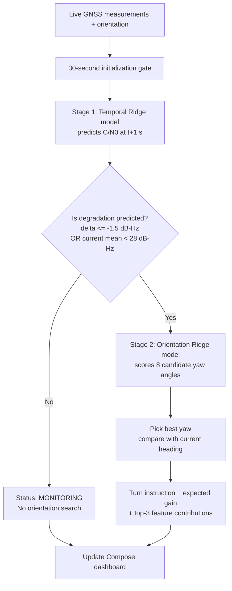
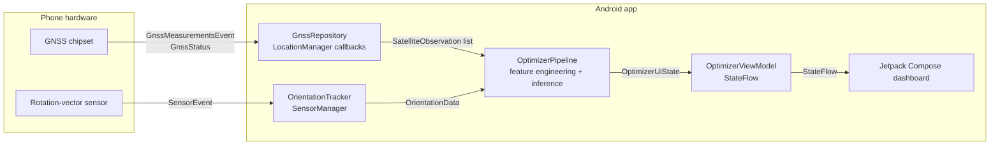
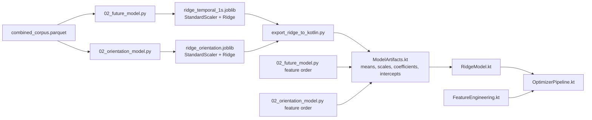
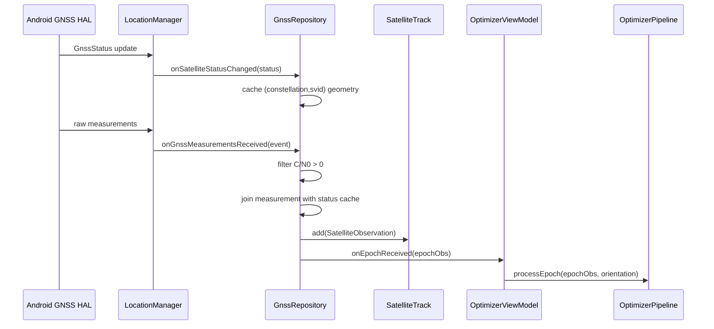
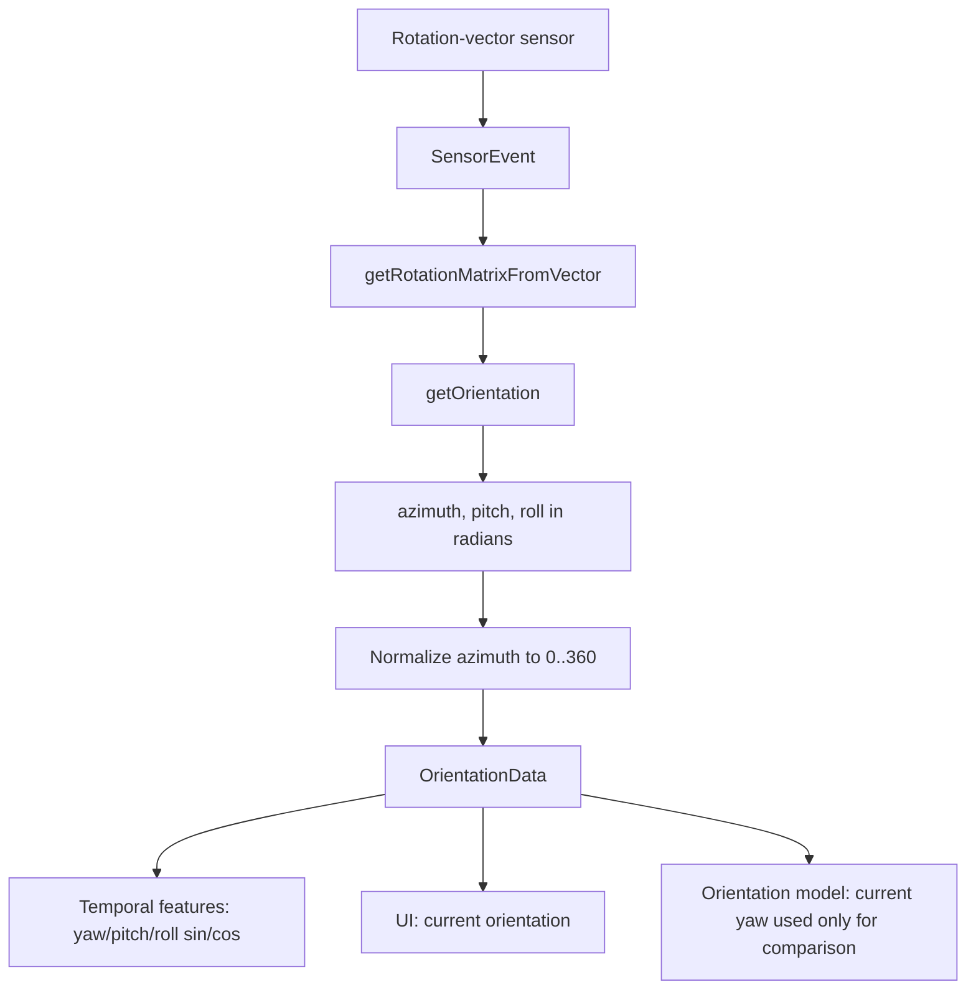
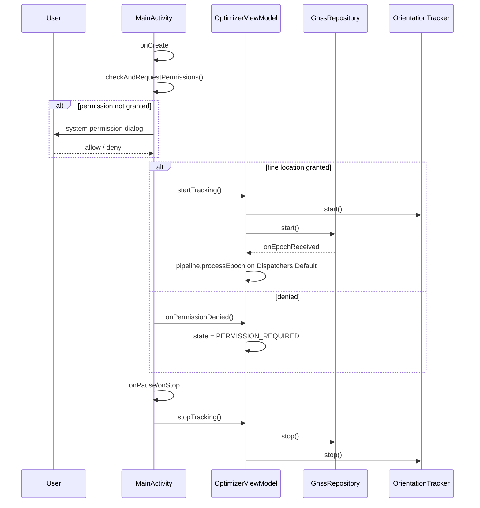
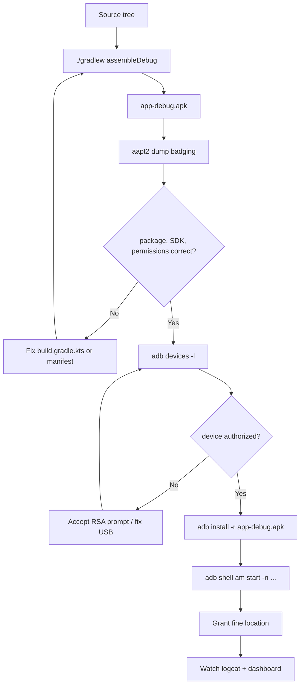
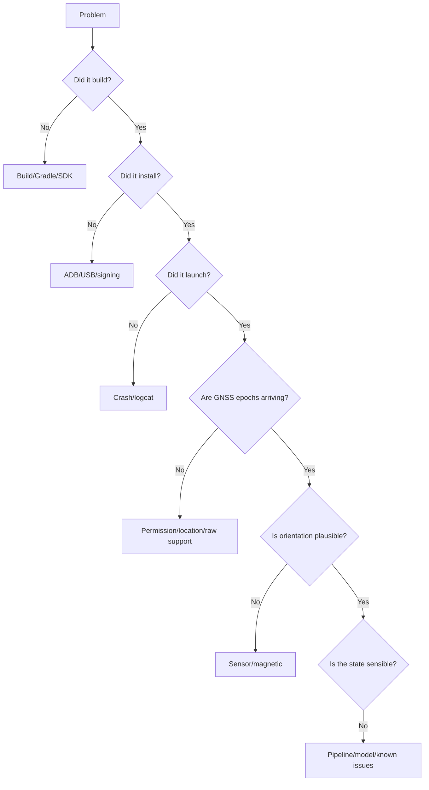

# Manual Implementation Guide

## GNSS Signal Prediction & Orientation Optimizer for Android

This document explains how to reproduce the Android application in this repository from the original Python/ML repository, step by step, ending with a debug APK installed on a physical Android phone.

The intended reader is a computer-science student who knows Python and basic programming but may not have built an Android application before. Every Android-specific term is introduced before it is used.

> **Important honesty note.** This guide describes the implementation that actually exists in this repository. Where a result could not be verified in the environment used to write the guide, it is marked **UNVERIFIED**. In particular, the two Android devices attached while this guide was written were listed by `adb` as `unauthorized`, so the final on-phone runtime checks were not performed here. The build, unit tests, model export, and Python/Kotlin parity were verified and their real outputs are quoted below.

---

## Table of Contents

- [Chapter 1 — Project Overview](#chapter-1--project-overview)
- [Chapter 2 — Development Environment Setup](#chapter-2--development-environment-setup)
- [Chapter 3 — Android Device Preparation](#chapter-3--android-device-preparation)
- [Chapter 4 — Understanding the Existing ML Models](#chapter-4--understanding-the-existing-ml-models)
- [Chapter 5 — Creating the Android Project](#chapter-5--creating-the-android-project)
- [Chapter 6 — Implementing GNSS Data Collection](#chapter-6--implementing-gnss-data-collection)
- [Chapter 7 — Implementing Device Orientation Tracking](#chapter-7--implementing-device-orientation-tracking)
- [Chapter 8 — Implementing the ML Inference Pipeline](#chapter-8--implementing-the-ml-inference-pipeline)
- [Chapter 9 — Feature Contributions and Signal Analysis](#chapter-9--feature-contributions-and-signal-analysis)
- [Chapter 10 — Building the User Interface](#chapter-10--building-the-user-interface)
- [Chapter 11 — Application Lifecycle and Permissions](#chapter-11--application-lifecycle-and-permissions)
- [Chapter 12 — Building, Installing and Running the APK](#chapter-12--building-installing-and-running-the-apk)
- [Chapter 13 — Testing and Validation](#chapter-13--testing-and-validation)
- [Chapter 14 — Troubleshooting](#chapter-14--troubleshooting)
- [Chapter 15 — Reproducing the Project from Scratch](#chapter-15--reproducing-the-project-from-scratch)
- [Appendix A — File Inventory](#appendix-a--file-inventory)
- [Appendix B — Observed Verification Log](#appendix-b--observed-verification-log)
- [Appendix C — Glossary](#appendix-c--glossary)
- [Appendix D — Documentation Quality Review](#appendix-d--documentation-quality-review)

---

## Chapter 1 — Project Overview

### 1.1 What the application does

The application is a native Android dashboard that:

1. Reads live **GNSS** (Global Navigation Satellite System) measurements from the phone's receiver.
2. Reads the phone's physical orientation from its motion sensors.
3. Runs two small machine-learning models **locally on the phone**.
4. Predicts whether the satellite signal is about to get worse.
5. If degradation is predicted, evaluates eight candidate phone headings and recommends a turn.
6. Shows the three model features that contributed most to each prediction.

The app does **not** send data to a server. It does **not** need an internet connection. It does **not** use a cloud ML service.

### 1.2 Why two Ridge models are required

The two models answer two different questions.

| Model | Question it answers | Target | Number of features |
|---|---|---|---|
| Temporal Ridge model | "Given this satellite signal's recent history, what will its C/N0 be one second from now?" | Future C/N0 at `t + 1000 ms` | 46 |
| Orientation Ridge model | "If the phone were facing heading θ, how strong would this satellite's signal be?" | Current C/N0 as a function of geometry | 24 |

They cannot be replaced by one model because their inputs are different in kind:

- The **temporal** model needs the past: current C/N0, 1/2/5/10-second lags, deltas, slopes, previous elevation and azimuth.
- The **orientation** model deliberately excludes current C/N0 and all lags. It must be able to score a heading the phone has **not** physically rotated to. If it received current C/N0, it would "leak" the answer for the current orientation and could not fairly evaluate a hypothetical one.

### 1.3 How temporal prediction and orientation prediction interact

The interaction is a **conditional two-stage pipeline**:



The temporal model is the **trigger**. The orientation model is the **optimizer**. The temporal model does not output a heading, and the orientation model does not forecast time.

### 1.4 Why native Android development

The app is written in **Kotlin** using the Android SDK and **Jetpack Compose**. Alternatives were considered:

| Alternative | Why it was not chosen |
|---|---|
| Python + Kivy/BeeWare | Cannot reliably access Android raw GNSS measurements (`GnssMeasurementsEvent`) or the rotation-vector sensor with the same fidelity. Packaging the Python runtime and scikit-learn on Android is heavy. |
| Flutter | Would still need a platform channel to Kotlin/Java for raw GNSS and sensors; adds a second language and runtime. |
| React Native | Same platform-channel problem, plus a JavaScript bridge in the hot data path. |
| Native Kotlin | Direct access to `LocationManager`, `GnssMeasurementsEvent`, `GnssStatus`, and `SensorManager`; smallest runtime; no bridge. |

### 1.5 Why inference is local

A fitted Ridge model is just a vector of coefficients, a vector of scaler means, a vector of scaler scales, and one intercept. The prediction is a dot product:

$$
\hat{y} = b + \sum_{i=1}^{D} w_i \cdot \frac{x_i - \mu_i}{\sigma_i}
$$

For 46 features this is 46 multiplications and additions. Running it in Kotlin takes microseconds and allocates nothing if the input array is reused. Adding TensorFlow Lite, ONNX Runtime, or a Python runtime would add tens of megabytes, JNI bindings, and battery cost without improving accuracy.

The app therefore embeds the fitted parameters as Kotlin `DoubleArray` constants in `ModelArtifacts.kt`.

### 1.6 Why GNSS and orientation sensor data are required

- **GNSS** provides the satellite identity, carrier frequency, C/N0, azimuth, elevation, and fix/almanac/ephemeris flags. These are the model inputs.
- **Orientation** provides the phone's yaw (azimuth), pitch, and roll. The temporal model uses all three. The orientation model uses the current sky geometry and a candidate yaw.
- Without GNSS there is no signal to predict. Without orientation the app cannot compute relative azimuth or recommend a turn.

### 1.7 Actual architecture



### 1.8 Repository layout (actual)

```text
ISRO_Project/
├── android/                         # Android application (created for this project)
│   ├── app/
│   │   ├── build.gradle.kts
│   │   └── src/
│   │       ├── main/
│   │       │   ├── AndroidManifest.xml
│   │       │   ├── java/org/isro/gnssoptimizer/
│   │       │   │   ├── gnss/GnssRepository.kt
│   │       │   │   ├── gnss/GnssSatelliteData.kt
│   │       │   │   ├── model/FeatureEngineering.kt
│   │       │   │   ├── model/ModelArtifacts.kt
│   │       │   │   ├── model/RidgeModel.kt
│   │       │   │   ├── pipeline/OptimizerPipeline.kt
│   │       │   │   ├── pipeline/OptimizerState.kt
│   │       │   │   ├── sensor/OrientationTracker.kt
│   │       │   │   └── ui/{MainActivity,OptimizerDashboard,OptimizerViewModel,Theme}.kt
│   │       │   └── res/...
│   │       └── test/java/org/isro/gnssoptimizer/ModelInferenceTest.kt
│   ├── build.gradle.kts
│   ├── settings.gradle.kts
│   ├── gradle.properties
│   ├── gradlew
│   └── gradle/wrapper/...
├── model/
│   ├── temporal_artifacts/
│   └── orientation_artifacts/
├── scripts/
│   ├── export_ridge_to_kotlin.py
│   └── verify_python_kotlin_parity.py
├── src/isro_project/                # Original Python pipeline
├── gnss-eda/                        # GNSS EDA and Parquet data
├── results/merged_data/combined_corpus.parquet
└── MANUAL_IMPLEMENTATION_GUIDE.md
```

> The original repository at commit `751af63` did not contain `android/`. The Android directory is the new deliverable described by this guide.

---

## Chapter 2 — Development Environment Setup

### 2.1 What you need

| Component | Required? | Version actually used | Purpose |
|---|---|---|---|
| Debian/Linux machine | Required | Debian 13 (`debian`) | Build and flash the app |
| JDK | Required | OpenJDK 21.0.12.1 | Runs Gradle and the Kotlin compiler |
| Android SDK Platform Tools (`adb`) | Required | `adb` 1.0.41 / 34.0.5 | USB device communication |
| Android SDK Platform | Required | `android-36` | `compileSdk = 36` |
| Android SDK Build-Tools | Required | `36.0.0` (34.0.0 also present) | Packages the APK |
| Gradle | Required, but bundled | Gradle 8.9 via wrapper | Build system |
| Kotlin | Required, but bundled | Kotlin Gradle plugin 2.0.0 | Language |
| Android Studio | Optional | not required for the command-line build | IDE and emulator |
| Python 3.14 + `uv`/venv | Required for model export | Python 3.14 in `.venv` | Re-export model constants |
| `git` | Recommended | any recent | Version control |
| `unzip`, `curl` | Recommended | any recent | SDK installation |

**Required** means the command-line build in this guide will not work without it. **Optional** means the same result can be achieved another way.

### 2.2 Install the JDK and basic tools

> **Runs on:** Debian/Linux development machine (not the phone).

```bash
sudo apt update
sudo apt install -y openjdk-21-jdk unzip curl git adb
```

Verify:

```bash
java -version
```

Observed on the machine used to write this guide:

```text
openjdk version "21.0.12.1" 2026-08-18
OpenJDK Runtime Environment (build 21.0.12.1+1-1-deb13u1-Debian)
OpenJDK 64-Bit Server VM (build 21.0.12.1+1-1-deb13u1-Debian, mixed mode, sharing)
```

Why JDK 21: Android Gradle Plugin 8.5.2 requires JDK 17 or newer. The project compiles Java/Kotlin bytecode for **Java 17** (`sourceCompatibility = VERSION_17`, `jvmTarget = "17"`), but the build tool itself runs on JDK 21. Both JDK 17 and JDK 21 are acceptable.

### 2.3 Install the Android SDK

The SDK is a directory containing platform libraries, build tools, and platform tools. The actual machine used:

```text
/home/tempest/Android/Sdk/
├── build-tools/34.0.0
├── build-tools/36.0.0
├── cmdline-tools/...
├── platforms/android-36
└── platform-tools/
```

You can install it in two ways.

#### Option A — Android Studio (recommended for beginners)

1. Download Android Studio from <https://developer.android.com/studio>.
2. Install it and launch it.
3. The Setup Wizard installs the SDK to a default location such as `~/Android/Sdk`.
4. Open **SDK Manager** and install:
   - **SDK Platform: Android 16.0 (API 36)**
   - **Android SDK Build-Tools 36.0.0**
   - **Android SDK Platform-Tools**

#### Option B — command-line tools only (what the actual machine used)

1. Download **Command line tools only** from <https://developer.android.com/studio#command-tools>.
2. Unzip it into `~/Android/Sdk/cmdline-tools/latest` so that `sdkmanager` is at:

```text
~/Android/Sdk/cmdline-tools/latest/bin/sdkmanager
```

3. Set temporary environment variables in the current shell:

```bash
export ANDROID_HOME="$HOME/Android/Sdk"
export PATH="$ANDROID_HOME/cmdline-tools/latest/bin:$ANDROID_HOME/platform-tools:$PATH"
```

4. Accept licenses:

```bash
sdkmanager --licenses
```

Type `y` for each license.

5. Install the exact packages:

```bash
sdkmanager "platform-tools" "platforms;android-36" "build-tools;36.0.0"
```

6. Verify:

```bash
ls "$HOME/Android/Sdk/platforms"
ls "$HOME/Android/Sdk/build-tools"
adb version
```

Observed:

```text
android-36

34.0.0
36.0.0

Android Debug Bridge version 1.0.41
Version 34.0.5-debian
```

> The Debian `adb` package and the SDK's `platform-tools/adb` can both exist. Either works. Use `which adb` to see which one your shell resolves.

### 2.4 Tell Gradle where the SDK is

Gradle needs a file named `local.properties` inside the Android project. Create it:

> **File:** `android/local.properties`  
> **Runs on:** Debian/Linux development machine, edit with a text editor.

```properties
sdk.dir=/home/tempest/Android/Sdk
```

Replace `/home/tempest/Android/Sdk` with **your** SDK path. On Windows the path would use escaped backslashes; on macOS it might be `/Users/you/Library/Android/sdk`.

This file is machine-specific. Do not commit it to a public repository.

The actual project file contains exactly:

```properties
sdk.dir=/home/tempest/Android/Sdk
```

### 2.5 Gradle, Kotlin, and the wrapper

You do **not** need to install Gradle globally. The project contains a **Gradle wrapper**:

```text
android/gradlew
android/gradlew.bat
android/gradle/wrapper/gradle-wrapper.jar
android/gradle/wrapper/gradle-wrapper.properties
```

`gradle-wrapper.properties` contains:

```properties
distributionBase=GRADLE_USER_HOME
distributionPath=wrapper/dists
distributionUrl=https\://services.gradle.org/distributions/gradle-8.9-bin.zip
networkTimeout=10000
validateDistributionUrl=false
zipStoreBase=GRADLE_USER_HOME
zipStorePath=wrapper/dists
```

When you run `./gradlew`, the wrapper downloads Gradle 8.9 once and caches it. This makes the build reproducible.

Verify:

> **Runs on:** Debian/Linux, from `android/`.

```bash
cd android
./gradlew --version
```

Observed:

```text
Gradle 8.9
Kotlin: 1.9.23
Launcher JVM: 21.0.12.1
```

The `Kotlin: 1.9.23` line is the Kotlin version **embedded in Gradle itself**. The project's Kotlin compiler plugin is **2.0.0**, declared in `android/build.gradle.kts`. These are different things and both are correct.

### 2.6 Environment variables: are they required?

The actual build did **not** set `ANDROID_HOME` or `ANDROID_SDK_ROOT`:

```text
ANDROID_HOME=
ANDROID_SDK_ROOT=
```

It worked because `android/local.properties` points to the SDK. You only need environment variables if you want to run `sdkmanager`, `adb`, or `aapt2` from arbitrary directories.

Optional shell setup:

```bash
export ANDROID_HOME="$HOME/Android/Sdk"
export PATH="$ANDROID_HOME/platform-tools:$ANDROID_HOME/cmdline-tools/latest/bin:$PATH"
```

To make it permanent, add those two lines to `~/.bashrc` and run `source ~/.bashrc`.

### 2.7 Verify the whole toolchain before continuing

> **Runs on:** Debian/Linux, from the repository root.

```bash
java -version
adb version
ls "$HOME/Android/Sdk/platforms"
ls "$HOME/Android/Sdk/build-tools"
cd android
./gradlew --version
```

You should see a JDK, ADB, `android-36`, build-tools, and Gradle 8.9. Do not continue until these work.

---

## Chapter 3 — Android Device Preparation

This chapter mixes commands on the computer with actions on the phone. Each step says which side it belongs to.

### 3.1 Enable Developer Options (phone)

1. On the phone, open **Settings**.
2. Open **About phone** (the exact label varies by manufacturer).
3. Find **Build number**.
4. Tap **Build number** seven times.
5. Enter the phone's PIN/pattern if asked.
6. A message such as "You are now a developer" appears.

If you do not see Developer Options after this, search Settings for "Developer options".

### 3.2 Enable USB debugging (phone)

1. Open **Settings → System → Developer options** (or **Settings → Developer options**).
2. Turn on **USB debugging**.
3. Optionally turn on **Stay awake** while charging so the screen does not sleep during long tests.

Some phones also require **Install via USB** or **USB debugging (Security settings)**. If `adb install` fails with a permission error, enable those.

### 3.3 Connect the phone (physical action)

1. Use a **data-capable** USB cable, not a charge-only cable.
2. Connect the phone to the computer.
3. On the phone, open the USB notification and choose **File transfer / MTP** or **USB debugging** mode. "Charging only" often hides ADB.
4. A dialog appears: **Allow USB debugging?** with the computer's RSA fingerprint.
5. Tick **Always allow from this computer**.
6. Tap **Allow**.

If the dialog does not appear, revoke authorizations and reconnect:

> **Runs on:** Debian/Linux.

```bash
adb kill-server
adb start-server
adb devices
```

Then unplug and replug the cable.

### 3.4 Verify the connection

> **Runs on:** Debian/Linux development machine.

```bash
adb devices -l
```

Possible outputs and what they mean:

```text
List of devices attached
KFPVWCG6RODIXSRO       device usb:1-1 product:... model:... device:...
```

- `device` — authorized and ready.
- `unauthorized` — the phone has not accepted the RSA prompt.
- `offline` — the ADB connection is stale; run `adb kill-server` and reconnect.
- No lines — cable, USB mode, or driver problem.

> **Observed while writing this guide:** two devices appeared as `unauthorized`:
>
> ```text
> List of devices attached
> BYXO5DE679CE8XFM	unauthorized
> KFPVWCG6RODIXSRO	unauthorized
> ```
>
> Therefore no on-device runtime verification was possible in that session. This is an environment limitation, not an app failure.

If more than one device is connected, select one explicitly:

```bash
adb -s KFPVWCG6RODIXSRO shell getprop ro.product.model
```

Replace the serial with your own from `adb devices`.

### 3.5 Check the Android version and API level

> **Runs on:** Debian/Linux; commands run on the phone through ADB.

```bash
adb shell getprop ro.product.model
adb shell getprop ro.product.manufacturer
adb shell getprop ro.build.version.release
adb shell getprop ro.build.version.sdk
adb shell getprop ro.build.version.codename
```

Interpretation:

- `ro.build.version.release` is the user-facing Android version, e.g. `16`.
- `ro.build.version.sdk` is the **API level**, e.g. `36`. The app's `compileSdk`/`targetSdk` are 36, and `minSdk` is 26.
- `ro.build.version.codename` should be `REL` on a release build.

The implementation plan in `docs/IMPLEMENTATION_PLAN.md` records the target device as **Realme RMX3868 / Android 16 / API 36 / MediaTek**. That record is from the project documentation; it could not be re-verified here because the attached devices were unauthorized.

### 3.6 Check available sensors

> **Runs on:** Debian/Linux; commands run on the phone.

```bash
adb shell pm list features | grep -i sensor
adb shell dumpsys sensorservice | grep -i -E "rotation|accelerometer|gyroscope|compass" | head -40
```

What to look for:

- `android.hardware.sensor.accelerometer`
- `android.hardware.sensor.gyroscope`
- `android.hardware.sensor.compass`
- A rotation-vector sensor in `dumpsys sensorservice` (often shown as `Rotation Vector` or `android.sensor.rotation_vector`)

The app requests `Sensor.TYPE_ROTATION_VECTOR`. Most phones provide it as a composite sensor built from accelerometer, gyroscope, and magnetometer. If it is missing, `OrientationTracker.start()` logs a warning and does not register; the UI will show 0° orientation and the pipeline will still run with that value.

### 3.7 Check GNSS capabilities

> **Runs on:** Debian/Linux; commands run on the phone.

```bash
adb shell pm list features | grep -i gps
adb shell dumpsys location | head -80
adb shell settings get secure location_mode
```

Interpretation:

- `android.hardware.location.gps` confirms a GPS receiver. The manifest marks this feature as `required="true"`, so the app will not install on a device without it.
- `dumpsys location` shows location providers, GNSS status, and recent location requests. The output varies by Android version and manufacturer.
- `location_mode` is `0` (off), `1` (device only / GPS only), `2` (battery saving), or `3` (high accuracy). For GNSS measurements, use **device only** or **high accuracy**.

Raw GNSS measurements are a separate capability from ordinary location. Many devices expose them; some do not, and some expose only a subset. There is no universal ADB command that lists every raw-measurement field a chipset supports. The reliable check is to run the app and inspect the `GnssRepository` logs and the dashboard's **Measured** count.

### 3.8 Check runtime permissions

Android permissions are either **normal** (granted at install) or **dangerous/runtime** (the user must approve while the app runs). Location is a runtime permission.

The app declares:

```xml
<uses-permission android:name="android.permission.ACCESS_FINE_LOCATION" />
<uses-permission android:name="android.permission.ACCESS_COARSE_LOCATION" />
```

`ACCESS_FINE_LOCATION` is required for GNSS satellite data. `ACCESS_COARSE_LOCATION` is requested alongside it because Android's permission dialog groups them.

After installing the app, check the grant state:

```bash
adb shell dumpsys package org.isro.gnssoptimizer.debug | grep -A 20 "runtime permissions"
```

You can also grant or revoke from the computer:

```bash
adb shell pm grant org.isro.gnssoptimizer.debug android.permission.ACCESS_FINE_LOCATION
adb shell pm grant org.isro.gnssoptimizer.debug android.permission.ACCESS_COARSE_LOCATION
adb shell pm revoke org.isro.gnssoptimizer.debug android.permission.ACCESS_FINE_LOCATION
```

> The package name is `org.isro.gnssoptimizer.debug` for the debug build because `applicationIdSuffix = ".debug"` is set in `app/build.gradle.kts`. The release package would be `org.isro.gnssoptimizer`, but this guide builds debug.

### 3.9 Device preparation checklist

- [ ] Developer Options enabled.
- [ ] USB debugging enabled.
- [ ] USB cable connected in a data mode.
- [ ] RSA dialog accepted.
- [ ] `adb devices -l` shows `device`, not `unauthorized`.
- [ ] `ro.build.version.sdk` is at least 26 (the manifest minimum).
- [ ] Location is enabled in device-only or high-accuracy mode.
- [ ] The device reports `android.hardware.location.gps`.

---

## Chapter 4 — Understanding the Existing ML Models

This chapter explains the two models that already exist in the repository before any Android code is written. You must understand their feature order and preprocessing because the Kotlin code must reproduce them **exactly**.

### 4.1 The original data pipeline

The raw data was recorded with a GNSS logging application that writes CSV files such as `Status.csv`, `OrientationDeg.csv`, `Raw.csv`, `Fix.csv`, and sensor files. In this repository the recorded sessions are under `data/Categorized_Data/` and the converted Parquet files are under `gnss-eda/data/parquet/`.

The merge script is:

```text
src/isro_project/01_merge_sessions.py
```

It uses **DuckDB** to perform an `ASOF LEFT JOIN` between each `Status` row and the closest preceding `OrientationDeg` row, within a maximum time difference of `MAX_ORIENTATION_DT_MS = 500` ms. It reconstructs sessions from gaps larger than 10 seconds and writes:

```text
results/merged_data/combined_corpus.parquet
```

Verified schema and size in this repository:

```text
Rows:    5,520,875
Sessions: 40
Devices:  1  (device_id = "oneplus")
File:     results/merged_data/combined_corpus.parquet  (42 MB)
```

The 23 columns are:

```text
UnixTimeMillis, SignalCount, SignalIndex, ConstellationType, Svid,
CarrierFrequencyHz, Cn0DbHz, AzimuthDegrees, ElevationDegrees,
UsedInFix, HasAlmanacData, HasEphemerisData, BasebandCn0DbHz,
utcTimeMillis, elapsedRealtimeNanos, yawDeg, rollDeg, pitchDeg,
CalibrationAccuracy, orientation_dt_ms, session_id, device_id, signal_id
```

Why DuckDB: the corpus has millions of rows and the development machine has a 2 GB memory constraint. DuckDB performs the join out-of-core and spills to disk. Loading the same data with pandas would exceed the memory budget. The script sets:

```python
con.execute("SET memory_limit = '2GB';")
con.execute("SET temp_directory = '/tmp/duckdb_temp';")
```

The merge script has two branches:

- **Parquet branch** (`merge_parquet_sources`) — used when `Status.parquet` and `OrientationDeg.parquet` exist. This is the path that produced the verified corpus.
- **CSV branch** (`merge_csv_sources`) — reads `data/Categorized_Data/*/Status.csv`. The checked-in CSV files contain a leading type column (`Status` / `OrientationDeg`). In the `Status.csv` sample inspected, `UnixTimeMillis` is empty, while `OrientationDeg.csv` uses `utcTimeMillis`. The CSV branch's positional column mapping is therefore not equivalent to the Parquet branch. Use the Parquet branch for a reproducible training run. This is an observed limitation of the original pipeline, not something the Android app depends on.

The Android app does **not** read this corpus. The corpus is only used to train and export the models.

### 4.2 Temporal model: training pipeline

Training script:

```text
src/isro_project/02_future_model.py
```

Its stages:

1. Load `combined_corpus.parquet`.
2. Keep rows with `Cn0DbHz > 0`.
3. If `CalibrationAccuracy` exists, keep only `CalibrationAccuracy == 3`.
4. Drop rows with missing signal identity fields (`device_id`, `session_id`, `ConstellationType`, `Svid`, `CarrierFrequencyHz`) or missing `UnixTimeMillis`.
5. Build static geometry, atmospheric, frequency, constellation, and interaction features.
6. Sort by `(device_id, session_id, ConstellationType, Svid, CarrierFrequencyHz, UnixTimeMillis)`.
7. Add C/N0 lags at 1, 2, 5, and 10 seconds, elevation lags at 1 and 5 seconds, and an azimuth lag at 1 second using `merge_asof` with a **150 ms** tolerance (`TARGET_TOLERANCE_MS`).
8. Build deltas and slopes.
9. Build the target `target_cn0`: the same signal's `Cn0DbHz` at `t + 1000 ms` (`HORIZON_MS`), using a forward `merge_asof` with the same 150 ms tolerance.
10. Drop rows where any feature or the target is missing.
11. Cross-validate with `GroupKFold` (4 folds, grouped by device if multiple known devices exist, otherwise by session).
12. Train a final `Pipeline(StandardScaler, Ridge(alpha=10.0))`.
13. Save artifacts.

The exact model pipeline is:

```python
ridge_model = Pipeline([
    ("scaler", StandardScaler()),
    ("ridge", Ridge(alpha=10.0)),
])
ridge_model.fit(X, y)
```

The target is:

```python
target_left["target_time"] = target_left["UnixTimeMillis"] + HORIZON_MS  # 1000 ms
future = pd.merge_asof(
    target_left, target_right,
    left_on="target_time", right_on="future_time",
    by=SIGNAL_KEYS, direction="forward",
    tolerance=TARGET_TOLERANCE_MS,  # 150 ms
)
df["target_cn0"] = target_result
```

So the model answers: *for this physical signal, one second from now, what C/N0 should we expect?*

#### Temporal feature order (46 features)

The order is stored in `model/temporal_artifacts/feature_cols.json` and must match `ModelArtifacts.TEMPORAL_FEATURES` exactly:

```json
[
  "elevation_sin", "elevation_cos", "rel_az_sin", "rel_az_cos",
  "airmass", "airmass_ky", "is_above_horizon", "freq_ghz",
  "freq_loss_db", "pitch_sin", "pitch_cos", "roll_sin", "roll_cos",
  "is_gps", "is_sbas", "is_glonass", "is_galileo", "is_beidou",
  "is_qzss", "is_navic", "rel_az_x_el", "navic_x_airmass",
  "gps_x_airmass", "galileo_x_airmass", "freq_loss_x_elev",
  "SignalCount", "UsedInFix", "HasAlmanacData", "HasEphemerisData",
  "Cn0DbHz", "BasebandCn0DbHz", "cn0_lag_1s", "cn0_lag_2s",
  "cn0_lag_5s", "cn0_lag_10s", "cn0_delta_1s", "cn0_delta_2s",
  "cn0_delta_5s", "cn0_slope_1s", "cn0_slope_5s",
  "elevation_lag_1s", "elevation_lag_5s", "azimuth_lag_1s",
  "elevation_delta_1s", "elevation_delta_5s", "azimuth_delta_1s"
]
```

Definitions (all angles in radians inside `sin`/`cos`; elevation and azimuth are degrees in the source):

| Feature | Formula |
|---|---|
| `elevation_sin` | $\sin(el)$ |
| `elevation_cos` | $\cos(el)$ |
| `rel_az_sin` | $\sin(az - yaw)$ |
| `rel_az_cos` | $\cos(az - yaw)$ |
| `airmass` | $1 / \sin(\mathrm{clamp}(el, 1°, 89°))$ |
| `airmass_ky` | $1 / (\sin(el) + 0.15 \cdot (\mathrm{clamp}(el,0°,90°)+3.885)^{-1.25})$ |
| `is_above_horizon` | 1 if $el > 0$, else 0 |
| `freq_ghz` | `CarrierFrequencyHz / 1e9` |
| `freq_loss_db` | $20\log_{10}(\mathrm{clamp}(f,10^8,10^{11})/1575420000)$ |
| `pitch_sin`, `pitch_cos` | $\sin(pitch)$, $\cos(pitch)$ |
| `roll_sin`, `roll_cos` | $\sin(roll)$, $\cos(roll)$ |
| `is_gps` … `is_navic` | one-hot constellation flags for IDs 1…7 |
| `rel_az_x_el` | `rel_az_cos * elevation_sin` |
| `navic_x_airmass` | `is_navic * airmass_ky` |
| `gps_x_airmass` | `is_gps * airmass_ky` |
| `galileo_x_airmass` | `is_galileo * airmass_ky` |
| `freq_loss_x_elev` | `freq_loss_db * elevation_sin` |
| `SignalCount` | number of measurements in the epoch |
| `UsedInFix` | 1/0 from `GnssStatus` |
| `HasAlmanacData` | 1/0 from `GnssStatus` |
| `HasEphemerisData` | 1/0 from `GnssStatus` |
| `Cn0DbHz` | current antenna C/N0 |
| `BasebandCn0DbHz` | current baseband C/N0 |
| `cn0_lag_Ns` | C/N0 approximately N seconds earlier |
| `cn0_delta_Ns` | `Cn0DbHz - cn0_lag_Ns` |
| `cn0_slope_1s` | `cn0_delta_1s / 1.0` |
| `cn0_slope_5s` | `(Cn0DbHz - cn0_lag_5s) / 5.0` |
| `elevation_lag_1s`, `elevation_lag_5s` | elevation approximately 1 s / 5 s earlier |
| `azimuth_lag_1s` | azimuth approximately 1 s earlier |
| `elevation_delta_1s`, `elevation_delta_5s` | current elevation minus lag |
| `azimuth_delta_1s` | circular shortest difference current azimuth minus lag |

> **Clamping note.** The clamp ranges shown for `freq_loss_db` and the Kasten-Young term describe the Kotlin implementation, which guards against missing or invalid values. The Python training code assumes physically valid inputs (carrier frequency in the normal GNSS bands, elevation 0–90°); for such inputs the two formulas are numerically identical. Clamping only changes behavior for invalid data.

Constellation IDs used by Android and by the training data:

| ID | Constellation |
|---:|---|
| 1 | GPS |
| 2 | SBAS |
| 3 | GLONASS |
| 4 | QZSS |
| 5 | BeiDou |
| 6 | Galileo |
| 7 | NavIC / IRNSS |

#### Temporal cross-validation results (actual artifact)

From `model/temporal_artifacts/ridge_cv.csv`:

| Fold | RMSE | MAE | R² |
|---:|---:|---:|---:|
| 1 | 4.5814 | 3.2843 | 0.6435 |
| 2 | 4.8291 | 3.3943 | 0.5948 |
| 3 | 4.7855 | 3.3769 | 0.5812 |
| 4 | 4.5905 | 3.2209 | 0.6847 |

These are **cross-validation metrics on recorded data**, not phone runtime accuracy and not a promise of real-world performance.

### 4.3 Orientation model: training pipeline

Training script:

```text
src/isro_project/02_orientation_model.py
```

This model is deliberately **orientation-agnostic**: it predicts current C/N0 from satellite geometry relative to a candidate phone heading. It does **not** use current C/N0, baseband C/N0, lags, deltas, slopes, `SignalCount`, `UsedInFix`, almanac, or ephemeris flags as inputs. Those either leak the current answer or describe the current fix state, which is not knowable for a heading the phone has not rotated to.

Training target: `Cn0DbHz` (the current measured value).

Training filters:

1. `Cn0DbHz > 0`.
2. If `CalibrationAccuracy` exists, keep only `CalibrationAccuracy == 3`.
3. Drop rows with any missing feature or target.

The same `Pipeline(StandardScaler, Ridge(alpha=10.0))` is used.

#### Orientation feature order (24 features)

From `model/orientation_artifacts/feature_cols.json`:

```json
[
  "cos_inc", "inc_deg", "elevation_sin", "elevation_cos",
  "is_above_horizon", "rel_az_sin", "rel_az_cos",
  "airmass_simple", "airmass_ky", "freq_ghz", "freq_loss_db",
  "is_gps", "is_sbas", "is_glonass", "is_qzss", "is_beidou",
  "is_galileo", "is_navic", "rel_az_x_el", "cos_inc_x_airmass",
  "navic_x_airmass", "gps_x_airmass", "galileo_x_airmass",
  "freq_loss_x_elev"
]
```

> **Training-script warning you will see.** At the end of `02_orientation_model.py`, a block named `EXPECTED_INFERENCE_KEYS` still lists `airmass`, `tilt_angle_sin`, and `tilt_angle_cos`, which are not in the 24-feature `feature_cols` list above. Running the training script therefore prints:
>
> ```text
> WARNING: trained feature_cols do not match the feature set step10_inference.py is expected to build.
>   In inference but not training: {'airmass', 'tilt_angle_sin', 'tilt_angle_cos'}
>   In training but not inference: {'airmass_simple', 'airmass_ky', 'cos_inc', 'inc_deg', ...}
> ```
>
> This is a stale documentation check in the Python script, not a defect in the exported model. The authoritative list is `model/orientation_artifacts/feature_cols.json`, which has the 24 features shown above and matches `ModelArtifacts.ORIENTATION_FEATURES`. The Android export reads `feature_cols.json`, so the warning does not affect the app. Do not "fix" the model by adding `tilt_angle_*` features; that would require retraining and re-exporting.

Key definitions:

- **Satellite line-of-sight unit vector in ENU** (East-North-Up):

$$
\mathbf{s} =
\begin{bmatrix}
\cos(el)\sin(az)\\
\cos(el)\cos(az)\\
\sin(el)
\end{bmatrix}
$$

- **Phone antenna normal vector in ENU**, from body-frame $[0,0,1]$ rotated by roll, pitch, yaw:

$$
n_E = \sin(roll)\sin(yaw) + \cos(roll)\sin(pitch)\cos(yaw)
$$

$$
n_N = -\sin(roll)\cos(yaw) + \cos(roll)\sin(pitch)\sin(yaw)
$$

$$
n_U = \cos(roll)\cos(pitch)
$$

- **Incidence angle cosine**:

$$
\cos(\theta_{inc}) = \mathbf{s}\cdot\mathbf{n}
$$

- `inc_deg` = $\arccos(\cos_{inc})$ in degrees.
- `rel_az` = satellite azimuth minus the **candidate** yaw.
- `airmass_simple` = $1/\sin(\mathrm{clamp}(el,1°,89°))$.
- `airmass_ky` = Kasten-Young model.
- `freq_loss_db` = $20\log_{10}(f/1575420000)$.
- `cos_inc_x_airmass` = `cos_inc * airmass_ky`.
- The other interaction terms are the same as the temporal model.

**Important geometric fact.** At inference the app assumes a flat phone (`pitch = 0`, `roll = 0`) for every candidate heading, matching `03_orientation_inference.py`. With `pitch = roll = 0`, the normal vector is exactly $[0,0,1]$, so:

$$
\cos_{inc} = \sin(el)
$$

and `inc_deg = 90° - el`. In other words, under the flat-phone assumption the incidence-angle features do **not** change with candidate yaw. The candidate yaw affects the prediction only through `rel_az_sin`, `rel_az_cos`, and `rel_az_x_el`. This is a real property of the implemented model, not a bug in the Android code. The training data did contain real pitch/roll, so the model learned an incidence-angle relationship that the flat inference assumption partially removes. Treat orientation predictions as model estimates, not physical measurements.

#### Orientation cross-validation results (actual artifact)

From `model/orientation_artifacts/ridge_cv.csv`:

| Fold | RMSE | MAE | R² |
|---:|---:|---:|---:|
| 1 | 7.0743 | 5.6764 | 0.1329 |
| 2 | 6.6870 | 5.3266 | 0.2308 |
| 3 | 6.7455 | 5.3836 | 0.2138 |
| 4 | 7.5583 | 6.0576 | 0.1528 |

The orientation model is weaker than the temporal model. That is expected: it is a physics-based approximation trained to generalize to headings that were not recorded for every satellite.

#### Candidate angles

The Python inference script `03_orientation_inference.py` uses:

```python
CANDIDATE_ANGLES = [0, 45, 90, 135]
```

The Android pipeline uses **eight** angles:

```kotlin
private val candidateAngles = doubleArrayOf(
    0.0, 45.0, 90.0, 135.0, 180.0, 225.0, 270.0, 315.0
)
```

The model itself accepts any yaw because yaw enters only through trigonometric functions. However, the Python inference script only exercised 0–135°. The 180–315° range is an Android-side extension and is **not covered by the recorded Python inference validation**. This is documented as a limitation.

### 4.4 Ridge regression in this project

**Linear regression** fits a line (or hyperplane) $\hat{y} = \mathbf{w}^T\mathbf{x} + b$ by minimizing squared error.

**Ridge regression** adds an L2 penalty on the weights:

$$
\min_{\mathbf{w},b} \sum_{i=1}^{N}(y_i - \mathbf{w}^T\mathbf{x}_i - b)^2 + \alpha \|\mathbf{w}\|_2^2
$$

The penalty shrinks large coefficients and reduces overfitting. In this project $\alpha = 10.0$. The intercept $b$ is not penalized by scikit-learn's `Ridge` by default.

**Feature scaling.** `StandardScaler` transforms each raw feature:

$$
z_i = \frac{x_i - \mu_i}{\sigma_i}
$$

where $\mu_i$ is the training mean and $\sigma_i$ is the training standard deviation (population standard deviation, `ddof=0`). The model is fitted on $z$, not on raw $x$. Therefore Android must apply the same transformation before the dot product.

The complete prediction is:

$$
\boxed{\hat{y} = b + \sum_{i=1}^{D} w_i \cdot \frac{x_i - \mu_i}{\sigma_i}}
$$

with $D = 46$ for the temporal model and $D = 24$ for the orientation model.

Why Ridge instead of a neural network or random forest:

- The model is tiny (46 or 24 coefficients), so it can be embedded as constants and run in microseconds.
- It is deterministic and easy to verify numerically.
- The repository also trained Random Forest models (`rf_temporal_1s.joblib`, `rf_orientation.joblib`), but the Android app uses Ridge because a forest cannot be represented as a short dot product and would require a much larger runtime or a generated tree evaluator. The Ridge artifacts were chosen for deployment.

### 4.5 Serialization format and actual parameters

Each artifact is a scikit-learn `Pipeline` serialized with `joblib`:

```text
model/temporal_artifacts/ridge_temporal_1s.joblib
model/orientation_artifacts/ridge_orientation.joblib
```

Loading one in Python:

```python
import joblib
pipe = joblib.load("model/temporal_artifacts/ridge_temporal_1s.joblib")
scaler = pipe.named_steps["scaler"]
ridge = pipe.named_steps["ridge"]
print(pipe.n_features_in_)       # 46
print(ridge.alpha)               # 10.0
print(ridge.intercept_)          # 32.02899739492305
print(ridge.coef_.shape)         # (46,)
print(scaler.mean_[:4])
print(scaler.scale_[:4])
```

Verified actual values:

```text
Temporal:    n_features_in_ = 46, alpha = 10.0
             intercept = 32.02899739492305
Orientation: n_features_in_ = 24, alpha = 10.0
             intercept = 31.81775807395517
```

`joblib` is Python-specific (it uses pickle). Android cannot load it. The parameters must be exported to Kotlin source.

#### Temporal coefficients (actual, in feature order)

These are the `ridge.coef_` values in the order of `TEMPORAL_FEATURES`. They are also in `model/temporal_artifacts/ridge_coefficients.csv`, sorted there by absolute value; the table below preserves model order.

| # | Feature | Coefficient |
|---:|---|---:|
| 0 | elevation_sin | -1.752186639458 |
| 1 | elevation_cos | 1.561069134980 |
| 2 | rel_az_sin | -0.013696995212 |
| 3 | rel_az_cos | -0.042863628071 |
| 4 | airmass | 0.403911928497 |
| 5 | airmass_ky | -1.015294122619 |
| 6 | is_above_horizon | -0.579319188945 |
| 7 | freq_ghz | 29.967193863209 |
| 8 | freq_loss_db | -29.562714003885 |
| 9 | pitch_sin | -0.624986817407 |
| 10 | pitch_cos | 0.422976655586 |
| 11 | roll_sin | 0.021406898104 |
| 12 | roll_cos | -0.043149036190 |
| 13 | is_gps | 0.064901962754 |
| 14 | is_sbas | 0.005721252838 |
| 15 | is_glonass | -0.151853466958 |
| 16 | is_galileo | 0.014469248337 |
| 17 | is_beidou | 0.031972016576 |
| 18 | is_qzss | -0.090149995576 |
| 19 | is_navic | 0.056844177674 |
| 20 | rel_az_x_el | 0.046702882864 |
| 21 | navic_x_airmass | 0.022052230628 |
| 22 | gps_x_airmass | -0.000385809911 |
| 23 | galileo_x_airmass | -0.032262397010 |
| 24 | freq_loss_x_elev | -0.197059557683 |
| 25 | SignalCount | -0.013787872372 |
| 26 | UsedInFix | 0.007805083832 |
| 27 | HasAlmanacData | 0.558947558982 |
| 28 | HasEphemerisData | 0.186038205123 |
| 29 | Cn0DbHz | 0.939120869206 |
| 30 | BasebandCn0DbHz | 1.694981169161 |
| 31 | cn0_lag_1s | 0.999176411243 |
| 32 | cn0_lag_2s | 1.017978201507 |
| 33 | cn0_lag_5s | 0.970278087102 |
| 34 | cn0_lag_10s | 1.026789608602 |
| 35 | cn0_delta_1s | -0.072879923480 |
| 36 | cn0_delta_2s | -0.096003733401 |
| 37 | cn0_delta_5s | -0.031480887811 |
| 38 | cn0_slope_1s | -0.072879923458 |
| 39 | cn0_slope_5s | -0.031480887767 |
| 40 | elevation_lag_1s | 1.602289148643 |
| 41 | elevation_lag_5s | 1.596962068457 |
| 42 | azimuth_lag_1s | -0.068274532893 |
| 43 | elevation_delta_1s | 0.164425194527 |
| 44 | elevation_delta_5s | 0.203978723887 |
| 45 | azimuth_delta_1s | -0.010946442004 |

Intercept:

```text
TEMPORAL_RIDGE_INTERCEPT = 3.202899739492e+01
```

#### Orientation coefficients (actual, in feature order)

| # | Feature | Coefficient |
|---:|---|---:|
| 0 | cos_inc | 1.168690257970 |
| 1 | inc_deg | 1.007649831377 |
| 2 | elevation_sin | -0.347028593346 |
| 3 | elevation_cos | 0.444728698857 |
| 4 | is_above_horizon | -3.697311959606 |
| 5 | rel_az_sin | -0.313807844521 |
| 6 | rel_az_cos | 0.141727000715 |
| 7 | airmass_simple | 8.044094344610 |
| 8 | airmass_ky | -13.046737027687 |
| 9 | freq_ghz | 117.328097353194 |
| 10 | freq_loss_db | -114.845438635383 |
| 11 | is_gps | 0.608459694202 |
| 12 | is_sbas | 0.123942292414 |
| 13 | is_glonass | -0.632743518893 |
| 14 | is_qzss | -0.211460937636 |
| 15 | is_beidou | 0.003311915241 |
| 16 | is_galileo | -0.240175294219 |
| 17 | is_navic | 0.322781518179 |
| 18 | rel_az_x_el | -0.211785694325 |
| 19 | cos_inc_x_airmass | 0.150396873561 |
| 20 | navic_x_airmass | 0.560707888568 |
| 21 | gps_x_airmass | -0.249891333405 |
| 22 | galileo_x_airmass | -0.233990067242 |
| 23 | freq_loss_x_elev | -0.772708241335 |

Intercept:

```text
ORIENTATION_RIDGE_INTERCEPT = 3.181775807396e+01
```

The very large `freq_ghz` and `freq_loss_db` coefficients are nearly canceling mirror terms. `freq_loss_db` is a function of `freq_ghz`; the pair lets the model express a nonlinear frequency effect while remaining linear in the feature vector. Do not remove either one.

### 4.6 Exporting the Python model to Kotlin

Create a script at:

```text
scripts/export_ridge_to_kotlin.py
```

> **Runs on:** Debian/Linux, from the repository root. The script needs the Python environment that has `joblib` and `scikit-learn` (the repository's `.venv`).

Complete script:

```python
#!/usr/bin/env python3
"""Export the two fitted scikit-learn Ridge pipelines to ModelArtifacts.kt."""
import json
from pathlib import Path
import joblib

ROOT = Path(__file__).resolve().parents[1]          # repository root
MODEL = ROOT / "model"
OUT = ROOT / "android/app/src/main/java/org/isro/gnssoptimizer/model/ModelArtifacts.kt"


def fmt_array(values):
    return ",\n        ".join(f"{float(v):.12e}" for v in values)


def emit(prefix, artifact_dir, filename):
    pipe = joblib.load(artifact_dir / filename)
    scaler = pipe.named_steps["scaler"]
    ridge = pipe.named_steps["ridge"]
    features = json.loads((artifact_dir / "feature_cols.json").read_text())
    assert len(features) == len(ridge.coef_) == len(scaler.mean_) == len(scaler.scale_)
    features_kt = ",\n        ".join(json.dumps(f) for f in features)
    return f'''    val {prefix}_FEATURES: Array<String> = arrayOf(
        {features_kt}
    )

    val {prefix}_SCALER_MEAN: DoubleArray = doubleArrayOf(
        {fmt_array(scaler.mean_)}
    )

    val {prefix}_SCALER_SCALE: DoubleArray = doubleArrayOf(
        {fmt_array(scaler.scale_)}
    )

    val {prefix}_RIDGE_COEF: DoubleArray = doubleArrayOf(
        {fmt_array(ridge.coef_)}
    )

    const val {prefix}_RIDGE_INTERCEPT: Double = {float(ridge.intercept_):.12e}
'''


header = '''package org.isro.gnssoptimizer.model

/**
 * Autogenerated model parameters exported directly from scikit-learn Ridge artifacts.
 * Precision: Double (64-bit IEEE 754).
 */
object ModelArtifacts {

    // ==========================================
    // STAGE 1: TEMPORAL RIDGE MODEL (t+1s C/N0)
    // ==========================================
'''
body = emit("TEMPORAL", MODEL / "temporal_artifacts", "ridge_temporal_1s.joblib")
body += '''
    // ==========================================
    // STAGE 2: ORIENTATION RIDGE MODEL (C/N0(theta))
    // ==========================================
'''
body += emit("ORIENTATION", MODEL / "orientation_artifacts", "ridge_orientation.joblib")
OUT.write_text(header + body + "}\n")
print(f"Wrote {OUT}")
```

Run it:

```bash
.venv/bin/python scripts/export_ridge_to_kotlin.py
```

Expected output:

```text
Wrote /home/tempest/Documents/ISRO_Project/android/app/src/main/java/org/isro/gnssoptimizer/model/ModelArtifacts.kt
```

The script was run against the checked-in artifacts while writing this guide and produced a file **byte-for-byte identical** to the checked-in `ModelArtifacts.kt` (an empty `diff`). This is the strongest evidence that the embedded constants are the real trained parameters, not hand-copied approximations.

If your `diff` is not empty, check:

1. You are using the repository's `.venv` or another environment with the same scikit-learn version.
2. You ran the script from the repository root.
3. `feature_cols.json` is present in both artifact directories.

### 4.7 Native Kotlin inference engine

Create:

```text
android/app/src/main/java/org/isro/gnssoptimizer/model/RidgeModel.kt
```

Complete file:

```kotlin
package org.isro.gnssoptimizer.model

import kotlin.math.abs

/**
 * Native Ridge regression inference engine.
 * Computes standard scaling: z_i = (x_i - mean_i) / scale_i
 * and linear dot product: y = sum(z_i * coef_i) + intercept.
 *
 * Feature contribution: c_i = z_i * coef_i (in dB-Hz relative to intercept).
 */
class RidgeModel(
    val featureNames: Array<String>,
    val scalerMean: DoubleArray,
    val scalerScale: DoubleArray,
    val coefficients: DoubleArray,
    val intercept: Double
) {
    init {
        require(featureNames.size == scalerMean.size) { "Feature count mismatch: names vs scalerMean" }
        require(scalerMean.size == scalerScale.size) { "Scaler mean/scale dimension mismatch" }
        require(scalerMean.size == coefficients.size) { "Scaler vs coefficient dimension mismatch" }
    }

    val numFeatures: Int get() = featureNames.size

    /**
     * Compute prediction for raw feature vector x.
     */
    fun predict(x: DoubleArray): Double {
        require(x.size == numFeatures) { "Input vector length ${x.size} != expected $numFeatures" }
        var sum = intercept
        for (i in 0 until numFeatures) {
            val scaled = (x[i] - scalerMean[i]) / scalerScale[i]
            sum += scaled * coefficients[i]
        }
        return sum
    }

    /**
     * Data class holding a feature's calculated additive contribution to the prediction.
     */
    data class FeatureContribution(
        val name: String,
        val contribution: Double,
        val absContribution: Double = abs(contribution),
        val isPositive: Boolean = contribution >= 0.0
    )

    /**
     * Compute top N most influential feature contributions for raw feature vector x.
     */
    fun topContributions(x: DoubleArray, topN: Int = 3): List<FeatureContribution> {
        require(x.size == numFeatures) { "Input vector length ${x.size} != expected $numFeatures" }
        val contributions = ArrayList<FeatureContribution>(numFeatures)

        for (i in 0 until numFeatures) {
            val scaled = (x[i] - scalerMean[i]) / scalerScale[i]
            val c = scaled * coefficients[i]
            contributions.add(FeatureContribution(featureNames[i], c))
        }

        contributions.sortByDescending { it.absContribution }
        return contributions.take(topN)
    }

    companion object {
        fun createTemporalModel(): RidgeModel = RidgeModel(
            featureNames = ModelArtifacts.TEMPORAL_FEATURES,
            scalerMean = ModelArtifacts.TEMPORAL_SCALER_MEAN,
            scalerScale = ModelArtifacts.TEMPORAL_SCALER_SCALE,
            coefficients = ModelArtifacts.TEMPORAL_RIDGE_COEF,
            intercept = ModelArtifacts.TEMPORAL_RIDGE_INTERCEPT
        )

        fun createOrientationModel(): RidgeModel = RidgeModel(
            featureNames = ModelArtifacts.ORIENTATION_FEATURES,
            scalerMean = ModelArtifacts.ORIENTATION_SCALER_MEAN,
            scalerScale = ModelArtifacts.ORIENTATION_SCALER_SCALE,
            coefficients = ModelArtifacts.ORIENTATION_RIDGE_COEF,
            intercept = ModelArtifacts.ORIENTATION_RIDGE_INTERCEPT
        )
    }
}
```

How it works:

- `init` checks that all arrays have the same length. If you export a model with 46 features but forget to update the Kotlin array, the app crashes immediately at model construction with a clear message.
- `predict` starts at the intercept and adds each standardized feature times its coefficient.
- `topContributions` computes the same per-feature terms, sorts by absolute value, and returns the top three. It does **not** recompute the prediction; it only decomposes it.
- `createTemporalModel()` and `createOrientationModel()` are factories so the rest of the app never needs to know array names.

### 4.8 Feature engineering helpers

Create:

```text
android/app/src/main/java/org/isro/gnssoptimizer/model/FeatureEngineering.kt
```

Complete file:

```kotlin
package org.isro.gnssoptimizer.model

import kotlin.math.*

object FeatureEngineering {

    /**
     * Smallest signed angular difference (a - b) in [-180, 180] degrees.
     * Matches Python: ((a - b + 180) % 360) - 180
     */
    fun circularDeltaDeg(a: Double, b: Double): Double {
        val diff = (a - b + 180.0)
        val modulo = ((diff % 360.0) + 360.0) % 360.0
        return modulo - 180.0
    }

    /**
     * Standard simple secant-like airmass: 1 / sin(clamp(el, 1°, 89°))
     */
    fun airmassSimple(elevationDeg: Double): Double {
        val elClipped = elevationDeg.coerceIn(1.0, 89.0)
        val elRad = Math.toRadians(elClipped)
        return 1.0 / sin(elRad)
    }

    /**
     * Kasten-Young (1989) tropospheric airmass model:
     * 1 / (sin(el) + 0.15 * (clamp(el, 0°, 90°) + 3.885)^(-1.25))
     */
    fun airmassKY(elevationDeg: Double): Double {
        val elRad = Math.toRadians(elevationDeg)
        val elClipped = elevationDeg.coerceIn(0.0, 90.0)
        val term = (elClipped + 3.885).pow(-1.25)
        val denom = sin(elRad) + 0.15 * term
        return 1.0 / denom.coerceAtLeast(1e-6)
    }

    /**
     * Carrier frequency relative path loss in dB compared to GPS L1 (1575.42 MHz):
     * 20 * log10(clamp(freq, 1e8, 1e11) / 1575420000.0)
     */
    fun freqLossDb(carrierFreqHz: Double): Double {
        val freqClipped = carrierFreqHz.coerceIn(1e8, 1e11)
        return 20.0 * log10(freqClipped / 1575420000.0)
    }

    /**
     * Line-of-sight unit vector and Antenna normal dot product (cos_inc).
     * ENU coordinates.
     */
    fun computeIncidenceAngle(
        azimuthDeg: Double,
        elevationDeg: Double,
        yawDeg: Double,
        pitchDeg: Double,
        rollDeg: Double
    ): Pair<Double, Double> {
        val az = Math.toRadians(azimuthDeg)
        val el = Math.toRadians(elevationDeg)
        val yaw = Math.toRadians(yawDeg)
        val pitch = Math.toRadians(pitchDeg)
        val roll = Math.toRadians(rollDeg)

        // Satellite LOS vector in ENU
        val sEast = cos(el) * sin(az)
        val sNorth = cos(el) * cos(az)
        val sUp = sin(el)

        // Phone antenna normal vector in ENU (from body [0, 0, 1] rotated by roll, pitch, yaw)
        val nEast = sin(roll) * sin(yaw) + cos(roll) * sin(pitch) * cos(yaw)
        val nNorth = -sin(roll) * cos(yaw) + cos(roll) * sin(pitch) * sin(yaw)
        val nUp = cos(roll) * cos(pitch)

        val cosInc = (sEast * nEast + sNorth * nNorth + sUp * nUp).coerceIn(-1.0, 1.0)
        val incDeg = Math.toDegrees(acos(cosInc))
        return Pair(cosInc, incDeg)
    }
}
```

Why `coerceIn` and `coerceAtLeast`:

- `acos` is only defined on $[-1, 1]$. Floating-point round-off can produce `1.0000000000000002`, which would return `NaN`. Clamping prevents that.
- `airmassKY` divides by a denominator that approaches zero near/below the horizon. Clamping to `1e-6` avoids infinity/`NaN`.
- `freqLossDb` clamps frequency to a physically plausible range so a missing or zero carrier frequency does not produce `-Infinity`.

### 4.9 How prediction parity was verified

Two independent checks were performed.

#### Check 1 — Python vs Kotlin on fixed vectors

The Kotlin test file contains three 46-element vectors and three 24-element vectors. A Python script loaded the original `joblib` pipelines and predicted the same vectors. Actual result while writing this guide:

```text
temporal n_vectors 3 n_features [46, 46, 46]
 python preds: ['-3.025542315e+02', '-2.793398670e+02', '-3.804312358e+02']
 kotlin expect: ['-3.025542315e+02', '-2.793398670e+02', '-3.804312358e+02']
 max abs diff: 3.979039320256561e-11

orientation n_vectors 3 n_features [24, 24, 24]
 python preds: ['-9.957252408e+02', '-6.164756444e+02', '-1.547507276e+03']
 kotlin expect: ['-9.957252408e+02', '-6.164756444e+02', '-1.547507276e+03']
 max abs diff: 4.3655745685100555e-10
```

The differences are floating-point round-off. The Kotlin test tolerance is `1e-4`.

> The test vectors are synthetic, not real satellite observations. Some produce large negative predictions because their `freq_ghz` values are negative (for example `-0.316`), which is not physical. The test proves arithmetic equivalence, not physical plausibility.

The exact test file is in Chapter 13.

#### Check 2 — Gradle unit test

```bash
cd android
./gradlew testDebugUnitTest --rerun-tasks
```

Actual result:

```text
BUILD SUCCESSFUL in 12s
22 actionable tasks: 22 executed
```

The JUnit XML report `android/app/build/test-results/testDebugUnitTest/TEST-org.isro.gnssoptimizer.ModelInferenceTest.xml` records:

```xml
<testsuite name="org.isro.gnssoptimizer.ModelInferenceTest"
           tests="5" skipped="0" failures="0" errors="0"
           timestamp="2026-11-09T19:55:32" time="0.041">
```

All five tests passed: temporal equivalence, orientation equivalence, circular delta, Kasten-Young airmass, and feature contributions.

### 4.10 Complete Python-to-Android relationship



### 4.11 Model assumptions and limitations

1. **Feature order is a hard contract.** Swapping two features produces wrong predictions without crashing. Always export from `feature_cols.json` and never reorder manually.
2. **Scaling is part of the model.** A coefficient vector without the matching scaler is meaningless.
3. **The temporal model predicts 1 second ahead only.** There is no 5-second or 10-second horizon in the artifact.
4. **The orientation model predicts current C/N0 for a hypothetical heading.** It is not a future forecast.
5. **The orientation model was trained with real pitch/roll but is evaluated with `pitch = roll = 0`.** This is the biggest conceptual limitation.
6. **Candidate angles 180–315° were not exercised by the Python inference script.**
7. **The models are trained on one device (`oneplus`) and 40 sessions.** Generalization to other phones, antenna designs, and mountings is not established.
8. **C/N0 is device- and environment-dependent.** Do not compare absolute values across phones.

---

## Chapter 5 — Creating the Android Project

### 5.1 Create the project in Android Studio

1. Open Android Studio.
2. Choose **New Project**.
3. Select the **Empty Activity** template (the Compose-based template).
4. Set:
   - **Name:** `GnssOptimizer`
   - **Package name:** `org.isro.gnssoptimizer`
   - **Save location:** `<repository>/android`
   - **Language:** Kotlin
   - **Minimum SDK:** API 26 ("Android 8.0")
   - **Build configuration language:** Kotlin DSL (`build.gradle.kts`)
5. Click **Finish**.

If Android Studio refuses to create the project in a non-empty directory, create it in a temporary directory and move its contents into `<repository>/android`.

The actual project uses:

| Setting | Value |
|---|---|
| Namespace | `org.isro.gnssoptimizer` |
| Application ID (release) | `org.isro.gnssoptimizer` |
| Application ID (debug) | `org.isro.gnssoptimizer.debug` |
| compileSdk | 36 |
| targetSdk | 36 |
| minSdk | 26 |
| Java source/target | 17 |
| Kotlin plugin | 2.0.0 |
| Android Gradle Plugin | 8.5.2 |
| Gradle | 8.9 |
| Compose BOM | 2024.06.00 |

**Namespace** is the Kotlin/Java package used for generated `R` and manifest class resolution. **Application ID** is the unique identity on the phone and in the Play Store. They are often the same, but they are not the same concept. The debug build adds `.debug` to the application ID so a debug and release build can coexist.

### 5.2 Project directory structure

```text
android/
├── build.gradle.kts                 # root build file: plugin versions
├── settings.gradle.kts              # module list and repositories
├── gradle.properties                # JVM memory and AndroidX flags
├── local.properties                 # sdk.dir (machine-specific)
├── gradlew                          # Gradle wrapper (Linux/macOS)
├── gradlew.bat                      # Gradle wrapper (Windows)
├── gradle/wrapper/
│   ├── gradle-wrapper.jar
│   └── gradle-wrapper.properties
└── app/
    ├── build.gradle.kts             # app module: SDK, dependencies
    ├── proguard-rules.pro           # empty in this project
    └── src/
        ├── main/
        │   ├── AndroidManifest.xml
        │   ├── java/org/isro/gnssoptimizer/...
        │   └── res/
        │       ├── drawable/ic_launcher_foreground.xml
        │       ├── mipmap-anydpi-v26/ic_launcher.xml
        │       ├── mipmap-anydpi-v26/ic_launcher_round.xml
        │       └── values/{colors,strings,themes}.xml
        └── test/java/org/isro/gnssoptimizer/ModelInferenceTest.kt
```

### 5.3 Root `build.gradle.kts`

> **File:** `android/build.gradle.kts`

```kotlin
plugins {
    id("com.android.application") version "8.5.2" apply false
    id("org.jetbrains.kotlin.android") version "2.0.0" apply false
    id("org.jetbrains.kotlin.plugin.compose") version "2.0.0" apply false
}
```

Why `apply false`: the root build declares plugin versions once; the app module applies them. This is the standard multi-module Gradle pattern.

Kotlin 2.0 moved the Compose compiler into a separate Gradle plugin (`org.jetbrains.kotlin.plugin.compose`). Without it, Compose code will not compile with Kotlin 2.0.

### 5.4 `settings.gradle.kts`

> **File:** `android/settings.gradle.kts`

```kotlin
pluginManagement {
    repositories {
        google {
            content {
                includeGroupByRegex("com\\.android.*")
                includeGroupByRegex("com\\.google.*")
                includeGroupByRegex("androidx.*")
            }
        }
        mavenCentral()
        gradlePluginPortal()
    }
}
dependencyResolutionManagement {
    repositoriesMode.set(RepositoriesMode.FAIL_ON_PROJECT_REPOS)
    repositories {
        google()
        mavenCentral()
    }
}

rootProject.name = "GnssOptimizer"
include(":app")
```

This tells Gradle where to download Android and Kotlin plugins and libraries. `FAIL_ON_PROJECT_REPOS` prevents individual modules from adding their own repositories, which keeps dependency resolution predictable.

### 5.5 `gradle.properties`

> **File:** `android/gradle.properties`

```properties
org.gradle.jvmargs=-Xmx2048m -Dfile.encoding=UTF-8
android.useAndroidX=true
kotlin.code.style=official
android.nonTransitiveRClass=true
android.suppressUnsupportedCompileSdk=36
```

- `-Xmx2048m` gives the Gradle daemon 2 GB of heap.
- `android.useAndroidX=true` is required for AndroidX libraries.
- `android.nonTransitiveRClass=true` makes resource IDs module-local.
- `android.suppressUnsupportedCompileSdk=36` suppresses the warning that AGP 8.5.2 was not tested against compileSdk 36. The build succeeded with this setting. Removing it may produce a warning or a hard failure depending on the AGP version.

### 5.6 App module `build.gradle.kts`

> **File:** `android/app/build.gradle.kts`

```kotlin
plugins {
    id("com.android.application")
    id("org.jetbrains.kotlin.android")
    id("org.jetbrains.kotlin.plugin.compose")
}

android {
    namespace = "org.isro.gnssoptimizer"
    compileSdk = 36

    defaultConfig {
        applicationId = "org.isro.gnssoptimizer"
        minSdk = 26
        targetSdk = 36
        versionCode = 1
        versionName = "1.0.0"

        testInstrumentationRunner = "androidx.test.runner.AndroidJUnitRunner"
        vectorDrawables {
            useSupportLibrary = true
        }
    }

    buildTypes {
        release {
            isMinifyEnabled = false
            proguardFiles(
                getDefaultProguardFile("proguard-android-optimize.txt"),
                "proguard-rules.pro"
            )
        }
        debug {
            isDebuggable = true
            applicationIdSuffix = ".debug"
        }
    }

    compileOptions {
        sourceCompatibility = JavaVersion.VERSION_17
        targetCompatibility = JavaVersion.VERSION_17
    }

    kotlinOptions {
        jvmTarget = "17"
    }

    buildFeatures {
        compose = true
    }

    packaging {
        resources {
            excludes += "/META-INF/{AL2.0,LGPL2.1}"
        }
    }
}

dependencies {
    implementation("androidx.core:core-ktx:1.13.1")
    implementation("androidx.lifecycle:lifecycle-runtime-ktx:2.8.4")
    implementation("androidx.lifecycle:lifecycle-viewmodel-compose:2.8.4")
    implementation("androidx.lifecycle:lifecycle-runtime-compose:2.8.4")
    implementation("androidx.activity:activity-compose:1.9.1")

    // Jetpack Compose
    val composeBom = platform("androidx.compose:compose-bom:2024.06.00")
    implementation(composeBom)
    implementation("androidx.compose.ui:ui")
    implementation("androidx.compose.ui:ui-graphics")
    implementation("androidx.compose.ui:ui-tooling-preview")
    implementation("androidx.compose.material3:material3")
    implementation("androidx.compose.material:material-icons-extended")

    // Coroutines
    implementation("org.jetbrains.kotlinx:kotlinx-coroutines-android:1.8.1")

    // Testing
    testImplementation("junit:junit:4.13.2")
}
```

Dependency-by-dependency:

| Dependency | Why it is needed |
|---|---|
| `androidx.core:core-ktx` | Kotlin extensions for Android framework classes; `ContextCompat` |
| `lifecycle-runtime-ktx` | Lifecycle-aware coroutine support |
| `lifecycle-viewmodel-compose` | `viewModels()` integration for Compose |
| `lifecycle-runtime-compose` | Compose lifecycle helpers (declared; the code uses `collectAsState`, not `collectAsStateWithLifecycle`) |
| `activity-compose` | `ComponentActivity.setContent` and `registerForActivityResult` |
| Compose BOM | Aligns all Compose library versions |
| `compose.ui`, `ui-graphics`, `ui-tooling-preview` | Core UI, drawing, and preview annotations |
| `material3` | Material 3 components (`Scaffold`, `Surface`, `Text`, `LinearProgressIndicator`) |
| `material-icons-extended` | Icon set (declared; the dashboard mostly uses text and shapes) |
| `kotlinx-coroutines-android` | `Dispatchers.Default`, `viewModelScope.launch` |
| `junit:junit:4.13.2` | Local JVM unit tests for model parity |

There is **no** TensorFlow Lite, ONNX Runtime, Retrofit, OkHttp, Room, or Hilt dependency. The app is intentionally small.

### 5.7 Android Manifest

> **File:** `android/app/src/main/AndroidManifest.xml`

```xml
<?xml version="1.0" encoding="utf-8"?>
<manifest xmlns:android="http://schemas.android.com/apk/res/android">

    <uses-permission android:name="android.permission.ACCESS_FINE_LOCATION" />
    <uses-permission android:name="android.permission.ACCESS_COARSE_LOCATION" />

    <uses-feature
        android:name="android.hardware.location.gps"
        android:required="true" />
    <uses-feature
        android:name="android.hardware.sensor.compass"
        android:required="false" />
    <uses-feature
        android:name="android.hardware.sensor.accelerometer"
        android:required="false" />
    <uses-feature
        android:name="android.hardware.sensor.gyroscope"
        android:required="false" />

    <application
        android:allowBackup="true"
        android:icon="@mipmap/ic_launcher"
        android:label="@string/app_name"
        android:roundIcon="@mipmap/ic_launcher_round"
        android:supportsRtl="true"
        android:theme="@style/Theme.GnssOptimizer">
        <activity
            android:name=".ui.MainActivity"
            android:exported="true"
            android:configChanges="orientation|screenSize|screenLayout|keyboardHidden"
            android:theme="@style/Theme.GnssOptimizer">
            <intent-filter>
                <action android:name="android.intent.action.MAIN" />
                <category android:name="android.intent.category.LAUNCHER" />
            </intent-filter>
        </activity>
    </application>

</manifest>
```

Key points:

- **`ACCESS_FINE_LOCATION`** is the runtime permission that gates GNSS satellite data. **`ACCESS_COARSE_LOCATION`** is requested with it.
- **`android.hardware.location.gps` required=true** means the app will not install on a device without a GPS feature. This is intentional: the app is useless without GNSS.
- **Sensors are optional** because a device without a compass or gyroscope can still run, albeit with poor orientation.
- **`android:exported="true"`** is required for the activity with a launcher intent filter on Android 12+.
- **`configChanges`** prevents the activity from being destroyed and recreated when the screen rotates. The app reads orientation from the sensor, not from the display rotation, so this avoids unnecessary callback churn. It does **not** transform sensor coordinates for display rotation; see Chapter 7.
- There is **no `INTERNET` permission**. The app cannot send data off the device.
- There is **no foreground-service permission**. The app runs only while visible.

### 5.8 Resources

> **File:** `android/app/src/main/res/values/strings.xml`

```xml
<resources>
    <string name="app_name">GNSS Optimizer</string>
</resources>
```

> **File:** `android/app/src/main/res/values/colors.xml`

```xml
<?xml version="1.0" encoding="utf-8"?>
<resources>
    <color name="ic_launcher_background">#0D1117</color>
</resources>
```

> **File:** `android/app/src/main/res/values/themes.xml`

```xml
<?xml version="1.0" encoding="utf-8"?>
<resources>
    <style name="Theme.GnssOptimizer" parent="android:Theme.Material.NoActionBar">
        <item name="android:statusBarColor">#0D1117</item>
        <item name="android:navigationBarColor">#0D1117</item>
    </style>
</resources>
```

The XML theme is only the window shell. The actual UI colors come from the Compose theme in `Theme.kt`.

The launcher icon is an adaptive icon:

> **File:** `android/app/src/main/res/mipmap-anydpi-v26/ic_launcher.xml`

```xml
<?xml version="1.0" encoding="utf-8"?>
<adaptive-icon xmlns:android="http://schemas.android.com/apk/res/android">
    <background android:drawable="@color/ic_launcher_background"/>
    <foreground android:drawable="@drawable/ic_launcher_foreground"/>
</adaptive-icon>
```

`ic_launcher_round.xml` is identical. The foreground is a simple vector star:

> **File:** `android/app/src/main/res/drawable/ic_launcher_foreground.xml`

```xml
<vector xmlns:android="http://schemas.android.com/apk/res/android"
    android:width="108dp"
    android:height="108dp"
    android:viewportWidth="108"
    android:viewportHeight="108">
    <path
        android:fillColor="#3FB950"
        android:pathData="M54,20 L64,44 L90,48 L70,66 L75,92 L54,78 L33,92 L38,66 L18,48 L44,44 Z" />
</vector>
```

### 5.9 Verify the empty project builds

Before writing any feature code:

> **Runs on:** Debian/Linux, from `android/`.

```bash
./gradlew assembleDebug
```

Expected: `BUILD SUCCESSFUL`. If this fails, fix the SDK path or Gradle/JDK setup before continuing. Debugging app code on top of a broken toolchain is much harder.

---

## Chapter 6 — Implementing GNSS Data Collection

### 6.1 GNSS concepts you need

- **GNSS** is the family of satellite navigation systems: GPS (USA), GLONASS (Russia), Galileo (EU), BeiDou (China), QZSS (Japan), NavIC (India), and SBAS (augmentation).
- **Constellation** is one of those systems. Android represents it as an integer (`GnssStatus.CONSTELLATION_GPS = 1`, and so on).
- **SVID** is the satellite vehicle ID within a constellation. The same SVID can exist in different constellations, so the pair `(constellation, svid)` identifies a satellite.
- **Carrier frequency** is the radio frequency of the signal, in Hz. A satellite can transmit multiple signals at different frequencies. The app treats `(constellation, svid, carrierFrequencyHz)` as one **signal track**.
- **C/N0** (carrier-to-noise density ratio) is the signal strength in **dB-Hz**. Higher is better. Typical open-sky values are roughly 30–45 dB-Hz; indoors they can fall below 20 dB-Hz.
- **Baseband C/N0** is the receiver baseband's estimate, which can differ from the antenna C/N0. The temporal model uses both.
- **Azimuth** is the satellite's compass bearing in degrees, usually 0–360.
- **Elevation** is the satellite's angle above the horizon in degrees, 0–90.
- **Used in fix** means the satellite contributed to the current position solution.
- **Almanac** and **ephemeris** are orbital data. Their flags indicate whether the receiver has them.
- **Pseudorange** is a distance-like measurement derived from signal travel time. The models do **not** use it.
- **Carrier phase** and **accumulated delta range (ADR)** are precise phase measurements. The models do **not** use them, although the raw logger records them.

### 6.2 Android APIs involved

| API | Role in this app |
|---|---|
| `LocationManager` | System service used to register GNSS callbacks and request location updates |
| `GnssStatus.Callback` | Delivers the sky view: azimuth, elevation, used-in-fix, almanac, ephemeris |
| `GnssMeasurementsEvent.Callback` | Delivers raw measurements: SVID, constellation, C/N0, carrier frequency, baseband C/N0 |
| `LocationListener` | Keeps the GNSS receiver actively producing updates |
| `ACCESS_FINE_LOCATION` | Runtime permission required for GNSS satellite data |

Why both `GnssStatus` and `GnssMeasurementsEvent`:

- `GnssMeasurementsEvent` does **not** reliably contain azimuth and elevation on all Android versions. Those come from `GnssStatus`.
- The app keeps a cache of the latest `GnssStatus` entry for each `(constellation, svid)` and joins it to each measurement. This is the on-device equivalent of the Python `merge_asof` between `Status` and `OrientationDeg`.

### 6.3 Data classes

Create:

```text
android/app/src/main/java/org/isro/gnssoptimizer/gnss/GnssSatelliteData.kt
```

Complete file:

```kotlin
package org.isro.gnssoptimizer.gnss

/**
 * Key identifying a unique physical carrier signal track.
 */
data class SignalKey(
    val constellationType: Int,
    val svid: Int,
    val carrierFrequencyHz: Long
)

/**
 * Snapshot of a satellite signal at a point in time.
 */
data class SatelliteObservation(
    val timestampMs: Long,
    val signalKey: SignalKey,
    val cn0DbHz: Double,
    val basebandCn0DbHz: Double,
    val azimuthDegrees: Double,
    val elevationDegrees: Double,
    val usedInFix: Boolean,
    val hasAlmanac: Boolean,
    val hasEphemeris: Boolean,
    val signalCount: Int
)

/**
 * Track buffer for a single satellite over a rolling observation window.
 */
class SatelliteTrack(val signalKey: SignalKey) {
    private val history = ArrayList<SatelliteObservation>(60)

    fun add(obs: SatelliteObservation) {
        history.add(obs)
        // Prune older than 35 seconds to keep memory bounded
        val cutoff = obs.timestampMs - 35_000L
        while (history.isNotEmpty() && history.first().timestampMs < cutoff) {
            history.removeAt(0)
        }
    }

    val latest: SatelliteObservation? get() = history.lastOrNull()
    val observationCount: Int get() = history.size
    val durationMs: Long get() = if (history.size >= 2) history.last().timestampMs - history.first().timestampMs else 0L

    /**
     * Find the closest observation observed approximately lagMs earlier, within toleranceMs.
     */
    fun getLaggedObservation(targetTimeMs: Long, lagMs: Long, toleranceMs: Long = 300L): SatelliteObservation? {
        val queryTime = targetTimeMs - lagMs
        var closest: SatelliteObservation? = null
        var minDiff = Long.MAX_VALUE

        for (obs in history) {
            val diff = kotlin.math.abs(obs.timestampMs - queryTime)
            if (diff <= toleranceMs && diff < minDiff) {
                minDiff = diff
                closest = obs
            }
        }
        return closest
    }
}
```

Why a 35-second buffer: the longest temporal lag is 10 seconds. A 35-second window leaves margin for irregular callback timing while keeping memory bounded. At roughly one epoch per second and up to ~100 signals, this is a few thousand small objects, not a memory problem.

Why `getLaggedObservation` searches instead of indexing by time: GNSS callbacks are not perfectly periodic. The method finds the observation closest to `now - lag` within a tolerance. The **actual tolerance is 300 ms** because that is the default parameter. The comment in `OptimizerPipeline` says 400 ms, but the code does not pass a value, so 300 ms is what runs. The Python training pipeline uses 150 ms. This is a real discrepancy; see Chapter 14.

### 6.4 GNSS repository

Create:

```text
android/app/src/main/java/org/isro/gnssoptimizer/gnss/GnssRepository.kt
```

Complete file:

```kotlin
package org.isro.gnssoptimizer.gnss

import android.annotation.SuppressLint
import android.content.Context
import android.location.*
import android.os.Build
import android.os.Handler
import android.os.Looper
import android.util.Log
import java.util.concurrent.ConcurrentHashMap

class GnssRepository(private val context: Context) {

    private val locationManager = context.getSystemService(Context.LOCATION_SERVICE) as LocationManager
    private val mainHandler = Handler(Looper.getMainLooper())

    // Satellite ephemeris and geometry cache from GnssStatus
    data class StatusInfo(
        val azimuthDeg: Double,
        val elevationDeg: Double,
        val usedInFix: Boolean,
        val hasAlmanac: Boolean,
        val hasEphemeris: Boolean
    )

    private val statusCache = ConcurrentHashMap<Pair<Int, Int>, StatusInfo>()
    val tracks = ConcurrentHashMap<SignalKey, SatelliteTrack>()

    @Volatile var totalSatellitesInView: Int = 0
    @Volatile var totalSatellitesUsedInFix: Int = 0
    @Volatile var totalSatellitesWithMeasurements: Int = 0
    @Volatile var isGnssActive: Boolean = false

    var onEpochReceived: ((List<SatelliteObservation>) -> Unit)? = null
    var onStatusChanged: ((visibleCount: Int, inFixCount: Int) -> Unit)? = null

    private val gnssStatusCallback = object : GnssStatus.Callback() {
        override fun onSatelliteStatusChanged(status: GnssStatus) {
            val count = status.satelliteCount
            var inFix = 0
            for (i in 0 until count) {
                val constellation = status.getConstellationType(i)
                val svid = status.getSvid(i)
                val az = status.getAzimuthDegrees(i).toDouble()
                val el = status.getElevationDegrees(i).toDouble()
                val used = status.usedInFix(i)
                if (used) inFix++

                statusCache[Pair(constellation, svid)] = StatusInfo(
                    azimuthDeg = az,
                    elevationDeg = el,
                    usedInFix = used,
                    hasAlmanac = status.hasAlmanacData(i),
                    hasEphemeris = status.hasEphemerisData(i)
                )
            }
            totalSatellitesInView = count
            totalSatellitesUsedInFix = inFix
            onStatusChanged?.invoke(count, inFix)
        }
    }

    private val measurementsCallback = object : GnssMeasurementsEvent.Callback() {
        override fun onGnssMeasurementsReceived(event: GnssMeasurementsEvent) {
            val nowMs = System.currentTimeMillis()
            val epochObs = ArrayList<SatelliteObservation>()
            val rawMeasurements = event.measurements

            var validMeasCount = 0
            for (meas in rawMeasurements) {
                val cn0 = meas.cn0DbHz
                if (cn0 <= 0.0 || cn0.isNaN() || cn0.isInfinite()) continue

                val constellation = meas.constellationType
                val svid = meas.svid
                val freqHz = if (meas.hasCarrierFrequencyHz()) {
                    meas.carrierFrequencyHz.toLong()
                } else {
                    1575420000L // Default L1 frequency fallback
                }

                val status = statusCache[Pair(constellation, svid)] ?: StatusInfo(
                    azimuthDeg = 0.0,
                    elevationDeg = 45.0, // default if ephemeris not yet parsed
                    usedInFix = false,
                    hasAlmanac = false,
                    hasEphemeris = false
                )

                val basebandCn0 = if (meas.hasBasebandCn0DbHz()) {
                    meas.basebandCn0DbHz
                } else {
                    cn0 // fallback to antenna C/N0
                }

                val key = SignalKey(constellation, svid, freqHz)
                val obs = SatelliteObservation(
                    timestampMs = nowMs,
                    signalKey = key,
                    cn0DbHz = cn0,
                    basebandCn0DbHz = basebandCn0,
                    azimuthDegrees = status.azimuthDeg,
                    elevationDegrees = status.elevationDeg,
                    usedInFix = status.usedInFix,
                    hasAlmanac = status.hasAlmanac,
                    hasEphemeris = status.hasEphemeris,
                    signalCount = rawMeasurements.size
                )

                val track = tracks.getOrPut(key) { SatelliteTrack(key) }
                track.add(obs)
                epochObs.add(obs)
                validMeasCount++
            }

            totalSatellitesWithMeasurements = validMeasCount
            if (epochObs.isNotEmpty()) {
                onEpochReceived?.invoke(epochObs)
            }
        }
    }

    private val locationListener = LocationListener { /* Keep location provider active */ }

    @SuppressLint("MissingPermission")
    fun start() {
        if (isGnssActive) return
        try {
            locationManager.registerGnssStatusCallback(gnssStatusCallback, mainHandler)
            locationManager.registerGnssMeasurementsCallback(measurementsCallback, mainHandler)

            // Request location updates to actively spin up the GNSS receiver
            if (locationManager.isProviderEnabled(LocationManager.GPS_PROVIDER)) {
                locationManager.requestLocationUpdates(
                    LocationManager.GPS_PROVIDER,
                    1000L,
                    0f,
                    locationListener,
                    Looper.getMainLooper()
                )
            }
            isGnssActive = true
            Log.i("GnssRepository", "GNSS callbacks registered successfully.")
        } catch (e: Exception) {
            Log.e("GnssRepository", "Failed to start GNSS collection", e)
        }
    }

    fun stop() {
        if (!isGnssActive) return
        try {
            locationManager.unregisterGnssStatusCallback(gnssStatusCallback)
            locationManager.unregisterGnssMeasurementsCallback(measurementsCallback)
            locationManager.removeUpdates(locationListener)
            isGnssActive = false
            Log.i("GnssRepository", "GNSS callbacks stopped.")
        } catch (e: Exception) {
            Log.e("GnssRepository", "Failed to stop GNSS collection", e)
        }
    }
}
```

### 6.5 What each part does

- **`statusCache`** stores the latest geometry per `(constellation, svid)`. It is a `ConcurrentHashMap` for safe publication between the Android callback thread and the main handler. The pipeline reads the `tracks` map, not `statusCache`.
- **`tracks`** stores one `SatelliteTrack` per `SignalKey`. This is the rolling history used for lags.
- **`totalSatellitesInView`** is the count from `GnssStatus`. It includes satellites the phone can see but may not be tracking.
- **`totalSatellitesUsedInFix`** is the count with `usedInFix == true`.
- **`totalSatellitesWithMeasurements`** is the count of measurements with valid C/N0 in the latest epoch. This can be lower than "in view" because some satellites are not tracked or have zero C/N0.
- **`onEpochReceived`** passes the current epoch's observations to the ViewModel/pipeline. It fires only if at least one valid measurement exists.
- **`onStatusChanged`** updates the visible/in-fix counts in the UI.
- **`start()`** is idempotent: `if (isGnssActive) return` prevents duplicate registration when both `onStart()` and `onResume()` call it.
- **`stop()`** unregisters all three callbacks.
- **`@SuppressLint("MissingPermission")`** silences the compiler warning. The actual permission check happens in `MainActivity` before `start()` is called. This is a deliberate contract, not a bypass.

### 6.6 Visible vs measured vs used in fix

These three numbers are shown separately in the UI because they mean different things:

| Count | Source | Meaning |
|---|---|---|
| Visible | `GnssStatus.satelliteCount` | Satellites the receiver currently sees in the sky |
| Measured | `GnssMeasurementsEvent.measurements` with `C/N0 > 0` | Satellites with a usable raw measurement in this epoch |
| In fix | `GnssStatus.usedInFix(i)` | Satellites used in the current position solution |

A satellite can be visible but not measured (not tracked, or C/N0 zero), and measured but not used in the fix (the navigation solution may exclude it).

### 6.7 GNSS collection flow



### 6.8 Hardware and API limitations discovered

1. **Baseband C/N0 requires API 30.** `GnssMeasurement.hasBasebandCn0DbHz()` and `getBasebandCn0DbHz()` were added in Android 11 (API 30). The app's `minSdk` is 26, and the code calls these methods without an `SDK_INT` guard. On API 26–29 this can throw `NoSuchMethodError`. The target device in the implementation plan is Android 16 (API 36), where it works. If you need to support API 26–29, add a version guard:
   ```kotlin
   val basebandCn0 = if (Build.VERSION.SDK_INT >= 30 && meas.hasBasebandCn0DbHz()) {
       meas.basebandCn0DbHz
   } else {
       cn0
   }
   ```
   The import `android.os.Build` is already present in the file. This fix is **not** in the checked-in code; it is a recommended compatibility change.
2. **Carrier phase and ADR are not used.** `GnssMeasurement` can expose `carrierPhase`, `carrierPhaseUncertainty`, `accumulatedDeltaRangeMeters`, and `accumulatedDeltaRangeState`. The models were trained on C/N0, geometry, frequency, and constellation, not phase. The app therefore does not read these fields. The original `Raw.csv` logger did record them.
3. **Pseudorange is not used.** Same reason: the models do not consume it.
4. **Not all devices expose raw measurements.** Some chipsets/vendors disable `GnssMeasurementsEvent` or return an empty collection. The app will show `INSUFFICIENT_DATA` and the **Measured** count will stay 0.
5. **Location must be enabled.** If the system location toggle is off, `requestLocationUpdates` and GNSS callbacks may not produce data even if the permission is granted.
6. **The status cache can be empty at startup.** Before the first `GnssStatus` callback, a measurement is joined to a default `(azimuth=0, elevation=45)`. This is a placeholder, not a real sky position. The first few seconds of predictions can be biased.
7. **Multiple frequencies create multiple tracks.** A satellite transmitting L1 and L5 appears as two `SignalKey`s with the same `(constellation, svid)` but different carrier frequencies. This is intentional and matches the training key.
8. **Timestamps are wall-clock.** The app uses `System.currentTimeMillis()` for observations, while `GnssMeasurementsEvent` also has a GNSS clock. Training used `UnixTimeMillis` (wall clock), so the app matches the training convention. Wall-clock jumps (NTP correction, manual time change) can distort lags.
9. **The app requests location updates at 1 Hz.** `requestLocationUpdates(GPS_PROVIDER, 1000L, 0f, ...)` keeps the receiver active. It does not directly drive the measurement callback rate; the chipset decides that.

---

## Chapter 7 — Implementing Device Orientation Tracking

### 7.1 Android sensor concepts

Android defines a **device coordinate system**:

- **X** points right across the screen.
- **Y** points up toward the top of the screen.
- **Z** points out of the screen toward the user.

The **world frame** used by Android's rotation vector is **East-North-Up (ENU)**:

- **X** points east.
- **Y** points north.
- **Z** points up.

A **rotation vector** is a compact quaternion-like representation of the device's rotation relative to the world frame. `SensorManager.getRotationMatrixFromVector()` converts it to a 3×3 rotation matrix. `SensorManager.getOrientation()` converts that matrix to three Euler angles in radians:

- `orientation[0]` — **azimuth** (yaw), rotation about the Z axis, range $[-π, π]$.
- `orientation[1]` — **pitch**, rotation about the X axis, range $[-π/2, π/2]$.
- `orientation[2]` — **roll**, rotation about the Y axis, range $[-π, π]$.

Android's azimuth is 0° when the device's top points north, 90° when it points east, 180° south, 270° west. When the rotation vector is derived using the magnetometer, "north" is **magnetic north**, not true north. GNSS azimuth is relative to **true north**. The app does **not** correct for magnetic declination. This introduces a heading bias that depends on location and date. It is a real limitation.

### 7.2 Orientation data class and tracker

Create:

```text
android/app/src/main/java/org/isro/gnssoptimizer/sensor/OrientationTracker.kt
```

Complete file:

```kotlin
package org.isro.gnssoptimizer.sensor

import android.content.Context
import android.hardware.Sensor
import android.hardware.SensorEvent
import android.hardware.SensorEventListener
import android.hardware.SensorManager
import android.util.Log

data class OrientationData(
    val azimuthDeg: Double,
    val pitchDeg: Double,
    val rollDeg: Double,
    val accuracy: Int,
    val timestampNs: Long
)

class OrientationTracker(context: Context) : SensorEventListener {

    private val sensorManager = context.getSystemService(Context.SENSOR_SERVICE) as SensorManager
    private val rotationSensor: Sensor? = sensorManager.getDefaultSensor(Sensor.TYPE_ROTATION_VECTOR)

    private val rotationMatrix = FloatArray(9)
    private val orientationAngles = FloatArray(3)

    @Volatile var currentOrientation: OrientationData = OrientationData(0.0, 0.0, 0.0, 3, 0L)
        private set

    @Volatile var isTracking: Boolean = false
        private set

    var onOrientationChanged: ((OrientationData) -> Unit)? = null

    fun start() {
        if (isTracking) return
        if (rotationSensor != null) {
            sensorManager.registerListener(this, rotationSensor, SensorManager.SENSOR_DELAY_UI)
            isTracking = true
            Log.i("OrientationTracker", "Sensor listener registered.")
        } else {
            Log.w("OrientationTracker", "TYPE_ROTATION_VECTOR sensor not available.")
        }
    }

    fun stop() {
        if (!isTracking) return
        sensorManager.unregisterListener(this)
        isTracking = false
        Log.i("OrientationTracker", "Sensor listener unregistered.")
    }

    override fun onSensorChanged(event: SensorEvent) {
        if (event.sensor.type == Sensor.TYPE_ROTATION_VECTOR) {
            SensorManager.getRotationMatrixFromVector(rotationMatrix, event.values)
            SensorManager.getOrientation(rotationMatrix, orientationAngles)

            // orientationAngles[0] = azimuth in radians (-pi to pi)
            // orientationAngles[1] = pitch in radians (-pi/2 to pi/2)
            // orientationAngles[2] = roll in radians (-pi to pi)
            val azDegRaw = Math.toDegrees(orientationAngles[0].toDouble())
            val pitchDeg = Math.toDegrees(orientationAngles[1].toDouble())
            val rollDeg = Math.toDegrees(orientationAngles[2].toDouble())

            // Normalize azimuth to [0, 360) matching OrientationDeg.csv
            val azimuthDeg = ((azDegRaw % 360.0) + 360.0) % 360.0

            currentOrientation = OrientationData(
                azimuthDeg = azimuthDeg,
                pitchDeg = pitchDeg,
                rollDeg = rollDeg,
                accuracy = event.accuracy,
                timestampNs = event.timestamp
            )
            onOrientationChanged?.invoke(currentOrientation)
        }
    }

    override fun onAccuracyChanged(sensor: Sensor?, accuracy: Int) {
        // Updated on sensor changed
    }
}
```

### 7.3 What each part does

- **`TYPE_ROTATION_VECTOR`** is a composite sensor. It is usually better than reading accelerometer and magnetometer separately because Android fuses them.
- **`SENSOR_DELAY_UI`** is a moderate rate suitable for a dashboard. It is not `SENSOR_DELAY_GAME` or `SENSOR_DELAY_FASTEST`; the app does not need 100 Hz orientation.
- **`currentOrientation`** is `@Volatile` because the GNSS callback thread reads it while the sensor callback writes it.
- **Azimuth normalization** converts Android's $[-180°, 180°]$ to $[0°, 360°]$, matching the training data's `yawDeg` convention. This matters for display and for relative-azimuth math.
- **Pitch and roll are not normalized.** They stay in Android's ranges. The temporal model uses their sine and cosine, which are periodic, so a 360° offset would not matter; the raw values are also displayed.
- **`accuracy`** is passed through. Android sensor accuracy constants are `0 = unreliable`, `1 = low`, `2 = medium`, `3 = high`. The default `OrientationData` uses `3`, which is optimistic before the first event. The UI does not currently display accuracy; this is a limitation.
- **`timestampNs`** is `SensorEvent.timestamp`, nanoseconds since boot. It is not used by the pipeline; the pipeline uses wall-clock epoch time for GNSS observations.
- **`onAccuracyChanged`** is empty because accuracy is read from each `SensorEvent`.

### 7.4 How orientation becomes model features

There are two different conversions.

#### Temporal model

The pipeline reads `OrientationData` and computes:

```kotlin
val yaw = Math.toRadians(orient.azimuthDeg)
val pitch = Math.toRadians(orient.pitchDeg)
val roll = Math.toRadians(orient.rollDeg)
```

Then:

- `rel_az_sin = sin(azimuth - yaw)`
- `rel_az_cos = cos(azimuth - yaw)`
- `pitch_sin`, `pitch_cos`
- `roll_sin`, `roll_cos`

So the temporal model uses the **current** yaw, pitch, and roll.

#### Orientation model

The pipeline evaluates a **candidate yaw** and deliberately forces:

```kotlin
pitchDeg = 0.0,
rollDeg = 0.0
```

for every candidate. This matches the Python inference script. The current pitch/roll are shown in the UI but are not used to score candidate headings.

### 7.5 Orientation flow



### 7.6 Sensor limitations

1. **Magnetic vs true north.** As noted, the app does not apply magnetic declination. A recommended turn can be offset by the local declination.
2. **Screen rotation is not compensated.** The sensor frame is the physical device frame. The manifest's `configChanges` prevents activity recreation, but it does not rotate sensor axes to match the display. If the user rotates the phone's screen, the reported yaw still follows the physical device, which is what the model expects. The UI may be in landscape while the yaw convention remains the device's top edge.
3. **No low-pass filter.** The implementation plan mentions a low-pass filter, but the checked-in `OrientationTracker` publishes raw `getOrientation` values. The UI can therefore jitter.
4. **Accuracy is not gated.** A low-accuracy magnetometer reading is still used. Near large metal objects or indoors, yaw can be wrong.
5. **Sensor may be absent.** If `rotationSensor == null`, `start()` logs a warning and `isTracking` stays false. The pipeline continues with the default `(0,0,0)` orientation. There is no UI error state for this; the orientation card simply shows 0°.
6. **`getOrientation` assumes a flat device for some conventions.** Android's documentation notes that `getOrientation()` is intended for a device lying flat; for arbitrary orientations, the rotation matrix should be used directly. The app uses `getOrientation()` for simplicity, matching the training data's Euler-angle convention. This can produce gimbal-lock-like behavior near pitch ±90°.

---

## Chapter 8 — Implementing the ML Inference Pipeline

The pipeline is the heart of the app. It receives one GNSS epoch and the current orientation, builds feature vectors, runs the two models, and returns an immutable UI state.

### 8.1 UI state model

Create:

```text
android/app/src/main/java/org/isro/gnssoptimizer/pipeline/OptimizerState.kt
```

Complete file:

```kotlin
package org.isro.gnssoptimizer.pipeline

import org.isro.gnssoptimizer.model.RidgeModel

enum class PipelineStatus {
    PERMISSION_REQUIRED,
    INITIALIZING,           // Buffering 30s observation window
    INSUFFICIENT_DATA,      // No satellites or C/N0 values
    MONITORING,             // Signal stable, normal monitoring
    DEGRADATION_PREDICTED,  // Temporal model predicts drop
    RECOMMENDATION_READY    // Turn recommendation calculated
}

enum class SignalQuality {
    EXCELLENT,  // >= 35 dB-Hz
    GOOD,       // 30 - 35 dB-Hz
    FAIR,       // 25 - 30 dB-Hz
    POOR        // < 25 dB-Hz
}

data class CandidateResult(
    val angleDeg: Double,
    val meanCn0: Double
)

data class OptimizerUiState(
    val status: PipelineStatus = PipelineStatus.INITIALIZING,
    val statusMessage: String = "Initializing GNSS observation window...",
    val bufferProgressSeconds: Int = 0, // 0 to 30

    // Current orientation
    val azimuthDeg: Double = 0.0,
    val pitchDeg: Double = 0.0,
    val rollDeg: Double = 0.0,

    // Current signal
    val currentMeanCn0: Double = 0.0,
    val signalQuality: SignalQuality = SignalQuality.FAIR,

    // Satellite counts
    val satellitesVisible: Int = 0,
    val satellitesWithMeasurements: Int = 0,
    val satellitesUsedInFix: Int = 0,

    // Stage 1: Temporal model prediction
    val predictedCn0Temporal: Double = 0.0,
    val predictedDeltaTemporal: Double = 0.0,
    val isDegradationPredicted: Boolean = false,

    // Stage 2: Orientation model recommendation
    val bestYawDeg: Double = 0.0,
    val deltaYawDeg: Double = 0.0,
    val turnDirectionText: String = "Maintain Heading",
    val turnDegreesText: String = "0°",
    val recommendationInstruction: String = "Signal is optimal. No rotation needed.",
    val predictedImprovementDb: Double = 0.0,
    val candidates: List<CandidateResult> = emptyList(),

    // Stage 3: Top feature explanations
    val temporalTopFeatures: List<RidgeModel.FeatureContribution> = emptyList(),
    val orientationTopFeatures: List<RidgeModel.FeatureContribution> = emptyList(),

    // Last update timestamp
    val lastUpdateEpochMs: Long = 0L
)
```

Why a single immutable state object: Compose re-renders when a `StateFlow` emits a new value. Replacing the whole object makes the update atomic and avoids partially updated UI. The ViewModel does `_uiState.value = newState`.

### 8.2 Pipeline implementation

Create:

```text
android/app/src/main/java/org/isro/gnssoptimizer/pipeline/OptimizerPipeline.kt
```

Complete file:

```kotlin
package org.isro.gnssoptimizer.pipeline

import org.isro.gnssoptimizer.gnss.GnssRepository
import org.isro.gnssoptimizer.gnss.SatelliteObservation
import org.isro.gnssoptimizer.model.FeatureEngineering
import org.isro.gnssoptimizer.model.RidgeModel
import org.isro.gnssoptimizer.sensor.OrientationData
import kotlin.math.*

class OptimizerPipeline(
    private val gnssRepository: GnssRepository
) {
    private val temporalModel = RidgeModel.createTemporalModel()
    private val orientationModel = RidgeModel.createOrientationModel()

    // 8 candidate yaw angles evaluated during optimization (matching training and full compass circle)
    private val candidateAngles = doubleArrayOf(0.0, 45.0, 90.0, 135.0, 180.0, 225.0, 270.0, 315.0)

    private var firstEpochTimestampMs: Long = 0L
    private var lastOptimizationTimestampMs: Long = 0L
    private val cooldownMs = 5000L // 5s hysteresis cooldown

    // Preallocated buffers for zero-allocation inference in hot loops
    private val temporalFeatureBuffer = DoubleArray(temporalModel.numFeatures)
    private val orientationFeatureBuffer = DoubleArray(orientationModel.numFeatures)

    fun reset() {
        firstEpochTimestampMs = 0L
        lastOptimizationTimestampMs = 0L
    }

    fun processEpoch(
        currentObs: List<SatelliteObservation>,
        orientation: OrientationData
    ): OptimizerUiState {
        val nowMs = System.currentTimeMillis()
        if (firstEpochTimestampMs == 0L) {
            firstEpochTimestampMs = nowMs
        }

        val elapsedBufferSeconds = ((nowMs - firstEpochTimestampMs) / 1000L).toInt().coerceIn(0, 30)

        val visibleCount = gnssRepository.totalSatellitesInView
        val measuredCount = gnssRepository.totalSatellitesWithMeasurements
        val fixCount = gnssRepository.totalSatellitesUsedInFix

        if (currentObs.isEmpty()) {
            return OptimizerUiState(
                status = PipelineStatus.INSUFFICIENT_DATA,
                statusMessage = "Waiting for GNSS satellite measurements...",
                bufferProgressSeconds = elapsedBufferSeconds,
                azimuthDeg = orientation.azimuthDeg,
                pitchDeg = orientation.pitchDeg,
                rollDeg = orientation.rollDeg,
                satellitesVisible = visibleCount,
                satellitesWithMeasurements = measuredCount,
                satellitesUsedInFix = fixCount,
                lastUpdateEpochMs = nowMs
            )
        }

        // Calculate current baseline mean C/N0
        var sumCn0 = 0.0
        for (obs in currentObs) {
            sumCn0 += obs.cn0DbHz
        }
        val currentMeanCn0 = sumCn0 / currentObs.size

        val quality = when {
            currentMeanCn0 >= 35.0 -> SignalQuality.EXCELLENT
            currentMeanCn0 >= 30.0 -> SignalQuality.GOOD
            currentMeanCn0 >= 25.0 -> SignalQuality.FAIR
            else -> SignalQuality.POOR
        }

        // Initial 30s observation buffer gate
        if (elapsedBufferSeconds < 30) {
            return OptimizerUiState(
                status = PipelineStatus.INITIALIZING,
                statusMessage = "Buffering observation window (${elapsedBufferSeconds}s / 30s)...",
                bufferProgressSeconds = elapsedBufferSeconds,
                azimuthDeg = orientation.azimuthDeg,
                pitchDeg = orientation.pitchDeg,
                rollDeg = orientation.rollDeg,
                currentMeanCn0 = currentMeanCn0,
                signalQuality = quality,
                satellitesVisible = visibleCount,
                satellitesWithMeasurements = measuredCount,
                satellitesUsedInFix = fixCount,
                lastUpdateEpochMs = nowMs
            )
        }

        // ==========================================
        // STAGE 1: TEMPORAL RIDGE MODEL INFERENCE
        // ==========================================
        var predTemporalSum = 0.0
        var validTemporalPredictions = 0
        var topTemporalContributors: List<RidgeModel.FeatureContribution> = emptyList()

        for (obs in currentObs) {
            val track = gnssRepository.tracks[obs.signalKey] ?: continue
            if (buildTemporalFeatures(obs, track, orientation, temporalFeatureBuffer)) {
                val pred = temporalModel.predict(temporalFeatureBuffer)
                predTemporalSum += pred
                validTemporalPredictions++

                if (topTemporalContributors.isEmpty()) {
                    topTemporalContributors = temporalModel.topContributions(temporalFeatureBuffer, 3)
                }
            }
        }

        val predictedCn0 = if (validTemporalPredictions > 0) {
            predTemporalSum / validTemporalPredictions
        } else {
            currentMeanCn0
        }

        val deltaCn0 = predictedCn0 - currentMeanCn0
        // Degradation condition: predicted drop >= 1.5 dB-Hz OR absolute weak signal < 28 dB-Hz
        val isDegradation = (deltaCn0 <= -1.5) || (currentMeanCn0 < 28.0)

        // ==========================================
        // STAGE 2: CONDITIONAL ORIENTATION MODEL
        // ==========================================
        var bestYaw = orientation.azimuthDeg
        var deltaYaw = 0.0
        var improvementDb = 0.0
        var candidateResults = emptyList<CandidateResult>()
        var topOrientContributors: List<RidgeModel.FeatureContribution> = emptyList()

        var turnDirectionText = "Maintain Heading"
        var turnDegreesText = "0°"
        var instructionText = "Signal is optimal. No rotation needed."
        var currentStatus = PipelineStatus.MONITORING
        var statusMessage = "Monitoring: GNSS signal stable."

        if (isDegradation) {
            currentStatus = PipelineStatus.DEGRADATION_PREDICTED
            statusMessage = "Degradation predicted (Δ ${String.format("%.1f", deltaCn0)} dB-Hz). Optimizing orientation..."

            // Evaluate all candidate angles
            val evaluated = ArrayList<CandidateResult>(candidateAngles.size)
            var maxCandidateCn0 = -1e9
            var bestAngle = orientation.azimuthDeg

            for (angle in candidateAngles) {
                var candidateSum = 0.0
                var candidateCount = 0

                for (obs in currentObs) {
                    buildOrientationFeatures(obs, angle, orientationFeatureBuffer)
                    val p = orientationModel.predict(orientationFeatureBuffer)
                    candidateSum += p
                    candidateCount++
                }

                val meanCand = if (candidateCount > 0) candidateSum / candidateCount else currentMeanCn0
                evaluated.add(CandidateResult(angle, meanCand))

                if (meanCand > maxCandidateCn0) {
                    maxCandidateCn0 = meanCand
                    bestAngle = angle
                }
            }

            candidateResults = evaluated
            bestYaw = bestAngle

            // Find candidate closest to current yaw for baseline comparison
            val currentCandidate = evaluated.minByOrNull {
                abs(FeatureEngineering.circularDeltaDeg(it.angleDeg, orientation.azimuthDeg))
            }
            val currentCandCn0 = currentCandidate?.meanCn0 ?: currentMeanCn0
            improvementDb = (maxCandidateCn0 - currentCandCn0).coerceAtLeast(0.0)

            deltaYaw = FeatureEngineering.circularDeltaDeg(bestYaw, orientation.azimuthDeg)

            // Compute top orientation features for the best candidate
            if (currentObs.isNotEmpty()) {
                buildOrientationFeatures(currentObs.first(), bestYaw, orientationFeatureBuffer)
                topOrientContributors = orientationModel.topContributions(orientationFeatureBuffer, 3)
            }

            if (abs(deltaYaw) > 10.0 && improvementDb >= 0.5) {
                currentStatus = PipelineStatus.RECOMMENDATION_READY
                val dir = if (deltaYaw > 0) "Right" else "Left"
                val deg = abs(deltaYaw).roundToInt()
                turnDirectionText = "Turn $dir $deg°"
                turnDegreesText = "${if (deltaYaw > 0) "+" else "-"}${deg}°"
                instructionText = "Rotate phone $dir by $deg° to face bearing ${bestYaw.roundToInt()}° (gain: +${String.format("%.1f", improvementDb)} dB-Hz)"
                statusMessage = "Optimization complete: $instructionText"
            } else {
                instructionText = "Current orientation is already near optimal."
                statusMessage = "Orientation optimal for current sky view."
            }
        }

        return OptimizerUiState(
            status = currentStatus,
            statusMessage = statusMessage,
            bufferProgressSeconds = 30,
            azimuthDeg = orientation.azimuthDeg,
            pitchDeg = orientation.pitchDeg,
            rollDeg = orientation.rollDeg,
            currentMeanCn0 = currentMeanCn0,
            signalQuality = quality,
            satellitesVisible = visibleCount,
            satellitesWithMeasurements = measuredCount,
            satellitesUsedInFix = fixCount,
            predictedCn0Temporal = predictedCn0,
            predictedDeltaTemporal = deltaCn0,
            isDegradationPredicted = isDegradation,
            bestYawDeg = bestYaw,
            deltaYawDeg = deltaYaw,
            turnDirectionText = turnDirectionText,
            turnDegreesText = turnDegreesText,
            recommendationInstruction = instructionText,
            predictedImprovementDb = improvementDb,
            candidates = candidateResults,
            temporalTopFeatures = topTemporalContributors,
            orientationTopFeatures = topOrientContributors,
            lastUpdateEpochMs = nowMs
        )
    }

    /**
     * Build 46 temporal features exactly matching 02_future_model.py.
     */
    private fun buildTemporalFeatures(
        obs: SatelliteObservation,
        track: org.isro.gnssoptimizer.gnss.SatelliteTrack,
        orient: OrientationData,
        out: DoubleArray
    ): Boolean {
        val now = obs.timestampMs

        // Find lag observations (nearest within 400ms tolerance)
        val lag1s = track.getLaggedObservation(now, 1000L) ?: obs
        val lag2s = track.getLaggedObservation(now, 2000L) ?: obs
        val lag5s = track.getLaggedObservation(now, 5000L) ?: obs
        val lag10s = track.getLaggedObservation(now, 10000L) ?: obs

        val el = Math.toRadians(obs.elevationDegrees)
        val az = Math.toRadians(obs.azimuthDegrees)
        val yaw = Math.toRadians(orient.azimuthDeg)
        val pitch = Math.toRadians(orient.pitchDeg)
        val roll = Math.toRadians(orient.rollDeg)

        val relAz = az - yaw
        val elSin = sin(el)
        val elCos = cos(el)
        val relAzSin = sin(relAz)
        val relAzCos = cos(relAz)

        val airmass = FeatureEngineering.airmassSimple(obs.elevationDegrees)
        val airmassKy = FeatureEngineering.airmassKY(obs.elevationDegrees)
        val isAboveHorizon = if (obs.elevationDegrees > 0) 1.0 else 0.0

        val freqGhz = obs.signalKey.carrierFrequencyHz / 1e9
        val freqLossDb = FeatureEngineering.freqLossDb(obs.signalKey.carrierFrequencyHz.toDouble())

        val pitchSin = sin(pitch)
        val pitchCos = cos(pitch)
        val rollSin = sin(roll)
        val rollCos = cos(roll)

        val ctype = obs.signalKey.constellationType
        val isGps = if (ctype == 1) 1.0 else 0.0
        val isSbas = if (ctype == 2) 1.0 else 0.0
        val isGlonass = if (ctype == 3) 1.0 else 0.0
        val isQzss = if (ctype == 4) 1.0 else 0.0
        val isBeidou = if (ctype == 5) 1.0 else 0.0
        val isGalileo = if (ctype == 6) 1.0 else 0.0
        val isNavic = if (ctype == 7) 1.0 else 0.0

        val relAzXEl = relAzCos * elSin
        val navicXAirmass = isNavic * airmassKy
        val gpsXAirmass = isGps * airmassKy
        val galileoXAirmass = isGalileo * airmassKy
        val freqLossXElev = freqLossDb * elSin

        val cn0Delta1s = obs.cn0DbHz - lag1s.cn0DbHz
        val cn0Delta2s = obs.cn0DbHz - lag2s.cn0DbHz
        val cn0Delta5s = obs.cn0DbHz - lag5s.cn0DbHz

        val cn0Slope1s = cn0Delta1s / 1.0
        val cn0Slope5s = cn0Delta5s / 5.0

        val elDelta1s = obs.elevationDegrees - lag1s.elevationDegrees
        val elDelta5s = obs.elevationDegrees - lag5s.elevationDegrees
        val azDelta1s = FeatureEngineering.circularDeltaDeg(obs.azimuthDegrees, lag1s.azimuthDegrees)

        // Populate array in exact order of ModelArtifacts.TEMPORAL_FEATURES (46 features)
        out[0] = elSin
        out[1] = elCos
        out[2] = relAzSin
        out[3] = relAzCos
        out[4] = airmass
        out[5] = airmassKy
        out[6] = isAboveHorizon
        out[7] = freqGhz
        out[8] = freqLossDb
        out[9] = pitchSin
        out[10] = pitchCos
        out[11] = rollSin
        out[12] = rollCos
        out[13] = isGps
        out[14] = isSbas
        out[15] = isGlonass
        out[16] = isGalileo
        out[17] = isBeidou
        out[18] = isQzss
        out[19] = isNavic
        out[20] = relAzXEl
        out[21] = navicXAirmass
        out[22] = gpsXAirmass
        out[23] = galileoXAirmass
        out[24] = freqLossXElev
        out[25] = obs.signalCount.toDouble()
        out[26] = if (obs.usedInFix) 1.0 else 0.0
        out[27] = if (obs.hasAlmanac) 1.0 else 0.0
        out[28] = if (obs.hasEphemeris) 1.0 else 0.0
        out[29] = obs.cn0DbHz
        out[30] = obs.basebandCn0DbHz
        out[31] = lag1s.cn0DbHz
        out[32] = lag2s.cn0DbHz
        out[33] = lag5s.cn0DbHz
        out[34] = lag10s.cn0DbHz
        out[35] = cn0Delta1s
        out[36] = cn0Delta2s
        out[37] = cn0Delta5s
        out[38] = cn0Slope1s
        out[39] = cn0Slope5s
        out[40] = lag1s.elevationDegrees
        out[41] = lag5s.elevationDegrees
        out[42] = lag1s.azimuthDegrees
        out[43] = elDelta1s
        out[44] = elDelta5s
        out[45] = azDelta1s

        return true
    }

    /**
     * Build 24 orientation features exactly matching 02_orientation_model.py and 03_orientation_inference.py.
     */
    private fun buildOrientationFeatures(
        obs: SatelliteObservation,
        targetYawDeg: Double,
        out: DoubleArray
    ) {
        val (cosInc, incDeg) = FeatureEngineering.computeIncidenceAngle(
            azimuthDeg = obs.azimuthDegrees,
            elevationDeg = obs.elevationDegrees,
            yawDeg = targetYawDeg,
            pitchDeg = 0.0, // Assumed flat phone per training and inference spec
            rollDeg = 0.0
        )

        val elRad = Math.toRadians(obs.elevationDegrees)
        val relAz = (obs.azimuthDegrees - targetYawDeg)
        val relAzRad = Math.toRadians(relAz)

        val elSin = sin(elRad)
        val elCos = cos(elRad)
        val isAboveHorizon = if (obs.elevationDegrees > 0) 1.0 else 0.0
        val relAzSin = sin(relAzRad)
        val relAzCos = cos(relAzRad)

        val airmassSimple = FeatureEngineering.airmassSimple(obs.elevationDegrees)
        val airmassKy = FeatureEngineering.airmassKY(obs.elevationDegrees)

        val freqGhz = obs.signalKey.carrierFrequencyHz / 1e9
        val freqLossDb = FeatureEngineering.freqLossDb(obs.signalKey.carrierFrequencyHz.toDouble())

        val ctype = obs.signalKey.constellationType
        val isGps = if (ctype == 1) 1.0 else 0.0
        val isSbas = if (ctype == 2) 1.0 else 0.0
        val isGlonass = if (ctype == 3) 1.0 else 0.0
        val isQzss = if (ctype == 4) 1.0 else 0.0
        val isBeidou = if (ctype == 5) 1.0 else 0.0
        val isGalileo = if (ctype == 6) 1.0 else 0.0
        val isNavic = if (ctype == 7) 1.0 else 0.0

        val relAzXEl = relAzCos * elSin
        val cosIncXAirmass = cosInc * airmassKy
        val navicXAirmass = isNavic * airmassKy
        val gpsXAirmass = isGps * airmassKy
        val galileoXAirmass = isGalileo * airmassKy
        val freqLossXElev = freqLossDb * elSin

        // Order matching ModelArtifacts.ORIENTATION_FEATURES (24 features)
        out[0] = cosInc
        out[1] = incDeg
        out[2] = elSin
        out[3] = elCos
        out[4] = isAboveHorizon
        out[5] = relAzSin
        out[6] = relAzCos
        out[7] = airmassSimple
        out[8] = airmassKy
        out[9] = freqGhz
        out[10] = freqLossDb
        out[11] = isGps
        out[12] = isSbas
        out[13] = isGlonass
        out[14] = isQzss
        out[15] = isBeidou
        out[16] = isGalileo
        out[17] = isNavic
        out[18] = relAzXEl
        out[19] = cosIncXAirmass
        out[20] = navicXAirmass
        out[21] = gpsXAirmass
        out[22] = galileoXAirmass
        out[23] = freqLossXElev
    }
}
```

### 8.3 Stage 1 — initial data collection (30 seconds)

The app does not run the temporal model immediately. It waits for a buffer.

The exact gate is:

```kotlin
if (firstEpochTimestampMs == 0L) {
    firstEpochTimestampMs = nowMs
}
val elapsedBufferSeconds = ((nowMs - firstEpochTimestampMs) / 1000L).toInt().coerceIn(0, 30)
...
if (elapsedBufferSeconds < 30) {
    return OptimizerUiState(status = PipelineStatus.INITIALIZING, ...)
}
```

What this actually means:

- The clock starts on the **first call to `processEpoch`**, not on the first GNSS callback.
- The gate is **wall-clock elapsed time**, not a per-satellite 30-second history check.
- If a satellite appears 25 seconds after the gate starts, it will have only 5 seconds of history when inference begins. Its 10-second lag will fall back to the current observation (see below).
- The UI shows `Buffering observation window (X s / 30s)` and a progress bar.
- After 30 seconds, `bufferProgressSeconds` is set to 30 in every returned state, even if the signal later disappears.

The per-signal history is kept by `SatelliteTrack`, which prunes observations older than 35 seconds. This is the **rolling window**.

### 8.4 Stage 1 — feature extraction and temporal inference

For each observation in the current epoch:

1. Look up its `SatelliteTrack`.
2. Call `buildTemporalFeatures(obs, track, orientation, buffer)`.
3. Call `temporalModel.predict(buffer)`.
4. Sum the predictions and count them.
5. Keep the top-3 contributions from the **first** successfully built observation.

The average prediction is:

$$
\widehat{C/N_0}_{t+1} = \frac{1}{N}\sum_{k=1}^{N} \hat{y}_k
$$

where $N$ is the number of observations with a track.

If no prediction is valid, the code falls back to the current mean C/N0.

**Lag handling.** For each lag:

```kotlin
val lag1s = track.getLaggedObservation(now, 1000L) ?: obs
```

If no observation exists within 300 ms of `now - 1000 ms`, the **current observation is used**. This makes the delta and slope zero for that lag. The Python training pipeline instead drops rows with missing lags (`dropna`). This is a deliberate Android robustness choice, but it is a **deviation from training** and can bias predictions during the first seconds of a track.

**Feature order.** The `out[...]` assignments are the contract. They match `ModelArtifacts.TEMPORAL_FEATURES` index-for-index. If you add a feature, you must update both the Python list, the exported array, and these indices.

**Prediction horizon.** The temporal model predicts exactly **one second ahead** (`HORIZON_MS = 1000`). The UI labels it `Temporal (t+1s)`.

### 8.5 Stage 1 — degradation decision

```kotlin
val deltaCn0 = predictedCn0 - currentMeanCn0
val isDegradation = (deltaCn0 <= -1.5) || (currentMeanCn0 < 28.0)
```

The orientation model runs if either condition is true:

- The temporal model predicts a drop of at least **1.5 dB-Hz** in the next second.
- The current mean C/N0 is already below **28 dB-Hz**.

Why 28 dB-Hz: it is a practical "weak signal" threshold. It is not a value derived from the model's validation; it is a product decision in the code. The `docs/PLAN_REVIEW.md` proposed `-2.0 dB-Hz` and 28 dB-Hz, but the implemented code uses `-1.5 dB-Hz`. The code is authoritative.

### 8.6 Stage 2 — conditional orientation model

The orientation model runs **only** when `isDegradation` is true. This is why it is called conditional.

For each of the eight candidate yaw angles:

1. Build 24 orientation features for every observation at that candidate yaw.
2. Predict each satellite's C/N0.
3. Average the predictions.
4. Store a `CandidateResult(angle, meanCn0)`.

Then:

- `bestYaw` is the angle with the highest mean predicted C/N0.
- The "current" candidate is the candidate angle closest to the phone's actual azimuth, using circular distance.
- `improvementDb = maxCandidateCn0 - currentCandidateCn0`, clamped to at least 0.
- `deltaYaw = circularDeltaDeg(bestYaw, currentAzimuth)`.

The turn instruction is produced only if:

```kotlin
if (abs(deltaYaw) > 10.0 && improvementDb >= 0.5) { ... }
```

Otherwise the app says the current orientation is already near optimal. This prevents a recommendation for a tiny, meaningless turn.

**Interpretation.** `bestYaw` is an absolute compass bearing, not a relative turn. The instruction says "face bearing X°". `deltaYaw` is the signed relative turn: positive means turn right (clockwise), negative means turn left.

### 8.7 Stage 3 — top feature contributions

The pipeline stores:

- `temporalTopFeatures` from the first valid temporal feature vector.
- `orientationTopFeatures` from the first observation at the best candidate yaw.

It does **not** average contributions across satellites. This is a presentation choice: the top features describe one representative satellite, not the whole sky. The UI labels the cards "Temporal Model" and "Orientation Model" without claiming they are aggregate.

### 8.8 Complete pipeline flowchart

```mermaid
flowchart TD
    A[processEpoch currentObs, orientation] --> B{currentObs empty?}
    B -- Yes --> C[INSUFFICIENT_DATA]
    B -- No --> D[Compute currentMeanCn0 and quality]
    D --> E{elapsed >= 30s?}
    E -- No --> F[INITIALIZING with progress]
    E -- Yes --> G[For each observation with a track]
    G --> H[Build 46 temporal features]
    H --> I[Ridge predict t+1s]
    I --> J[Average predictions]
    J --> K[delta = predicted - current]
    K --> L{delta <= -1.5 OR current < 28?}
    L -- No --> M[MONITORING]
    L -- Yes --> N[For each of 8 candidate yaws]
    N --> O[Build 24 orientation features]
    O --> P[Ridge predict mean C/N0]
    P --> Q[Pick best yaw]
    Q --> R[Compute deltaYaw and improvement]
    R --> S{|deltaYaw| > 10 and gain >= 0.5?}
    S -- Yes --> T[RECOMMENDATION_READY]
    S -- No --> U[Orientation near optimal]
    M --> V[Return OptimizerUiState]
    C --> V
    F --> V
    T --> V
    U --> V
```

### 8.9 Implementation details that matter

1. **Preallocated buffers.** `temporalFeatureBuffer` and `orientationFeatureBuffer` are allocated once. `buildTemporalFeatures` and `buildOrientationFeatures` overwrite them. This avoids garbage collection in the hot loop.
2. **The buffers are not thread-safe.** `processEpoch` is called from `Dispatchers.Default` via `viewModelScope.launch`. If two epochs overlap, they share the buffers. In practice the GNSS epoch rate is about 1 Hz and inference is microseconds, so overlap is unlikely. It is still a design assumption. The same concern applies to `SatelliteTrack.history`: the pipeline iterates it while the GNSS callback may append to it. See issue 16 in Chapter 14.10.
3. **`cooldownMs` is unused.** It is declared but never read. The app therefore recomputes and can change the recommendation on every epoch. `docs/PLAN_REVIEW.md` describes a 5-second hysteresis, but the implementation does not enforce it. If the recommendation flickers, this is why.
4. **`reset()` is never called.** The ViewModel creates the pipeline once. After the first 30 seconds, pausing and resuming the app does not restart the buffer. Old tracks remain in `GnssRepository.tracks`. This can produce stale lags after a long pause.
5. **`buildTemporalFeatures` always returns `true`.** The `if` check in `processEpoch` is therefore always true when a track exists. The return value is a placeholder for future validation, not a real filter.
6. **`currentObs` is the current epoch only.** The average C/N0 is over the current epoch, not over the 30-second window.
7. **`signalCount` is `rawMeasurements.size`**, not `GnssStatus.satelliteCount`. It includes measurements that were filtered out for zero C/N0 because the size is taken before the filter loop. This is a subtle difference from the training data's `SignalCount`, which came from the logger's status row. It can shift the `SignalCount` feature.

---

## Chapter 9 — Feature Contributions and Signal Analysis

### 9.1 The contribution formula

For a standardized linear model:

$$
\hat{y} = b + \sum_{i=1}^{D} c_i
$$

where:

$$
c_i = w_i \cdot \frac{x_i - \mu_i}{\sigma_i} = w_i z_i
$$

Each $c_i$ is the feature's **additive contribution** to the prediction, in dB-Hz. The intercept $b$ is the baseline. The sum of all contributions plus the intercept is exactly the prediction.

This is not a causal explanation. It is a decomposition of the linear formula. A feature with a large positive contribution is pushing the prediction up relative to the intercept; a negative contribution is pulling it down. Correlated features can share credit in ways that are not physically unique.

### 9.2 Implementation

The `RidgeModel.topContributions` method:

```kotlin
fun topContributions(x: DoubleArray, topN: Int = 3): List<FeatureContribution> {
    require(x.size == numFeatures) { "Input vector length ${x.size} != expected $numFeatures" }
    val contributions = ArrayList<FeatureContribution>(numFeatures)

    for (i in 0 until numFeatures) {
        val scaled = (x[i] - scalerMean[i]) / scalerScale[i]
        val c = scaled * coefficients[i]
        contributions.add(FeatureContribution(featureNames[i], c))
    }

    contributions.sortByDescending { it.absContribution }
    return contributions.take(topN)
}
```

`FeatureContribution` stores:

```kotlin
data class FeatureContribution(
    val name: String,
    val contribution: Double,
    val absContribution: Double = abs(contribution),
    val isPositive: Boolean = contribution >= 0.0
)
```

Ranking is by **absolute** contribution, so a large negative feature appears before a small positive one. The UI shows the sign separately.

### 9.3 A real synthetic example

Using the first temporal test vector from `ModelInferenceTest.kt` (a synthetic vector, not a satellite observation), the Python reference produces:

| Rank | Feature | Contribution (dB-Hz) | Standardized value | Coefficient |
|---:|---|---:|---:|---:|
| 1 | `freq_ghz` | -272.938886 | -9.107923 | +29.967194 |
| 2 | `freq_loss_db` | -21.712974 | +0.734472 | -29.562714 |
| 3 | `elevation_cos` | -15.172895 | -9.719554 | +1.561069 |
| 4 | `BasebandCn0DbHz` | -6.229019 | -3.674979 | +1.694981 |
| 5 | `is_above_horizon` | +4.673317 | -8.066913 | -0.579319 |

The prediction is:

```text
intercept 32.028997 + sum(contributions) = -302.554231508
```

For the first orientation test vector:

| Rank | Feature | Contribution (dB-Hz) | Standardized value | Coefficient |
|---:|---|---:|---:|---:|
| 1 | `freq_ghz` | -961.437336 | -8.194434 | +117.328097 |
| 2 | `freq_loss_db` | -186.275789 | +1.621969 | -114.845439 |
| 3 | `is_above_horizon` | +107.897033 | -29.182561 | -3.697312 |
| 4 | `airmass_ky` | +11.269570 | -0.863785 | -13.046737 |
| 5 | `airmass_simple` | -4.663819 | -0.579782 | +8.044094 |

Again, these vectors are synthetic and physically unrealistic. Do not interpret the magnitudes as real signal behavior.

### 9.4 Current vs predicted C/N0

The app computes:

```kotlin
val currentMeanCn0 = sum(currentObs.cn0) / currentObs.size
```

and, after the temporal model:

```kotlin
val predictedCn0 = predTemporalSum / validTemporalPredictions
val deltaCn0 = predictedCn0 - currentMeanCn0
```

So:

- **Current** is the measured mean over the current epoch.
- **Predicted** is the mean of per-satellite one-second-ahead predictions.
- **Delta** is the difference.

The UI's `Temporal (t+1s)` card shows the predicted value and the delta. A negative delta below -1.5 dB-Hz triggers the orientation search.

### 9.5 Predicted improvement vs measured improvement

These are different quantities and must not be confused.

**Predicted improvement** (`predictedImprovementDb`) is computed entirely inside the orientation model:

```kotlin
improvementDb = (maxCandidateCn0 - currentCandCn0).coerceAtLeast(0.0)
```

- `maxCandidateCn0` is the best candidate's mean predicted C/N0.
- `currentCandCn0` is the candidate closest to the current heading, also predicted by the model.
- The difference is a **model-relative** gain. It is not added to the measured current C/N0 inside the pipeline.

**Projected value** in the UI is:

```kotlin
state.currentMeanCn0 + state.predictedImprovementDb
```

This mixes a measured baseline with a model-relative gain. It is a presentation estimate, not a measurement.

**Measured improvement** would require:

1. Recording the measured mean C/N0 before the turn.
2. Physically turning the phone.
3. Waiting for the signal to settle.
4. Recording the measured mean C/N0 after the turn.
5. Subtracting before from after.

The app does **not** automate this experiment and does not display a measured before/after gain. Any claim of real-world improvement must come from a separate controlled test.

### 9.6 Why the top features can look surprising

- `freq_ghz` and `freq_loss_db` are nearly collinear. They often occupy the top two ranks with opposite signs. This is expected for a linear model with a nonlinear frequency relationship.
- `is_above_horizon` has a negative coefficient in both models. Because `is_above_horizon` is 1 for almost all valid satellites, its standardized value is usually negative (below the training mean), and multiplying by a negative coefficient produces a positive contribution. This is a mathematical artifact of scaling, not evidence that "being above the horizon hurts."
- `freq_ghz` is nearly constant for a single signal (e.g. 1.57542 GHz). Its standardized value is therefore dominated by whether the signal is L1, L5, or another band. A single-band phone will show similar contributions for every satellite.

---

## Chapter 10 — Building the User Interface

### 10.1 Jetpack Compose in one page

**Jetpack Compose** is Android's declarative UI toolkit. Instead of writing XML layouts and mutating views, you write Kotlin functions annotated with `@Composable`. Compose calls those functions when state changes and reconciles the UI.

Key ideas used in this app:

- **Composable function**: a function that describes UI. It must be fast and free of side effects.
- **State**: a value that, when changed, causes recomposition. The app uses a `StateFlow<OptimizerUiState>` collected with `collectAsState()`.
- **Recomposition**: Compose re-runs the affected composables when state changes.
- **`Modifier`**: an immutable description of layout, padding, size, background, etc.
- **`LazyColumn`**: a vertically scrolling list that composes only visible items.
- **`Row` / `Column`**: horizontal / vertical layout containers.
- **`weight(1f)`**: distributes remaining horizontal space equally between siblings.
- **`Surface`**: a Material container with color, shape, and border.
- **`Scaffold`**: provides the basic screen structure and insets.

### 10.2 Theme

Create:

```text
android/app/src/main/java/org/isro/gnssoptimizer/ui/Theme.kt
```

Complete file:

```kotlin
package org.isro.gnssoptimizer.ui

import androidx.compose.material3.MaterialTheme
import androidx.compose.material3.darkColorScheme
import androidx.compose.runtime.Composable
import androidx.compose.ui.graphics.Color

val BgDark = Color(0xFF0B0F19)
val CardBg = Color(0xFF161B26)
val CardBorder = Color(0xFF283042)
val CyanAccent = Color(0xFF38BDF8)
val GreenSignal = Color(0xFF22C55E)
val YellowWarning = Color(0xFFFACC15)
val RedAlert = Color(0xFFF87171)
val TextPrimary = Color(0xFFF8FAFC)
val TextSecondary = Color(0xFF94A3B8)
val MutedBg = Color(0xFF1E2638)

private val DarkColorScheme = darkColorScheme(
    primary = CyanAccent,
    background = BgDark,
    surface = CardBg,
    onPrimary = Color.Black,
    onBackground = TextPrimary,
    onSurface = TextPrimary
)

@Composable
fun GnssOptimizerTheme(content: @Composable () -> Unit) {
    MaterialTheme(
        colorScheme = DarkColorScheme,
        content = content
    )
}
```

The theme is intentionally dark and low-chroma so the signal colors (green/yellow/red/cyan) stand out.

### 10.3 Dashboard

Create:

```text
android/app/src/main/java/org/isro/gnssoptimizer/ui/OptimizerDashboard.kt
```

Complete file:

```kotlin
package org.isro.gnssoptimizer.ui

import androidx.compose.foundation.background
import androidx.compose.foundation.border
import androidx.compose.foundation.layout.*
import androidx.compose.foundation.lazy.LazyColumn
import androidx.compose.foundation.shape.RoundedCornerShape
import androidx.compose.material3.*
import androidx.compose.runtime.Composable
import androidx.compose.ui.Alignment
import androidx.compose.ui.Modifier
import androidx.compose.ui.graphics.Color
import androidx.compose.ui.text.font.FontFamily
import androidx.compose.ui.text.font.FontWeight
import androidx.compose.ui.unit.dp
import androidx.compose.ui.unit.sp
import org.isro.gnssoptimizer.model.RidgeModel
import org.isro.gnssoptimizer.pipeline.OptimizerUiState
import org.isro.gnssoptimizer.pipeline.PipelineStatus
import org.isro.gnssoptimizer.pipeline.SignalQuality
import kotlin.math.roundToInt

@Composable
fun OptimizerDashboard(
    state: OptimizerUiState,
    modifier: Modifier = Modifier
) {
    Scaffold(
        modifier = modifier.fillMaxSize(),
        containerColor = BgDark
    ) { innerPadding ->
        LazyColumn(
            modifier = Modifier
                .fillMaxSize()
                .padding(innerPadding)
                .padding(horizontal = 16.dp, vertical = 12.dp),
            verticalArrangement = Arrangement.spacedBy(14.dp)
        ) {
            // ================= HEADER =================
            item {
                HeaderSection(state)
            }

            // ================= STATUS BANNER =================
            item {
                StatusBanner(state)
            }

            // ================= SECTION 1: CURRENT CONDITIONS =================
            item {
                SectionTitle("CURRENT CONDITIONS")
            }
            item {
                Row(
                    modifier = Modifier.fillMaxWidth(),
                    horizontalArrangement = Arrangement.spacedBy(10.dp)
                ) {
                    OrientationCard(
                        modifier = Modifier.weight(1f),
                        azimuth = state.azimuthDeg,
                        pitch = state.pitchDeg,
                        roll = state.rollDeg
                    )
                    SignalStrengthCard(
                        modifier = Modifier.weight(1f),
                        cn0 = state.currentMeanCn0,
                        quality = state.signalQuality
                    )
                }
            }
            item {
                SatelliteStatusCard(
                    visible = state.satellitesVisible,
                    measured = state.satellitesWithMeasurements,
                    inFix = state.satellitesUsedInFix
                )
            }

            // ================= SECTION 2: MODEL PREDICTIONS =================
            item {
                SectionTitle("MODEL PREDICTIONS")
            }
            item {
                Row(
                    modifier = Modifier.fillMaxWidth(),
                    horizontalArrangement = Arrangement.spacedBy(10.dp)
                ) {
                    TemporalPredictionCard(
                        modifier = Modifier.weight(1f),
                        state = state
                    )
                    OrientationModelCard(
                        modifier = Modifier.weight(1f),
                        state = state
                    )
                }
            }

            // ================= SECTION 3: RECOMMENDATIONS =================
            item {
                SectionTitle("RECOMMENDATIONS")
            }
            item {
                RecommendationCard(state = state)
            }
            item {
                ExpectedSignalChangeCard(state = state)
            }

            // ================= SECTION 4: MODEL EXPLANATIONS =================
            item {
                SectionTitle("FEATURE CONTRIBUTIONS (TOP 3)")
            }
            item {
                Row(
                    modifier = Modifier.fillMaxWidth(),
                    horizontalArrangement = Arrangement.spacedBy(10.dp)
                ) {
                    FeatureContributionCard(
                        modifier = Modifier.weight(1f),
                        title = "Temporal Model",
                        subtitle = "Predicting t+1s",
                        features = state.temporalTopFeatures
                    )
                    FeatureContributionCard(
                        modifier = Modifier.weight(1f),
                        title = "Orientation Model",
                        subtitle = "Physics Interaction",
                        features = state.orientationTopFeatures
                    )
                }
            }

            item {
                Spacer(modifier = Modifier.height(24.dp))
            }
        }
    }
}

@Composable
fun HeaderSection(state: OptimizerUiState) {
    Row(
        modifier = Modifier.fillMaxWidth(),
        horizontalArrangement = Arrangement.SpaceBetween,
        verticalAlignment = Alignment.CenterVertically
    ) {
        Column {
            Text(
                text = "ISRO GNSS OPTIMIZER",
                color = CyanAccent,
                fontSize = 18.sp,
                fontWeight = FontWeight.Bold,
                letterSpacing = 1.sp
            )
            Text(
                text = "On-Device Ridge Inference Engine",
                color = TextSecondary,
                fontSize = 12.sp
            )
        }
        val (badgeBg, badgeText, badgeColor) = when (state.status) {
            PipelineStatus.PERMISSION_REQUIRED -> Triple(RedAlert.copy(alpha = 0.2f), "NO PERM", RedAlert)
            PipelineStatus.INITIALIZING -> Triple(YellowWarning.copy(alpha = 0.2f), "BUFFERING", YellowWarning)
            PipelineStatus.INSUFFICIENT_DATA -> Triple(YellowWarning.copy(alpha = 0.2f), "NO GNSS", YellowWarning)
            PipelineStatus.MONITORING -> Triple(GreenSignal.copy(alpha = 0.2f), "TRACKING", GreenSignal)
            PipelineStatus.DEGRADATION_PREDICTED -> Triple(RedAlert.copy(alpha = 0.2f), "ALERT", RedAlert)
            PipelineStatus.RECOMMENDATION_READY -> Triple(CyanAccent.copy(alpha = 0.2f), "OPTIMIZED", CyanAccent)
        }
        Surface(
            color = badgeBg,
            shape = RoundedCornerShape(6.dp),
            border = androidx.compose.foundation.BorderStroke(1.dp, badgeColor.copy(alpha = 0.4f))
        ) {
            Text(
                text = badgeText,
                color = badgeColor,
                fontSize = 11.sp,
                fontWeight = FontWeight.Bold,
                modifier = Modifier.padding(horizontal = 8.dp, vertical = 4.dp)
            )
        }
    }
}

@Composable
fun StatusBanner(state: OptimizerUiState) {
    Surface(
        color = CardBg,
        shape = RoundedCornerShape(8.dp),
        border = androidx.compose.foundation.BorderStroke(1.dp, CardBorder),
        modifier = Modifier.fillMaxWidth()
    ) {
        Row(
            modifier = Modifier.padding(12.dp),
            verticalAlignment = Alignment.CenterVertically
        ) {
            Column(modifier = Modifier.weight(1f)) {
                Text(
                    text = state.statusMessage,
                    color = TextPrimary,
                    fontSize = 13.sp,
                    fontWeight = FontWeight.Medium
                )
                if (state.status == PipelineStatus.INITIALIZING) {
                    LinearProgressIndicator(
                        progress = { state.bufferProgressSeconds / 30f },
                        modifier = Modifier
                            .fillMaxWidth()
                            .padding(top = 8.dp)
                            .height(4.dp),
                        color = CyanAccent,
                        trackColor = MutedBg
                    )
                }
            }
        }
    }
}

@Composable
fun SectionTitle(title: String) {
    Text(
        text = title,
        color = TextSecondary,
        fontSize = 11.sp,
        fontWeight = FontWeight.Bold,
        letterSpacing = 1.2.sp,
        modifier = Modifier.padding(top = 6.dp)
    )
}

// ================= CARD 1: CURRENT ORIENTATION =================
@Composable
fun OrientationCard(
    modifier: Modifier = Modifier,
    azimuth: Double,
    pitch: Double,
    roll: Double
) {
    DashboardCard(modifier = modifier, title = "Current Orientation") {
        Row(modifier = Modifier.fillMaxWidth(), horizontalArrangement = Arrangement.SpaceBetween) {
            OrientationMetric("YAW", "${azimuth.roundToInt()}°")
            OrientationMetric("PITCH", "${pitch.roundToInt()}°")
            OrientationMetric("ROLL", "${roll.roundToInt()}°")
        }
    }
}

@Composable
fun OrientationMetric(label: String, value: String) {
    Column(horizontalAlignment = Alignment.CenterHorizontally) {
        Text(text = label, color = TextSecondary, fontSize = 10.sp, fontWeight = FontWeight.SemiBold)
        Text(
            text = value,
            color = TextPrimary,
            fontSize = 16.sp,
            fontWeight = FontWeight.Bold,
            fontFamily = FontFamily.Monospace
        )
    }
}

// ================= CARD 2: SIGNAL STRENGTH =================
@Composable
fun SignalStrengthCard(
    modifier: Modifier = Modifier,
    cn0: Double,
    quality: SignalQuality
) {
    val (color, label) = when (quality) {
        SignalQuality.EXCELLENT -> Pair(GreenSignal, "Excellent")
        SignalQuality.GOOD -> Pair(GreenSignal, "Good")
        SignalQuality.FAIR -> Pair(YellowWarning, "Fair")
        SignalQuality.POOR -> Pair(RedAlert, "Poor")
    }

    DashboardCard(modifier = modifier, title = "Signal Strength") {
        Row(
            modifier = Modifier.fillMaxWidth(),
            horizontalArrangement = Arrangement.SpaceBetween,
            verticalAlignment = Alignment.Bottom
        ) {
            Column {
                Text(
                    text = if (cn0 > 0) String.format("%.1f", cn0) else "--",
                    color = color,
                    fontSize = 24.sp,
                    fontWeight = FontWeight.Bold,
                    fontFamily = FontFamily.Monospace
                )
                Text(text = "dB-Hz (Mean)", color = TextSecondary, fontSize = 10.sp)
            }
            Surface(
                color = color.copy(alpha = 0.15f),
                shape = RoundedCornerShape(4.dp)
            ) {
                Text(
                    text = label,
                    color = color,
                    fontSize = 10.sp,
                    fontWeight = FontWeight.Bold,
                    modifier = Modifier.padding(horizontal = 6.dp, vertical = 2.dp)
                )
            }
        }
    }
}

// ================= CARD 3: SATELLITE STATUS =================
@Composable
fun SatelliteStatusCard(visible: Int, measured: Int, inFix: Int) {
    DashboardCard(modifier = Modifier.fillMaxWidth(), title = "Satellite Status") {
        Row(modifier = Modifier.fillMaxWidth(), horizontalArrangement = Arrangement.SpaceAround) {
            SatelliteMetric("VISIBLE", visible.toString())
            SatelliteMetric("MEASURED", measured.toString(), CyanAccent)
            SatelliteMetric("IN FIX", inFix.toString(), GreenSignal)
        }
    }
}

@Composable
fun SatelliteMetric(label: String, count: String, highlightColor: Color = TextPrimary) {
    Column(horizontalAlignment = Alignment.CenterHorizontally) {
        Text(text = label, color = TextSecondary, fontSize = 10.sp, fontWeight = FontWeight.SemiBold)
        Text(
            text = count,
            color = highlightColor,
            fontSize = 18.sp,
            fontWeight = FontWeight.Bold,
            fontFamily = FontFamily.Monospace
        )
    }
}

// ================= CARD 4: TEMPORAL PREDICTION =================
@Composable
fun TemporalPredictionCard(modifier: Modifier = Modifier, state: OptimizerUiState) {
    val delta = state.predictedDeltaTemporal
    val deltaColor = if (delta >= 0) GreenSignal else if (delta > -1.5) YellowWarning else RedAlert
    val deltaSign = if (delta >= 0) "+" else ""

    DashboardCard(modifier = modifier, title = "Temporal (t+1s)") {
        Text(
            text = if (state.bufferProgressSeconds >= 30) String.format("%.1f dB-Hz", state.predictedCn0Temporal) else "Buffering...",
            color = TextPrimary,
            fontSize = 18.sp,
            fontWeight = FontWeight.Bold,
            fontFamily = FontFamily.Monospace
        )
        Spacer(modifier = Modifier.height(4.dp))
        Text(
            text = if (state.bufferProgressSeconds >= 30) "Δ $deltaSign${String.format("%.1f", delta)} dB-Hz" else "Horizon: 1000ms",
            color = deltaColor,
            fontSize = 12.sp,
            fontWeight = FontWeight.SemiBold
        )
    }
}

// ================= CARD 5: ORIENTATION MODEL =================
@Composable
fun OrientationModelCard(modifier: Modifier = Modifier, state: OptimizerUiState) {
    DashboardCard(modifier = modifier, title = "Target Heading") {
        Text(
            text = if (state.isDegradationPredicted) "${state.bestYawDeg.roundToInt()}°" else "Optimal",
            color = if (state.isDegradationPredicted) CyanAccent else GreenSignal,
            fontSize = 18.sp,
            fontWeight = FontWeight.Bold,
            fontFamily = FontFamily.Monospace
        )
        Spacer(modifier = Modifier.height(4.dp))
        Text(
            text = "Current: ${state.azimuthDeg.roundToInt()}°",
            color = TextSecondary,
            fontSize = 12.sp
        )
    }
}

// ================= CARD 6: RECOMMENDATION =================
@Composable
fun RecommendationCard(state: OptimizerUiState) {
    DashboardCard(modifier = Modifier.fillMaxWidth(), title = "Orientation Recommendation") {
        Row(
            modifier = Modifier.fillMaxWidth(),
            horizontalArrangement = Arrangement.SpaceBetween,
            verticalAlignment = Alignment.CenterVertically
        ) {
            Column(modifier = Modifier.weight(1f)) {
                Text(
                    text = state.turnDirectionText,
                    color = if (state.isDegradationPredicted) CyanAccent else GreenSignal,
                    fontSize = 20.sp,
                    fontWeight = FontWeight.Bold
                )
                Spacer(modifier = Modifier.height(4.dp))
                Text(
                    text = state.recommendationInstruction,
                    color = TextSecondary,
                    fontSize = 12.sp
                )
            }
            Surface(
                color = MutedBg,
                shape = RoundedCornerShape(8.dp),
                border = androidx.compose.foundation.BorderStroke(1.dp, CardBorder)
            ) {
                Text(
                    text = state.turnDegreesText,
                    color = if (state.deltaYawDeg != 0.0) CyanAccent else TextSecondary,
                    fontSize = 18.sp,
                    fontWeight = FontWeight.Bold,
                    fontFamily = FontFamily.Monospace,
                    modifier = Modifier.padding(horizontal = 12.dp, vertical = 8.dp)
                )
            }
        }
    }
}

// ================= CARD 7: EXPECTED SIGNAL CHANGE =================
@Composable
fun ExpectedSignalChangeCard(state: OptimizerUiState) {
    val gain = state.predictedImprovementDb
    val gainColor = if (gain > 0) GreenSignal else TextSecondary

    DashboardCard(modifier = Modifier.fillMaxWidth(), title = "Expected Signal Change") {
        Row(
            modifier = Modifier.fillMaxWidth(),
            horizontalArrangement = Arrangement.SpaceBetween,
            verticalAlignment = Alignment.CenterVertically
        ) {
            Column {
                Text(text = "CURRENT MEASURED", color = TextSecondary, fontSize = 10.sp)
                Text(
                    text = "${String.format("%.1f", state.currentMeanCn0)} dB-Hz",
                    color = TextPrimary,
                    fontSize = 15.sp,
                    fontWeight = FontWeight.Bold,
                    fontFamily = FontFamily.Monospace
                )
            }
            Text(text = "➔", color = CyanAccent, fontSize = 18.sp)
            Column {
                Text(text = "PROJECTED", color = TextSecondary, fontSize = 10.sp)
                Text(
                    text = "${String.format("%.1f", state.currentMeanCn0 + gain)} dB-Hz",
                    color = CyanAccent,
                    fontSize = 15.sp,
                    fontWeight = FontWeight.Bold,
                    fontFamily = FontFamily.Monospace
                )
            }
            Surface(
                color = gainColor.copy(alpha = 0.15f),
                shape = RoundedCornerShape(6.dp)
            ) {
                Text(
                    text = "+${String.format("%.1f", gain)} dB-Hz",
                    color = gainColor,
                    fontSize = 12.sp,
                    fontWeight = FontWeight.Bold,
                    modifier = Modifier.padding(horizontal = 8.dp, vertical = 4.dp)
                )
            }
        }
    }
}

// ================= CARD 8 & 9: FEATURE CONTRIBUTIONS =================
@Composable
fun FeatureContributionCard(
    modifier: Modifier = Modifier,
    title: String,
    subtitle: String,
    features: List<RidgeModel.FeatureContribution>
) {
    DashboardCard(modifier = modifier, title = title) {
        Text(text = subtitle, color = TextSecondary, fontSize = 10.sp)
        Spacer(modifier = Modifier.height(6.dp))

        if (features.isEmpty()) {
            Text(text = "Awaiting data...", color = TextSecondary, fontSize = 11.sp)
        } else {
            Column(verticalArrangement = Arrangement.spacedBy(4.dp)) {
                for (f in features) {
                    val sign = if (f.isPositive) "+" else "-"
                    val color = if (f.isPositive) GreenSignal else RedAlert
                    Row(
                        modifier = Modifier.fillMaxWidth(),
                        horizontalArrangement = Arrangement.SpaceBetween
                    ) {
                        Text(
                            text = f.name.take(12),
                            color = TextPrimary,
                            fontSize = 11.sp,
                            fontWeight = FontWeight.Medium
                        )
                        Text(
                            text = "$sign${String.format("%.2f", f.absContribution)}",
                            color = color,
                            fontSize = 11.sp,
                            fontWeight = FontWeight.Bold,
                            fontFamily = FontFamily.Monospace
                        )
                    }
                }
            }
        }
    }
}

// ================= REUSABLE CARD CONTAINER =================
@Composable
fun DashboardCard(
    modifier: Modifier = Modifier,
    title: String,
    content: @Composable ColumnScope.() -> Unit
) {
    Surface(
        modifier = modifier,
        color = CardBg,
        shape = RoundedCornerShape(8.dp),
        border = androidx.compose.foundation.BorderStroke(1.dp, CardBorder)
    ) {
        Column(
            modifier = Modifier
                .fillMaxWidth()
                .padding(12.dp)
        ) {
            Text(
                text = title.uppercase(),
                color = TextSecondary,
                fontSize = 10.sp,
                fontWeight = FontWeight.Bold,
                letterSpacing = 0.8.sp
            )
            Spacer(modifier = Modifier.height(8.dp))
            content()
        }
    }
}
```

### 10.4 Layout structure

The dashboard is **not** a `LazyVerticalGrid`. It is a `LazyColumn` of full-width sections, with `Row`s inside some sections:

```text
Scaffold
└── LazyColumn
    ├── HeaderSection                 (full width)
    ├── StatusBanner                  (full width)
    ├── "CURRENT CONDITIONS"          (section label)
    ├── Row [OrientationCard | SignalStrengthCard]   (two equal columns)
    ├── SatelliteStatusCard           (full width)
    ├── "MODEL PREDICTIONS"
    ├── Row [TemporalPredictionCard | OrientationModelCard]
    ├── "RECOMMENDATIONS"
    ├── RecommendationCard            (full width)
    ├── ExpectedSignalChangeCard      (full width)
    ├── "FEATURE CONTRIBUTIONS (TOP 3)"
    └── Row [Temporal features | Orientation features]
```

`Modifier.weight(1f)` on each child of a `Row` makes the two cards equal width. `Arrangement.spacedBy(10.dp)` inserts the gap. The outer `LazyColumn` uses `spacedBy(14.dp)` for vertical rhythm.

### 10.5 What each card shows

| Card | Data source | Notes |
|---|---|---|
| Header | `state.status` | Badge text: `NO PERM`, `BUFFERING`, `NO GNSS`, `TRACKING`, `ALERT`, `OPTIMIZED` |
| Status banner | `state.statusMessage` | Shows a progress bar only while `INITIALIZING` |
| Current Orientation | `azimuthDeg`, `pitchDeg`, `rollDeg` | Rounded to whole degrees; monospace |
| Signal Strength | `currentMeanCn0`, `signalQuality` | Quality thresholds: ≥35 Excellent, ≥30 Good, ≥25 Fair, else Poor |
| Satellite Status | visible / measured / in fix | Three columns |
| Temporal (t+1s) | `predictedCn0Temporal`, `predictedDeltaTemporal` | Shows "Buffering..." until `bufferProgressSeconds >= 30` |
| Target Heading | `bestYawDeg`, `azimuthDeg` | Shows "Optimal" unless degradation is predicted |
| Orientation Recommendation | `turnDirectionText`, `turnDegreesText`, `recommendationInstruction` | Human-readable turn |
| Expected Signal Change | `currentMeanCn0`, `predictedImprovementDb` | Current measured → projected; badge always prefixes `+` |
| Feature Contributions | `temporalTopFeatures`, `orientationTopFeatures` | Top 3 by absolute contribution; names truncated to 12 characters |

### 10.6 How application state reaches the UI

In `MainActivity`:

```kotlin
setContent {
    GnssOptimizerTheme {
        val state by viewModel.uiState.collectAsState()
        OptimizerDashboard(state = state)
    }
}
```

`collectAsState()` subscribes the composition to the `StateFlow`. Every time `_uiState.value` changes in the ViewModel, Compose recomposes the dashboard with the new `OptimizerUiState`.

This is **state hoisting**: the UI is a pure function of `state`. The dashboard does not read sensors, GNSS, or models directly.

### 10.7 Human-readable turning instructions

The pipeline produces three related strings:

```kotlin
val dir = if (deltaYaw > 0) "Right" else "Left"
val deg = abs(deltaYaw).roundToInt()
turnDirectionText = "Turn $dir $deg°"
turnDegreesText = "${if (deltaYaw > 0) "+" else "-"}${deg}°"
instructionText = "Rotate phone $dir by $deg° to face bearing ${bestYaw.roundToInt()}° (gain: +${String.format("%.1f", improvementDb)} dB-Hz)"
```

- `turnDirectionText` is the short headline.
- `turnDegreesText` is the signed badge.
- `recommendationInstruction` is the full sentence.

The direction convention assumes a top-down compass view: increasing azimuth is clockwise, so a positive `deltaYaw` is a right turn. If the user is facing 350° and the best heading is 10°, `circularDeltaDeg(10, 350)` returns `+20`, so the instruction is "Turn Right 20°", not "Turn Right 340°".

### 10.8 UI limitations

1. **No visual compass.** The orientation is numeric only.
2. **No per-satellite list.** The app shows counts and aggregate signal, not a sky plot.
3. **No candidate table.** `state.candidates` is populated but the dashboard does not render it.
4. **No accuracy indicator.** Sensor accuracy is captured in `OrientationData` but not displayed.
5. **Locale-sensitive formatting.** `String.format("%.1f", ...)` uses the device locale. In a locale with a comma decimal separator, values may display as `32,5`. If you need invariant formatting, use `String.format(Locale.US, ...)`.
6. **Feature names are truncated.** `f.name.take(12)` turns `BasebandCn0DbHz` into `BasebandCn0D` and `is_above_horizon` into `is_above_hor`. This is a display choice, not a model change.
7. **The projected value mixes measured and predicted quantities.** See Section 9.5.

---

## Chapter 11 — Application Lifecycle and Permissions

### 11.1 Android lifecycle in one page

An **Activity** is a screen with a lifecycle. The callbacks used here:

| Callback | When it runs | What the app does |
|---|---|---|
| `onCreate` | Activity created | Set Compose content, request permission |
| `onStart` | Becoming visible | Start tracking if permission granted |
| `onResume` | Interactive | Start tracking if permission granted |
| `onPause` | Losing focus | Stop tracking |
| `onStop` | No longer visible | Stop tracking |
| `onDestroy` | Destroyed | ViewModel `onCleared` stops tracking |

`onStart`/`onResume` and `onPause`/`onStop` are paired. The repository's `start()`/`stop()` methods are idempotent, so the double calls are safe.

### 11.2 MainActivity

Create:

```text
android/app/src/main/java/org/isro/gnssoptimizer/ui/MainActivity.kt
```

Complete file:

```kotlin
package org.isro.gnssoptimizer.ui

import android.Manifest
import android.content.pm.PackageManager
import android.os.Bundle
import androidx.activity.ComponentActivity
import androidx.activity.compose.setContent
import androidx.activity.result.contract.ActivityResultContracts
import androidx.activity.viewModels
import androidx.compose.runtime.collectAsState
import androidx.compose.runtime.getValue
import androidx.core.content.ContextCompat

class MainActivity : ComponentActivity() {

    private val viewModel: OptimizerViewModel by viewModels()

    private val requestPermissionLauncher = registerForActivityResult(
        ActivityResultContracts.RequestMultiplePermissions()
    ) { permissions ->
        val fineGranted = permissions[Manifest.permission.ACCESS_FINE_LOCATION] == true
        if (fineGranted) {
            viewModel.startTracking()
        } else {
            viewModel.onPermissionDenied()
        }
    }

    override fun onCreate(savedInstanceState: Bundle?) {
        super.onCreate(savedInstanceState)

        checkAndRequestPermissions()

        setContent {
            GnssOptimizerTheme {
                val state by viewModel.uiState.collectAsState()
                OptimizerDashboard(state = state)
            }
        }
    }

    override fun onStart() {
        super.onStart()
        if (hasLocationPermission()) {
            viewModel.startTracking()
        }
    }

    override fun onResume() {
        super.onResume()
        if (hasLocationPermission()) {
            viewModel.startTracking()
        }
    }

    override fun onPause() {
        super.onPause()
        viewModel.stopTracking()
    }

    override fun onStop() {
        super.onStop()
        viewModel.stopTracking()
    }

    private fun hasLocationPermission(): Boolean {
        return ContextCompat.checkSelfPermission(
            this,
            Manifest.permission.ACCESS_FINE_LOCATION
        ) == PackageManager.PERMISSION_GRANTED
    }

    private fun checkAndRequestPermissions() {
        if (!hasLocationPermission()) {
            requestPermissionLauncher.launch(
                arrayOf(
                    Manifest.permission.ACCESS_FINE_LOCATION,
                    Manifest.permission.ACCESS_COARSE_LOCATION
                )
            )
        }
    }
}
```

Why `ACCESS_FINE_LOCATION` is the only check: on Android 10+, coarse location does not grant access to GNSS satellite measurements. Fine location is the meaningful grant.

### 11.3 ViewModel

Create:

```text
android/app/src/main/java/org/isro/gnssoptimizer/ui/OptimizerViewModel.kt
```

Complete file:

```kotlin
package org.isro.gnssoptimizer.ui

import android.app.Application
import androidx.lifecycle.AndroidViewModel
import androidx.lifecycle.viewModelScope
import kotlinx.coroutines.Dispatchers
import kotlinx.coroutines.flow.MutableStateFlow
import kotlinx.coroutines.flow.StateFlow
import kotlinx.coroutines.flow.asStateFlow
import kotlinx.coroutines.launch
import org.isro.gnssoptimizer.gnss.GnssRepository
import org.isro.gnssoptimizer.pipeline.OptimizerPipeline
import org.isro.gnssoptimizer.pipeline.OptimizerUiState
import org.isro.gnssoptimizer.pipeline.PipelineStatus
import org.isro.gnssoptimizer.sensor.OrientationTracker

class OptimizerViewModel(application: Application) : AndroidViewModel(application) {

    private val gnssRepository = GnssRepository(application)
    private val orientationTracker = OrientationTracker(application)
    private val pipeline = OptimizerPipeline(gnssRepository)

    private val _uiState = MutableStateFlow(OptimizerUiState())
    val uiState: StateFlow<OptimizerUiState> = _uiState.asStateFlow()

    init {
        orientationTracker.onOrientationChanged = { orient ->
            _uiState.value = _uiState.value.copy(
                azimuthDeg = orient.azimuthDeg,
                pitchDeg = orient.pitchDeg,
                rollDeg = orient.rollDeg
            )
        }

        gnssRepository.onStatusChanged = { visible, inFix ->
            _uiState.value = _uiState.value.copy(
                satellitesVisible = visible,
                satellitesUsedInFix = inFix,
                statusMessage = if (_uiState.value.status == PipelineStatus.INITIALIZING) {
                    "Tracking $visible satellites ($inFix in fix). Buffering..."
                } else _uiState.value.statusMessage
            )
        }

        gnssRepository.onEpochReceived = { epochObs ->
            viewModelScope.launch(Dispatchers.Default) {
                val orient = orientationTracker.currentOrientation
                val newState = pipeline.processEpoch(epochObs, orient)
                _uiState.value = newState
            }
        }
    }

    fun startTracking() {
        orientationTracker.start()
        gnssRepository.start()
    }

    fun stopTracking() {
        gnssRepository.stop()
        orientationTracker.stop()
    }

    fun onPermissionDenied() {
        _uiState.value = _uiState.value.copy(
            status = PipelineStatus.PERMISSION_REQUIRED,
            statusMessage = "Fine Location permission is required to read GNSS satellite signals."
        )
    }

    override fun onCleared() {
        super.onCleared()
        stopTracking()
    }
}
```

Why `AndroidViewModel`: it needs an application `Context` to obtain `LocationManager` and `SensorManager`. `AndroidViewModel` provides `getApplication()` without leaking an Activity context.

Why `viewModelScope`: coroutines launched in it are cancelled automatically when the ViewModel is cleared, preventing work after the screen is gone.

Why `Dispatchers.Default`: feature building and inference are CPU work. They should not run on the main thread. The current code launches a new coroutine per GNSS epoch. At about 1 Hz this is fine; at very high callback rates it could queue work. A production version might use a conflated channel or a single worker.

### 11.4 Permission flow



### 11.5 Lifecycle behavior

- **Foreground only.** When the app is paused or stopped, GNSS callbacks and sensor listeners are unregistered. There is no foreground service and no background collection.
- **Resume.** `onStart` and `onResume` call `startTracking()` again. The repository and tracker guard against duplicate registration.
- **Configuration changes.** The manifest declares `configChanges` for orientation, screen size, screen layout, and keyboard. The activity is not recreated on rotation, so `onCreate` does not re-run and the pipeline buffer is preserved.
- **Process death.** If Android kills the process, everything is lost. The next launch starts a new 30-second buffer.
- **ViewModel clearing.** `onCleared()` stops tracking. This is a final safety net if the activity is destroyed without a normal pause/stop sequence.

### 11.6 Handling denied permissions

If the user denies fine location:

- The permission callback calls `viewModel.onPermissionDenied()`.
- The UI status becomes `PERMISSION_REQUIRED` and the banner says fine location is required.
- The dashboard still renders with default values.
- If the user later grants permission in system settings and returns to the app, `onResume` sees the grant and starts tracking.

If the user selects "Don't ask again", the system dialog will not reappear. The user must open **Settings → Apps → GNSS Optimizer → Permissions → Location** and allow it.

### 11.7 Handling unavailable hardware

- **No GPS feature:** the manifest's `required="true"` prevents installation. This is intentional.
- **No rotation-vector sensor:** `OrientationTracker.start()` logs `TYPE_ROTATION_VECTOR sensor not available.` and does not register. The app continues with `(0,0,0)`. There is no dedicated UI error.
- **GNSS registration exception:** `GnssRepository.start()` catches the exception and logs `Failed to start GNSS collection`. `isGnssActive` stays false. The UI remains in `INITIALIZING` or `INSUFFICIENT_DATA` because no epochs arrive.
- **Location disabled:** `requestLocationUpdates` is skipped if `GPS_PROVIDER` is disabled. The measurement callback may still be registered, but the chipset may not produce data. The UI shows `NO GNSS` / `INSUFFICIENT_DATA`.

### 11.8 Resource release

`GnssRepository.stop()` unregisters:

```kotlin
locationManager.unregisterGnssStatusCallback(gnssStatusCallback)
locationManager.unregisterGnssMeasurementsCallback(measurementsCallback)
locationManager.removeUpdates(locationListener)
```

`OrientationTracker.stop()` calls `sensorManager.unregisterListener(this)`.

The `tracks` map is **not** cleared on stop. It is only cleared when the process dies. After a long pause, the next epoch can find old observations within the 35-second prune window if the pause was shorter than 35 seconds. If the pause was longer, `SatelliteTrack.add` prunes them on the next observation. This is acceptable but worth knowing when debugging stale lags.

---

## Chapter 12 — Building, Installing and Running the APK

This chapter turns the source tree into an installable file and puts it on the phone. Every command states where it runs.

### 12.1 Build variants in this project

Gradle builds **variants**. This project defines two:

| Variant | Application ID | Signed? | Purpose |
|---|---|---|---|
| `debug` | `org.isro.gnssoptimizer.debug` | Yes, with the auto-generated debug keystore | Development and this guide |
| `release` | `org.isro.gnssoptimizer` | No, until you add a signing config | Distribution |

The debug suffix comes from:

```kotlin
debug {
    isDebuggable = true
    applicationIdSuffix = ".debug"
}
```

Two consequences that cause most beginner confusion:

1. The installed package is **`org.isro.gnssoptimizer.debug`**, not `org.isro.gnssoptimizer`. Every `adb` command that names a package must use the `.debug` form.
2. The launcher activity's fully qualified name is still `org.isro.gnssoptimizer.ui.MainActivity`, because the namespace is unchanged. Only the application ID gets the suffix.

### 12.2 Build the debug APK

> **Runs on:** Debian/Linux development machine, from the `android/` directory.

```bash
cd android
./gradlew assembleDebug
```

The first run downloads Gradle 8.9 and all dependencies, so it can take several minutes. Later runs are incremental.

Actual output observed while writing this guide:

```text
> Task :app:packageDebug UP-TO-DATE
> Task :app:createDebugApkListingFileRedirect UP-TO-DATE
> Task :app:assembleDebug

BUILD SUCCESSFUL in 4s
34 actionable tasks: 3 executed, 31 up-to-date
```

`UP-TO-DATE` means Gradle reused previous outputs because no input changed. On a clean checkout you will see the tasks actually execute and the time will be longer.

To force a full rebuild:

> **Runs on:** Debian/Linux, from `android/`.

```bash
./gradlew clean
./gradlew assembleDebug
```

`clean` deletes `android/app/build/`. It does not delete source, the SDK, or the Gradle cache.

### 12.3 Locate and inspect the APK

The APK is written to:

```text
android/app/build/outputs/apk/debug/app-debug.apk
```

> **Runs on:** Debian/Linux, from the repository root.

```bash
ls -lh android/app/build/outputs/apk/debug/
```

Observed:

```text
-rw-rw-r-- 1 tempest tempest 15M Nov 10 01:20 app-debug.apk
-rw-rw-r-- 1 tempest tempest 412 Nov 10 01:20 output-metadata.json
```

The exact byte size observed on the last build was **14,942,594 bytes** (about 14.25 MiB, displayed as 15M by `ls`). The byte count varies by a few hundred bytes between builds because the ZIP container stores timestamps; treat "about 15 MB" as the stable expectation. Most of the size is the Compose UI runtime and `material-icons-extended`; the model constants themselves are only a few kilobytes of source.

`output-metadata.json` is a small Gradle-generated descriptor. It is not part of the APK.

### 12.4 Verify the APK before installing

Use `aapt2` from the same build-tools version that built the APK.

> **Runs on:** Debian/Linux, from the repository root.

```bash
"$HOME/Android/Sdk/build-tools/36.0.0/aapt2" dump badging \
  android/app/build/outputs/apk/debug/app-debug.apk | head -7
```

Observed:

```text
package: name='org.isro.gnssoptimizer.debug' versionCode='1' versionName='1.0.0' platformBuildVersionName='16' platformBuildVersionCode='36' compileSdkVersion='36' compileSdkVersionCodename='16'
minSdkVersion:'26'
targetSdkVersion:'36'
uses-permission: name='android.permission.ACCESS_FINE_LOCATION'
uses-permission: name='android.permission.ACCESS_COARSE_LOCATION'
uses-permission: name='org.isro.gnssoptimizer.debug.DYNAMIC_RECEIVER_NOT_EXPORTED_PERMISSION'
application-label:'GNSS Optimizer'
```

Check each line against what you expect:

| Line | Expected | Why it matters |
|---|---|---|
| `package: name` | `org.isro.gnssoptimizer.debug` | Confirms the debug suffix |
| `versionCode` / `versionName` | `1` / `1.0.0` | Matches `build.gradle.kts` |
| `minSdkVersion` | `26` | Android 8.0 is the floor |
| `targetSdkVersion` | `36` | Android 16 behavior |
| `compileSdkVersion` | `36` | Built against API 36 |
| `ACCESS_FINE_LOCATION` | present | Needed for GNSS |
| `ACCESS_COARSE_LOCATION` | present | Requested with fine |
| `DYNAMIC_RECEIVER_NOT_EXPORTED_PERMISSION` | present | Auto-added by AndroidX; not written by this project |
| `application-label` | `GNSS Optimizer` | From `strings.xml` |

The `DYNAMIC_RECEIVER_NOT_EXPORTED_PERMISSION` entry surprises many readers. It is injected by the AndroidX Core library to protect dynamically registered broadcast receivers. It is normal and not a privacy problem.

To confirm the launcher activity:

> **Runs on:** Debian/Linux, from the repository root.

```bash
"$HOME/Android/Sdk/build-tools/36.0.0/aapt2" dump badging \
  android/app/build/outputs/apk/debug/app-debug.apk | grep -E "launchable-activity|uses-feature"
```

You should see:

```text
launchable-activity: name='org.isro.gnssoptimizer.ui.MainActivity'  label='' icon=''
  uses-feature: name='android.hardware.location'
  uses-feature: name='android.hardware.location.gps'
  uses-feature-not-required: name='android.hardware.sensor.accelerometer'
  uses-feature-not-required: name='android.hardware.sensor.compass'
  uses-feature-not-required: name='android.hardware.sensor.gyroscope'
  uses-feature: name='android.hardware.faketouch'
```

Three things to read from this:

- **`android.hardware.location.gps` with no `-not-required` suffix** means it is required, matching `android:required="true"` in the manifest. The app will not install on a device without a GPS feature.
- **`android.hardware.location`** is not written in the manifest. `aapt2` adds it because `ACCESS_FINE_LOCATION` implies the generic location feature.
- **The three sensors appear only as `uses-feature-not-required`**, matching `android:required="false"`. The app installs on a phone without a compass, accelerometer, or gyroscope, but orientation tracking will then be unavailable (Chapter 14.6).
- **`android.hardware.faketouch`** is added by the build tools as the default input feature for every app. It is not from this project.

The exact ordering of these lines is a build-tools detail; compare the set of features, not the sequence. The leading two-space indentation on the `uses-feature` lines is part of `aapt2`'s output.

### 12.5 Install on the phone

> **Runs on:** Debian/Linux development machine. The phone must be connected and authorized (Chapter 3).

```bash
adb devices -l
```

Only continue when the target shows `device`. Then:

```bash
adb install -r android/app/build/outputs/apk/debug/app-debug.apk
```

- `-r` means **reinstall**, keeping app data. Without it, installing over an existing copy fails with `INSTALL_FAILED_ALREADY_EXISTS`.
- Do **not** add `-g` unless you want to auto-grant the location permission for scripted testing. `-g` grants all runtime permissions at install time.

Expected success output:

```text
Performing Streamed Install
Success
```

If multiple devices are attached, add `-s <serial>`:

```bash
adb -s KFPVWCG6RODIXSRO install -r android/app/build/outputs/apk/debug/app-debug.apk
```

Alternatively, let Gradle install it:

```bash
cd android
./gradlew installDebug
```

`installDebug` uses the same `adb` under the hood and fails the same way if the device is unauthorized.

### 12.6 Confirm the installation

> **Runs on:** Debian/Linux; commands execute on the phone.

```bash
adb shell pm list packages | grep gnssoptimizer
adb shell dumpsys package org.isro.gnssoptimizer.debug | grep -E "versionName|versionCode|firstInstallTime"
```

Expected:

```text
package:org.isro.gnssoptimizer.debug
versionName=1.0.0
versionCode=1
firstInstallTime=...
```

To list the declared permissions and their grant state:

```bash
adb shell dumpsys package org.isro.gnssoptimizer.debug | grep -A 12 "runtime permissions"
```

Before first launch, location is usually `granted=false`.

### 12.7 Launch the app

> **Runs on:** Debian/Linux; the intent is delivered on the phone.

```bash
adb shell am start -n org.isro.gnssoptimizer.debug/org.isro.gnssoptimizer.ui.MainActivity
```

Expected:

```text
Starting: Intent { cmp=org.isro.gnssoptimizer.debug/org.isro.gnssoptimizer.ui.MainActivity }
```

The first launch shows the system location permission dialog. The app requests **both** fine and coarse location through `RequestMultiplePermissions`. You must allow **fine** (often labeled "Precise location"); coarse alone is not enough for satellite measurements.

If you want to grant permissions without touching the phone:

```bash
adb shell pm grant org.isro.gnssoptimizer.debug android.permission.ACCESS_FINE_LOCATION
adb shell pm grant org.isro.gnssoptimizer.debug android.permission.ACCESS_COARSE_LOCATION
```

Then start the activity again.

### 12.8 What you should see, second by second

This sequence is derived from the code. The exact timing depends on the GNSS chipset.

| Time after start | UI state | What is happening |
|---|---|---|
| 0 s | `NO PERM` or `BUFFERING`, message "Initializing GNSS observation window..." | Activity created; permission requested; no epoch yet |
| ~1 s | `BUFFERING`, counts appear | First `GnssMeasurementsEvent`; `processEpoch` starts the 30 s clock |
| 1–29 s | `BUFFERING`, progress bar `X s / 30s` | Pipeline returns `INITIALIZING`; tracks fill |
| 30 s | `TRACKING` or `ALERT` | Temporal model runs; degradation test decides whether Stage 2 runs |
| On degradation | `ALERT` then possibly `OPTIMIZED` | Eight candidate headings scored; turn instruction produced |

Two details that are easy to misread:

- The `BUFFERING` clock starts on the **first epoch**, not at activity creation. If GNSS takes 10 seconds to produce data, buffering finishes about 40 seconds after launch.
- `bufferProgressSeconds` is clamped to 30. The progress bar reaches 100% and stays there.

If the app shows `NO GNSS` immediately, no epoch has arrived. That is a data problem, not a model problem; see Chapter 14.

### 12.9 Watch the logs

Clear the buffer, start the app, and follow the relevant tags:

> **Runs on:** Debian/Linux; logcat reads the phone.

```bash
adb logcat -c
adb shell am start -n org.isro.gnssoptimizer.debug/org.isro.gnssoptimizer.ui.MainActivity
adb logcat -s GnssRepository:I OrientationTracker:I AndroidRuntime:E ActivityManager:I
```

Expected healthy lines:

```text
I GnssRepository: GNSS callbacks registered successfully.
I OrientationTracker: Sensor listener registered.
```

If the rotation-vector sensor is missing:

```text
W OrientationTracker: TYPE_ROTATION_VECTOR sensor not available.
```

If GNSS registration throws:

```text
E GnssRepository: Failed to start GNSS collection
```

A crash produces an `AndroidRuntime` block with `FATAL EXCEPTION` and a stack trace. Copy the whole block, not just the first line.

To capture everything to a file for later analysis:

```bash
adb logcat -v time > /tmp/opencode/gnss-logcat.txt
```

Stop with `Ctrl+C`. Then search:

```bash
grep -E "GnssRepository|OrientationTracker|FATAL|AndroidRuntime" /tmp/opencode/gnss-logcat.txt
```

To filter only this app's process ID:

```bash
adb shell pidof org.isro.gnssoptimizer.debug
adb logcat --pid=$(adb shell pidof org.isro.gnssoptimizer.debug)
```

### 12.10 Take a screenshot

> **Runs on:** Debian/Linux; the screenshot is written on the computer.

```bash
adb exec-out screencap -p > /tmp/opencode/gnss-dashboard.png
```

`exec-out` avoids the CRLF corruption that `adb shell screencap -p` can introduce on some systems. Open the PNG to confirm the dashboard rendered.

### 12.11 Stop, clear, and uninstall

> **Runs on:** Debian/Linux; actions execute on the phone.

```bash
# Stop the process without uninstalling
adb shell am force-stop org.isro.gnssoptimizer.debug

# Clear all app data (resets permissions on some Android versions)
adb shell pm clear org.isro.gnssoptimizer.debug

# Uninstall
adb uninstall org.isro.gnssoptimizer.debug
```

`pm clear` is the fastest way to reproduce a first-run experience, including the permission dialog.

### 12.12 Build a release APK (optional)

> **Runs on:** Debian/Linux, from `android/`.

```bash
./gradlew assembleRelease
```

Output:

```text
android/app/build/outputs/apk/release/app-release-unsigned.apk
```

It is **unsigned** because `app/build.gradle.kts` defines no `signingConfig` for release. Android will refuse to install it. To install a release build you must either:

1. Add a signing config with your own keystore, or
2. Use Android Studio's **Generate Signed Bundle / APK** wizard.

This guide deliberately uses the debug build because it is signed automatically and requires no keystore setup.

### 12.13 Build and install flow



### 12.14 Command cheat sheet

| Goal | Command | Runs on |
|---|---|---|
| Build debug | `./gradlew assembleDebug` (from `android/`) | Computer |
| Clean build | `./gradlew clean assembleDebug` | Computer |
| Install via Gradle | `./gradlew installDebug` | Computer |
| List devices | `adb devices -l` | Computer |
| Install APK | `adb install -r <apk>` | Computer |
| Launch | `adb shell am start -n org.isro.gnssoptimizer.debug/org.isro.gnssoptimizer.ui.MainActivity` | Computer |
| Grant fine location | `adb shell pm grant org.isro.gnssoptimizer.debug android.permission.ACCESS_FINE_LOCATION` | Computer |
| Stop app | `adb shell am force-stop org.isro.gnssoptimizer.debug` | Computer |
| Clear data | `adb shell pm clear org.isro.gnssoptimizer.debug` | Computer |
| Uninstall | `adb uninstall org.isro.gnssoptimizer.debug` | Computer |
| Logs | `adb logcat -s GnssRepository:I OrientationTracker:I AndroidRuntime:E` | Computer |
| Screenshot | `adb exec-out screencap -p > shot.png` | Computer |

---

## Chapter 13 — Testing and Validation

### 13.1 What can be tested where

Android projects have three practical test layers:

| Layer | Location | Runs on | Speed | What it can prove |
|---|---|---|---|---|
| Local JVM unit test | `app/src/test/` | Computer JVM | Milliseconds | Pure Kotlin math, model parity |
| Instrumented test | `app/src/androidTest/` | Phone or emulator | Seconds | Android APIs, UI, permissions |
| Manual device test | none | Physical phone | Minutes | Real GNSS, sensors, UX |

This project contains **only** local JVM unit tests. There is no `androidTest/` directory and no Compose UI test. The reasons are explained in Section 13.6.

### 13.2 The unit test file

> **File:** `android/app/src/test/java/org/isro/gnssoptimizer/ModelInferenceTest.kt`

Complete file:

```kotlin
package org.isro.gnssoptimizer

import org.isro.gnssoptimizer.model.FeatureEngineering
import org.isro.gnssoptimizer.model.RidgeModel
import org.junit.Assert.assertEquals
import org.junit.Assert.assertTrue
import org.junit.Test
import kotlin.math.abs

class ModelInferenceTest {

    private val temporalModel = RidgeModel.createTemporalModel()
    private val orientationModel = RidgeModel.createOrientationModel()

    private val temporalTestInputs = arrayOf(
        doubleArrayOf(3.047170797544e-01, -1.039984106240e+00, 7.504511958065e-01, 9.405647163912e-01, -1.951035188654e+00, -1.302179506862e+00, 1.278404031673e-01, -3.162425923436e-01, -1.680115750429e-02, -8.530439275736e-01, 8.793979748628e-01, 7.777919354289e-01, 6.603069756122e-02, 1.127241206968e+00, 4.675093422520e-01, -8.592924628832e-01, 3.687507840825e-01, -9.588826008290e-01, 8.784503013073e-01, -4.992591098625e-02, -1.848623635453e-01, -6.809295444039e-01, 1.222541338674e+00, -1.545294820688e-01, -4.283278221631e-01, -3.521335504882e-01, 5.323091855533e-01, 3.654440643641e-01, 4.127326115960e-01, 4.308210030079e-01, 2.141647600870e+00, -4.064150163846e-01, -5.122427290715e-01, -8.137727282479e-01, 6.159794225755e-01, 1.128972292721e+00, -1.139474576549e-01, -8.401564769625e-01, -8.244812156912e-01, 6.505927878247e-01, 7.432541712034e-01, 5.431542683052e-01, -6.655097072887e-01, 2.321613230667e-01, 1.166858091407e-01, 2.186885967290e-01),
        doubleArrayOf(8.714287779482e-01, 2.235955487747e-01, 6.789135630719e-01, 6.757906948889e-02, 2.891193986900e-01, 6.312882258385e-01, -1.457155819856e+00, -3.196712163573e-01, -4.703726542928e-01, -6.388778482433e-01, -2.751422512267e-01, 1.494941311234e+00, -8.658311156932e-01, 9.682783545915e-01, -1.682869771616e+00, -3.348850299858e-01, 1.627530651050e-01, 5.862223313593e-01, 7.112265797929e-01, 7.933472351999e-01, -3.487250722484e-01, -4.623517926646e-01, 8.579758812572e-01, -1.913043248816e-01, -1.275686323338e+00, -1.133287214003e+00, -9.194522860016e-01, 4.971607440538e-01, 1.424257360706e-01, 6.904853540678e-01, -4.272526463365e-01, 1.585396910767e-01, 6.255903939673e-01, -3.093465397202e-01, 4.567752375574e-01, -6.619259410667e-01, -3.630538465651e-01, -3.817378939983e-01, -1.195839645589e+00, 4.869724807856e-01, -4.694023402027e-01, 1.249411872769e-02, 4.807466589059e-01, 4.465311760299e-01, 6.653851089728e-01, -9.848548450942e-02),
        doubleArrayOf(-4.232983120442e-01, -7.971821090640e-02, -1.687334433958e+00, -1.447112472423e+00, -1.322699612354e+00, -9.972468276015e-01, 3.997742267234e-01, -9.054790553601e-01, -3.781625540394e-01, 1.299228297786e+00, -3.562639710614e-01, 7.375155684671e-01, -9.336176800099e-01, -2.054375578676e-01, -9.500220549106e-01, -3.390330759006e-01, 8.403081374574e-01, -1.727320423192e+00, 4.344236435459e-01, 2.377356023323e-01, -5.941499556968e-01, -1.446057854388e+00, 7.212950771387e-02, -5.294927090638e-01, 2.326762113547e-01, 2.185214552344e-02, 1.601778891321e+00, -2.393556274730e-01, -1.023497492622e+00, 1.792756349563e-01, 2.199966839718e-01, 1.359187575240e+00, 8.351112459146e-01, 3.568710591495e-01, 1.463302891220e+00, -1.188763054323e+00, -6.397515327497e-01, -9.265759414055e-01, -3.898098031558e-01, -1.376686147556e+00, 6.351509468144e-01, -2.222226970988e-01, -1.470806294503e+00, -1.015579081208e+00, 3.135138474502e-01, 8.381265678944e-01)
    )

    private val temporalExpectedOutputs = doubleArrayOf(
        -3.025542315081e+02, -2.793398670498e+02, -3.804312358353e+02
    )

    private val orientationTestInputs = arrayOf(
        doubleArrayOf(1.996730891692e+00, 2.913862466007e+00, 4.144094332760e-01, -9.895381200319e-01, -2.132046280731e+00, 2.677114623438e-01, -8.129410953103e-01, -4.153572601797e-01, -6.120967990598e-01, -1.407908864164e-01, 1.065980230788e+00, 1.570485674453e-01, -1.586348370387e-01, -1.035653752826e+00, -1.674682944704e+00, -4.863079090733e-01, -5.378255081832e-02, 1.767929913580e+00, 1.302745214729e-01, 9.827395110231e-01, -4.992955985392e-01, -1.184943766417e+00, -9.651167622324e-01, -7.252260645358e-01),
        doubleArrayOf(2.128469732435e+00, -8.213866792244e-01, 8.384892037363e-01, -9.029271780870e-01, 9.315730128742e-01, 3.849509661059e-01, -1.566378976581e-01, -4.076252613543e-02, -6.547876954294e-01, 4.460722014821e-01, -4.549834803408e-01, -1.225605763767e+00, -1.277937574320e+00, 1.725879177221e-01, 1.579091256410e+00, 1.599916135734e-01, -1.186383261099e-01, 2.858261396025e-01, 1.306001741707e+00, 2.193825013639e-01, -4.109272308337e-01, 1.106288710060e+00, 4.287564384616e-01, 1.535755991996e+00),
        doubleArrayOf(1.832344372219e-01, -1.224469031721e+00, -1.368159199246e+00, 1.650927932231e+00, 1.723665720783e+00, -1.795192132826e-01, -3.831873211360e-01, 1.461444292242e+00, -1.107045682043e+00, -8.947270189558e-01, 6.433267946890e-01, -3.946051228596e-01, -5.121866720071e-03, -1.634428985245e-01, 3.375745487989e-01, 1.407481861314e+00, 9.058490690175e-02, 6.439387932769e-01, -2.050172101031e+00, -4.871840193012e-02, -8.432302702929e-01, -1.218813060424e+00, -8.781523669288e-01, -3.341234407008e-01)
    )

    private val orientationExpectedOutputs = doubleArrayOf(
        -9.957252407594e+02, -6.164756444275e+02, -1.547507275518e+03
    )

    @Test
    fun testTemporalModelInferenceEquivalence() {
        for (i in temporalTestInputs.indices) {
            val input = temporalTestInputs[i]
            val expected = temporalExpectedOutputs[i]
            val actual = temporalModel.predict(input)
            assertEquals("Temporal prediction $i mismatch", expected, actual, 1e-4)
        }
    }

    @Test
    fun testOrientationModelInferenceEquivalence() {
        for (i in orientationTestInputs.indices) {
            val input = orientationTestInputs[i]
            val expected = orientationExpectedOutputs[i]
            val actual = orientationModel.predict(input)
            assertEquals("Orientation prediction $i mismatch", expected, actual, 1e-4)
        }
    }

    @Test
    fun testCircularDelta() {
        assertEquals(20.0, FeatureEngineering.circularDeltaDeg(10.0, 350.0), 1e-6)
        assertEquals(-20.0, FeatureEngineering.circularDeltaDeg(350.0, 10.0), 1e-6)
        assertEquals(0.0, FeatureEngineering.circularDeltaDeg(180.0, 180.0), 1e-6)
        assertEquals(-180.0, FeatureEngineering.circularDeltaDeg(0.0, 180.0), 1e-6)
    }

    @Test
    fun testAirmassKY() {
        // At 90 deg (zenith), airmass should be close to 1.0
        val amZenith = FeatureEngineering.airmassKY(90.0)
        assertTrue("Zenith airmass should be close to 1.0", abs(amZenith - 1.0) < 0.05)
        
        // At 30 deg, sin(30) = 0.5, simple airmass = 2.0
        val am30 = FeatureEngineering.airmassKY(30.0)
        assertTrue("30 deg airmass should be ~2.0", abs(am30 - 2.0) < 0.1)
    }

    @Test
    fun testFeatureContributions() {
        val input = temporalTestInputs[0]
        val top = temporalModel.topContributions(input, 3)
        assertEquals(3, top.size)
        assertTrue("Rank 1 abs contribution should be >= Rank 2", top[0].absContribution >= top[1].absContribution)
        assertTrue("Rank 2 abs contribution should be >= Rank 3", top[1].absContribution >= top[2].absContribution)
    }
}
```

What each test proves:

| Test | Proves | Does not prove |
|---|---|---|
| `testTemporalModelInferenceEquivalence` | Kotlin scaler + dot product matches the Python prediction on three fixed vectors | That the vectors are physically meaningful |
| `testOrientationModelInferenceEquivalence` | Same for the 24-feature model | That candidate headings are realistic |
| `testCircularDelta` | Angle wrap-around is correct, including the 0°/360° boundary | That GNSS azimuth is accurate |
| `testAirmassKY` | Kasten-Young formula returns ~1 at zenith and ~2 at 30° | That the training data used the same clamping |
| `testFeatureContributions` | Contributions are sorted by absolute value and exactly three are returned | That the ranking is causal |

Why the tolerance is `1e-4` and not `0.0`: Kotlin and scikit-learn may accumulate floating-point operations in a different order. The observed differences are about `4e-11` (temporal) and `4.4e-10` (orientation), far below `1e-4`. A tolerance of `1e-4` catches a wrong coefficient while tolerating round-off.

### 13.3 Run the unit tests

> **Runs on:** Debian/Linux development machine, from `android/`.

```bash
cd android
./gradlew testDebugUnitTest
```

Observed (everything up to date):

```text
BUILD SUCCESSFUL in 2s
22 actionable tasks: 22 up-to-date
```

`UP-TO-DATE` means Gradle did not re-run the tests. To force execution:

```bash
./gradlew testDebugUnitTest --rerun-tasks
```

Observed (tests actually executed):

```text
BUILD SUCCESSFUL in 12s
22 actionable tasks: 22 executed
```

Results are written to:

```text
android/app/build/test-results/testDebugUnitTest/TEST-org.isro.gnssoptimizer.ModelInferenceTest.xml
android/app/build/reports/tests/testDebugUnitTest/index.html
```

Observed XML header:

```xml
<testsuite name="org.isro.gnssoptimizer.ModelInferenceTest"
           tests="5" skipped="0" failures="0" errors="0"
           timestamp="2026-11-09T19:55:32" hostname="debian" time="0.041">
```

Interpretation:

- `tests="5"` — five `@Test` methods.
- `failures="0"` — no assertion failed.
- `errors="0"` — no exception escaped.
- `time="0.041"` — 41 ms of test execution, excluding Gradle startup.

Two values you should not compare literally: `timestamp` and `time`. They change on every run (an earlier run while writing this guide recorded `19:47:20` and `0.028`). What must stay constant is `tests="5"`, `failures="0"`, and `errors="0"`. The total Gradle wall time also varies (2 s when up to date, 12–27 s when tasks re-execute) depending on machine load and what is cached.

To read the result without opening a browser:

```bash
grep -o '<testsuite[^>]*>' \
  android/app/build/test-results/testDebugUnitTest/TEST-org.isro.gnssoptimizer.ModelInferenceTest.xml
```

To see per-test timings:

```bash
grep -o '<testcase[^>]*>' \
  android/app/build/test-results/testDebugUnitTest/TEST-org.isro.gnssoptimizer.ModelInferenceTest.xml
```

### 13.4 Re-verify Python/Kotlin parity independently

The unit test compares Kotlin against numbers that were pasted into the test file. If both the test numbers and `ModelArtifacts.kt` were wrong in the same way, the test would still pass. The parity script closes that gap by loading the original `joblib` models.

> **File:** `scripts/verify_python_kotlin_parity.py`

Complete script:

```python
#!/usr/bin/env python3
"""Recompute the Kotlin unit-test expectations with the original joblib models.

The Kotlin test file stores three 46-feature vectors and three 24-feature
vectors plus the expected predictions.  This script loads the scikit-learn
pipelines that produced ModelArtifacts.kt and checks the same vectors, so a
failure isolates either an export error or a Kotlin arithmetic error.
"""
import json
import re
from pathlib import Path

import joblib
import numpy as np

ROOT = Path(__file__).resolve().parents[1]
TEST_FILE = ROOT / "android/app/src/test/java/org/isro/gnssoptimizer/ModelInferenceTest.kt"
ARTIFACTS = {
    "temporal": ROOT / "model/temporal_artifacts",
    "orientation": ROOT / "model/orientation_artifacts",
}
MODELS = {
    "temporal": ARTIFACTS["temporal"] / "ridge_temporal_1s.joblib",
    "orientation": ARTIFACTS["orientation"] / "ridge_orientation.joblib",
}
NUMBER = re.compile(r"[-+]?\d+\.\d+e[-+]\d+")


def block(source: str, name: str) -> str:
    return source.split(name, 1)[1].split("private val", 1)[0]


def vectors(text: str) -> list[np.ndarray]:
    return [
        np.array([float(v) for v in NUMBER.findall(body)])
        for body in re.findall(r"doubleArrayOf\((.*?)\)", text, re.S)
    ]


def main() -> None:
    source = TEST_FILE.read_text()
    cases = {
        "temporal": (
            vectors(block(source, "temporalTestInputs")),
            np.array([float(v) for v in NUMBER.findall(block(source, "temporalExpectedOutputs"))]),
        ),
        "orientation": (
            vectors(block(source, "orientationTestInputs")),
            np.array([float(v) for v in NUMBER.findall(block(source, "orientationExpectedOutputs"))]),
        ),
    }

    for label, (inputs, expected) in cases.items():
        pipeline = joblib.load(MODELS[label])
        features = json.loads((ARTIFACTS[label] / "feature_cols.json").read_text())
        assert len(features) == pipeline.n_features_in_, f"{label}: feature list mismatch"

        predictions = np.array([pipeline.predict(x.reshape(1, -1))[0] for x in inputs])
        print(f"{label}: {len(inputs)} vectors, {inputs[0].size} features")
        for index, (prediction, wanted) in enumerate(zip(predictions, expected)):
            print(f"  vector {index}: python={prediction:.12e} kotlin={wanted:.12e}")
        print(f"  max abs diff: {np.max(np.abs(predictions - expected)):.3e}")


if __name__ == "__main__":
    main()
```

Run it:

> **Runs on:** Debian/Linux, from the repository root, using the repository `.venv`.

```bash
.venv/bin/python scripts/verify_python_kotlin_parity.py
```

Actual output observed while writing this guide:

```text
temporal: 3 vectors, 46 features
  vector 0: python=-3.025542315081e+02 kotlin=-3.025542315081e+02
  vector 1: python=-2.793398670498e+02 kotlin=-2.793398670498e+02
  vector 2: python=-3.804312358353e+02 kotlin=-3.804312358353e+02
  max abs diff: 3.979e-11
orientation: 3 vectors, 24 features
  vector 0: python=-9.957252407594e+02 kotlin=-9.957252407594e+02
  vector 1: python=-6.164756444275e+02 kotlin=-6.164756444275e+02
  vector 2: python=-1.547507275518e+03 kotlin=-1.547507275518e+03
  max abs diff: 4.366e-10
```

The script suppresses a harmless scikit-learn warning about feature names by redirecting stderr if you use `2>/dev/null`. The warning appears because the test vectors are passed as plain NumPy arrays rather than DataFrames. It does not affect the values.

### 13.5 Verify the export is reproducible

This check answers a stronger question than parity: *does the export script regenerate the checked-in Kotlin file exactly?*

> **Runs on:** Debian/Linux, from the repository root.

```bash
cp android/app/src/main/java/org/isro/gnssoptimizer/model/ModelArtifacts.kt /tmp/opencode/ModelArtifacts.before.kt
.venv/bin/python scripts/export_ridge_to_kotlin.py
diff -u /tmp/opencode/ModelArtifacts.before.kt \
        android/app/src/main/java/org/isro/gnssoptimizer/model/ModelArtifacts.kt
```

Observed: **empty diff**, meaning the script reproduced the file byte-for-byte. If the diff is non-empty, the checked-in file was hand-edited or generated from different artifacts. Regenerate rather than patching numbers by hand.

### 13.6 Static APK validation

These checks do not run the app, but they catch packaging mistakes.

> **Runs on:** Debian/Linux, from the repository root.

```bash
APK=android/app/build/outputs/apk/debug/app-debug.apk
"$HOME/Android/Sdk/build-tools/36.0.0/aapt2" dump badging "$APK" | head -8
unzip -l "$APK" | grep -E "classes|AndroidManifest|resources"
```

What to confirm:

- The package is `org.isro.gnssoptimizer.debug`.
- `minSdkVersion:'26'` and `targetSdkVersion:'36'`.
- Only the expected permissions appear.
- `classes.dex` exists.
- The APK is roughly 15 MB; a 1 MB APK would mean resources or Compose were not packaged.

### 13.7 Why there are no instrumented or UI tests

The pipeline's feature builders are `private` methods of `OptimizerPipeline`. The class constructor takes a `GnssRepository`, which extends nothing but calls `Context.getSystemService(Context.LOCATION_SERVICE)`. On a plain JVM, `android.location.LocationManager` is a stub that throws `RuntimeException("Stub!")`. Therefore `OptimizerPipeline` cannot be instantiated in a local unit test without refactoring.

To make the pipeline unit-testable, extract a pure function or an interface:

```kotlin
interface SatelliteTrackSource {
    fun trackFor(key: SignalKey): SatelliteTrack?
}
```

Then `OptimizerPipeline` depends on `SatelliteTrackSource` rather than `GnssRepository`, and a test can supply an in-memory implementation. This refactor is **not** in the checked-in code. It is the single highest-value testing improvement available.

Similarly, `OptimizerDashboard` is a pure function of `OptimizerUiState`, so a Compose UI test could render it with a fake state. No such test exists.

### 13.8 On-device test plan

Everything in this section is **UNVERIFIED** in this environment because the attached devices were `unauthorized`. The plan is written so you can execute it and record real results.

#### Preparation

> **Runs on:** Debian/Linux.

```bash
adb devices -l                     # must show "device"
adb install -r android/app/build/outputs/apk/debug/app-debug.apk
adb shell pm grant org.isro.gnssoptimizer.debug android.permission.ACCESS_FINE_LOCATION
adb shell settings put secure location_mode 3
adb logcat -c
```

Go outdoors or near a window with a clear view of the sky. Indoor GNSS is unreliable and may never produce enough measurements.

#### T1 — Launch and permission

| Step | Action | Expected |
|---|---|---|
| 1 | Launch the activity | Dashboard renders; status badge shows `BUFFERING` or `NO PERM` |
| 2 | If prompted, allow precise location | Badge changes away from `NO PERM` |
| 3 | Check logcat | `GNSS callbacks registered successfully.` and `Sensor listener registered.` |

Record the actual badge text and log lines.

#### T2 — GNSS counts

| Step | Action | Expected |
|---|---|---|
| 1 | Wait 5–10 s | `VISIBLE`, `MEASURED`, `IN FIX` become non-zero |
| 2 | Compare `MEASURED` with `VISIBLE` | Measured ≤ visible |
| 3 | Rotate the phone slowly | `VISIBLE` may change; `MEASURED` follows |

If `VISIBLE > 0` but `MEASURED = 0`, raw measurements are not reaching the app. See Chapter 14.

#### T3 — Buffering gate

| Step | Action | Expected |
|---|---|---|
| 1 | Note the first epoch time in logcat | The 30 s clock starts then |
| 2 | Watch the progress bar | Reaches 100% after ~30 s |
| 3 | After 30 s | Status becomes `TRACKING` or `ALERT`; Temporal card stops saying "Buffering..." |

#### T4 — Orientation tracking

| Step | Action | Expected |
|---|---|---|
| 1 | Hold the phone flat, top pointing north | YAW ≈ 0° (magnetic north) |
| 2 | Rotate 90° clockwise | YAW ≈ 90° |
| 3 | Tilt the top up | PITCH changes |
| 4 | Roll the phone sideways | ROLL changes |

Because magnetic declination is not corrected, YAW may differ from true north by the local declination. Record the difference and the location.

#### T5 — Degradation trigger

This is the hardest test because you cannot command the model to predict a drop.

| Step | Action | Expected |
|---|---|---|
| 1 | Confirm `TRACKING` with good signal | No orientation search |
| 2 | Move indoors, under a metal roof, or cover the phone's antenna area | Mean C/N0 falls; temporal delta becomes negative |
| 3 | Watch for `ALERT` | Occurs when delta ≤ -1.5 dB-Hz or mean < 28 dB-Hz |

If the status never leaves `TRACKING`, the signal is too stable to trigger Stage 2. That is correct behavior, not a failure.

#### T6 — Recommendation

When `ALERT` appears:

| Check | Expected |
|---|---|
| Target Heading card | Shows a bearing, not "Optimal" |
| Recommendation card | "Turn Left/Right N°" or "Current orientation is already near optimal" |
| Expected Signal Change card | Current measured and projected values |
| Feature cards | Three feature names with signed contributions |

A recommendation is produced only if `|deltaYaw| > 10°` **and** `improvementDb >= 0.5`. Otherwise the app explicitly says the current orientation is near optimal. Record which branch occurred.

#### T7 — Pause and resume

| Step | Action | Expected |
|---|---|---|
| 1 | Press Home | Logcat shows callbacks stopped |
| 2 | Return to the app | Callbacks restart; dashboard resumes |
| 3 | Observe buffer | It does **not** restart at 0 s (`reset()` is never called) |

This is a known behavior, not a bug fix. Document it.

#### T8 — Configuration change

| Step | Action | Expected |
|---|---|---|
| 1 | Rotate the screen to landscape | Activity is not recreated (`configChanges`) |
| 2 | Check logcat | No `onCreate`/`onDestroy` pair |
| 3 | Check YAW | Follows the physical device, not the display |

#### T9 — Failure modes

| Step | Action | Expected |
|---|---|---|
| 1 | Turn system location off | No new epochs; status stays `BUFFERING` or becomes `NO GNSS` |
| 2 | Revoke location permission | On resume, `NO PERM` |
| 3 | Enable airplane mode | GNSS may stop; app does not crash (no network dependency) |

#### T10 — Resource behavior (optional)

Use Android Studio's Profiler or:

```bash
adb shell dumpsys meminfo org.isro.gnssoptimizer.debug | head -20
adb shell dumpsys batterystats --charged org.isro.gnssoptimizer.debug | head -40
```

Record memory and battery impact over a 10-minute session.

### 13.9 Test matrix

| ID | Test | Layer | Status in this guide | Evidence |
|---|---|---|---|---|
| U1 | Temporal model parity | JVM unit | **Verified pass** | 3 vectors, max diff 3.98e-11 |
| U2 | Orientation model parity | JVM unit | **Verified pass** | 3 vectors, max diff 4.37e-10 |
| U3 | Circular delta | JVM unit | **Verified pass** | 4 assertions |
| U4 | Kasten-Young airmass | JVM unit | **Verified pass** | 2 assertions |
| U5 | Feature contribution ranking | JVM unit | **Verified pass** | 3 assertions |
| P1 | Export reproducibility | Python | **Verified** | Empty `diff` |
| P2 | Python/Kotlin parity script | Python | **Verified** | Output in Section 13.4 |
| B1 | Debug build | Gradle | **Verified** | `BUILD SUCCESSFUL` |
| B2 | APK metadata | `aapt2` | **Verified** | Package, SDK, permissions |
| D1 | Launch and permission | Device | **UNVERIFIED** | Devices unauthorized |
| D2 | GNSS counts | Device | **UNVERIFIED** | — |
| D3 | Buffering gate | Device | **UNVERIFIED** | — |
| D4 | Orientation tracking | Device | **UNVERIFIED** | — |
| D5 | Degradation trigger | Device | **UNVERIFIED** | — |
| D6 | Recommendation | Device | **UNVERIFIED** | — |
| D7 | Pause/resume | Device | **UNVERIFIED** | — |
| D8 | Configuration change | Device | **UNVERIFIED** | — |
| D9 | Failure modes | Device | **UNVERIFIED** | — |
| R1 | Measured before/after turn gain | Physical experiment | **Not implemented** | — |

### 13.10 What the verified tests do not prove

Be explicit about this when presenting the project:

1. **They do not prove the app runs.** They prove the math compiles and matches Python.
2. **They do not prove the features are correct on a live epoch.** The test vectors bypass `buildTemporalFeatures` and `buildOrientationFeatures`.
3. **They do not prove the model is accurate in the field.** Cross-validation RMSE is ~4.6–4.8 dB-Hz (temporal) and ~6.7–7.6 dB-Hz (orientation) on recorded data.
4. **They do not prove a turn improves reception.** No controlled before/after measurement exists.
5. **They do not cover API 26–29.** The `hasBasebandCn0DbHz()` call is unguarded.
6. **They do not cover the 180°–315° candidate range** that the Android app added.

---

## Chapter 14 — Troubleshooting

### 14.1 Diagnose in this order

Most "the app does not work" reports are actually one of five failures. Check them in order; each step narrows the next.



The single most useful command is:

> **Runs on:** Debian/Linux.

```bash
adb logcat -s GnssRepository:I OrientationTracker:I AndroidRuntime:E
```

### 14.2 Build-time problems

| Symptom | Likely cause | Check | Fix |
|---|---|---|---|
| `SDK location not found` | `local.properties` missing or wrong | `cat android/local.properties` | Create it with `sdk.dir=/absolute/path` |
| `Unsupported class file major version 65` | Gradle running on JDK 21 but AGP too old | `./gradlew --version` | Use AGP 8.5.2+ or JDK 17/21 as in this project |
| `Plugin [id 'com.android.application', version '8.5.2'] was not found` | No network, proxy, or wrong repository | `curl -I https://dl.google.com` | Fix network/proxy; keep `google()` in `pluginManagement` |
| `Could not download gradle-8.9-bin.zip` | Blocked network | Open the URL in a browser | Download manually and place it in `~/.gradle/wrapper/dists` |
| `compileSdk 36 is not supported by this version of AGP` | AGP 8.5.2 predates API 36 | Warning text | Keep `android.suppressUnsupportedCompileSdk=36` or upgrade AGP |
| `This version of the Compose Compiler requires Kotlin 1.9.x` | Compose compiler plugin missing | `android/build.gradle.kts` | Apply `org.jetbrains.kotlin.plugin.compose` 2.0.0 |
| `Unresolved reference: MaterialTheme` | Compose dependencies not resolved | `./gradlew :app:dependencies` | Ensure the Compose BOM and `material3` are declared |
| `Execution failed for task ':app:processDebugResources'` | Malformed XML in `res/` | Full error line | Fix the named file/line |
| Build killed / `Java heap space` | Gradle heap too small | `gradle.properties` | Raise `-Xmx2048m` if the machine has RAM; lower it if not |
| `Duplicate class ...` | Conflicting dependency versions | `./gradlew :app:dependencies` | Align versions or exclude the duplicate |

#### Detailed: `SDK location not found`

The exact error looks like:

```text
FAILURE: Build failed with an exception.
* What went wrong:
Could not determine the dependencies of task ':app:compileDebugJavaWithJavac'.
> SDK location not found. Define a valid SDK location with an ANDROID_HOME environment
  variable or by setting the sdk.dir path in your project's local properties file at
  '/path/to/android/local.properties'.
```

Fix:

```properties
# android/local.properties
sdk.dir=/home/you/Android/Sdk
```

Use an **absolute** path. `~` is not expanded in `local.properties`. On Windows, escape backslashes: `sdk.dir=C\:\\Users\\you\\AppData\\Local\\Android\\Sdk`.

#### Detailed: wrong Java version

AGP 8.5.2 requires JDK 17 or newer. Check:

```bash
./gradlew --version
```

The `Launcher JVM` line must be 17+. If your system default is JDK 11, point Gradle at a newer one:

```bash
export JAVA_HOME=/usr/lib/jvm/java-21-openjdk-amd64
```

Do not confuse this with `jvmTarget = "17"`, which is the bytecode level of the app, not the JDK that runs Gradle.

### 14.3 Install-time problems

| Symptom | Meaning | Fix |
|---|---|---|
| `error: no devices/emulators found` | ADB sees nothing | Cable, USB mode, `adb kill-server && adb start-server` |
| `error: device unauthorized` | RSA prompt not accepted | Unlock phone, accept "Allow USB debugging", `adb devices` |
| `error: device offline` | Stale connection | Replug, restart ADB |
| `INSTALL_FAILED_UPDATE_INCOMPATIBLE` | Same package installed with a different signing key | `adb uninstall <package>` then reinstall |
| `INSTALL_FAILED_USER_RESTRICTED` | Vendor blocks USB install (common on MIUI) | Enable "Install via USB" / disable "MIUI optimization" |
| `INSTALL_FAILED_INSUFFICIENT_STORAGE` | Phone full | Free space |
| `INSTALL_FAILED_OLDER_SDK` | Phone API < 26 | Use an API 26+ device |
| `INSTALL_PARSE_FAILED_NO_CERTIFICATES` | You built `assembleRelease` and it is unsigned | Use `assembleDebug` or sign the release |
| `Performing Streamed Install` hangs | USB/driver issue | Try another cable/port; `adb install --no-streaming` |
| `adb: failed to install ... EOF` | Interrupted transfer | Retry; check free space |

#### Detailed: authorized vs unauthorized

```bash
adb devices -l
```

```text
List of devices attached
BYXO5DE679CE8XFM	unauthorized
KFPVWCG6RODIXSRO	unauthorized
```

`unauthorized` means the computer's RSA key is not trusted. On the phone:

1. Unlock the screen.
2. Watch for **Allow USB debugging?**
3. Tick **Always allow from this computer**.
4. Tap **Allow**.

If no dialog appears:

```bash
adb kill-server
adb start-server
adb devices
```

Then unplug and replug. On some phones you must also enable **USB debugging (Security settings)**.

This was the exact blocker while writing this guide: both attached devices were `unauthorized`, so install and runtime tests could not be performed.

### 14.4 Startup and permission problems

| Symptom | Likely cause | Diagnosis | Fix |
|---|---|---|---|
| App closes immediately | Crash | `adb logcat -s AndroidRuntime:E` | Read the stack trace |
| `PERMISSION_REQUIRED` never clears | Fine location denied or "don't ask again" | `dumpsys package ... \| grep -A 12 "runtime permissions"` | Grant in system settings or `pm grant` |
| No permission dialog | Already granted/denied | Same | Clear data: `adb shell pm clear ...` |
| Dialog appears but allow does nothing | Only coarse granted | Check `ACCESS_FINE_LOCATION` specifically | Enable "Precise location" |
| App launches but screen is blank | Compose exception | `adb logcat *:E` | Fix the composable error |
| Crash on Android 8–10 only | `hasBasebandCn0DbHz()` requires API 30 | Stack trace shows `NoSuchMethodError` | Add the version guard below |

#### Detailed: the API 30 baseband crash

`GnssMeasurement.hasBasebandCn0DbHz()` and `getBasebandCn0DbHz()` were added in API 30 (Android 11). The manifest allows API 26. The checked-in code calls them directly:

```kotlin
val basebandCn0 = if (meas.hasBasebandCn0DbHz()) {
    meas.basebandCn0DbHz
} else {
    cn0
}
```

On API 26–29 this can throw `NoSuchMethodError` the first time a measurement arrives. The fix:

```kotlin
val basebandCn0 = if (Build.VERSION.SDK_INT >= Build.VERSION_CODES.R && meas.hasBasebandCn0DbHz()) {
    meas.basebandCn0DbHz
} else {
    cn0
}
```

`android.os.Build` is already imported. `Build.VERSION_CODES.R` is API 30. This fix is **not** in the checked-in code because the target device is API 36. If you claim API 26 support, apply it.

### 14.5 GNSS data problems

| Symptom | Likely cause | Diagnosis | Fix |
|---|---|---|---|
| `VISIBLE > 0`, `MEASURED = 0` | Raw measurements unsupported or callback not firing | `adb logcat -s GnssRepository` | Try another device; confirm `registerGnssMeasurementsCallback` succeeded |
| All counts zero | Location off, indoors, or permission denied | `adb shell settings get secure location_mode` | Set to `3`; go outdoors |
| `BUFFERING` forever | No epochs, so the 30 s clock never starts | Check `MEASURED` | Fix data source |
| `NO GNSS` | `currentObs.isEmpty()` | Check logcat | Same |
| Counts freeze | App backgrounded or callbacks stopped | Check lifecycle | Bring app to foreground |
| Data stops when screen off | Foreground-only design | Expected | Keep screen on; no background service exists |
| Only GPS appears | Device/chipset limitation | `GnssStatus` constellation types | Not fixable in the app |
| `CarrierFrequencyHz` missing | API < 24 or chipset | Log the value | Code falls back to 1575.42 MHz |
| Azimuth/elevation always 0/45 | Status cache empty at startup | First epochs only | Wait for `GnssStatus`; not a permanent bug |

#### Detailed: raw measurements are not universal

`GnssMeasurementsEvent` is optional hardware support. Some devices:

- Return an empty measurement list.
- Return measurements with `cn0DbHz == 0`.
- Return measurements only for some constellations.
- Require the screen to be on and a location request active.

The app requests location updates at 1 Hz to keep the receiver active, but it cannot force a chipset to expose raw data. If `MEASURED` stays 0 outdoors with permission granted, test a different phone before changing code.

#### Detailed: the 30-second gate is not a satellite-history check

The gate is:

```kotlin
if (firstEpochTimestampMs == 0L) firstEpochTimestampMs = nowMs
val elapsedBufferSeconds = ((nowMs - firstEpochTimestampMs) / 1000L).toInt().coerceIn(0, 30)
if (elapsedBufferSeconds < 30) return INITIALIZING
```

It measures wall-clock time since the **first epoch**, not per-satellite history. Consequences:

- A satellite that appears at second 29 has one second of history but is used immediately at second 30.
- Its 1 s/2 s/5 s/10 s lags fall back to the current observation, making deltas zero.
- The first predictions after the gate can be biased toward "no change".

This is a design limitation, not a crash. To improve it, require `track.durationMs >= 10_000` per signal before including that signal in the temporal average.

### 14.6 Orientation problems

| Symptom | Likely cause | Diagnosis | Fix |
|---|---|---|---|
| YAW always 0° | No rotation-vector sensor, or no event yet | `adb logcat -s OrientationTracker` | Use a device with the sensor; move the phone |
| YAW offset from true north | Magnetic vs true north | Compare with a compass | Apply magnetic declination (not implemented) |
| YAW jumps wildly | Magnetic interference | Move away from metal/magnets | Recalibrate by moving the phone in a figure-8 |
| PITCH/ROLL near ±90° behave oddly | `getOrientation()` gimbal lock | Tilt slowly | Use the rotation matrix directly for arbitrary poses |
| Orientation updates lag | `SENSOR_DELAY_UI` | Expected | Change to `SENSOR_DELAY_GAME` if needed |
| No orientation error shown | Accuracy not gated | `event.accuracy` is captured but unused | Display/gate on accuracy |

`SensorManager.getOrientation()` is intended for a device that is roughly flat. Near pitch ±90° the Euler representation is singular. The app uses it for consistency with the training Euler angles; this is a known trade-off.

### 14.7 Pipeline and model behavior problems

| Symptom | Likely cause | Diagnosis | Fix |
|---|---|---|---|
| Recommendation flickers every second | `cooldownMs` declared but unused | Read `OptimizerPipeline.kt` | Implement hysteresis (snippet below) |
| Stale predictions after pause | `reset()` never called; tracks persist | Pause > 35 s and resume | Call `pipeline.reset()` on start |
| Predicted C/N0 is absurd (e.g. -300) | Feature order mismatch or unrealistic inputs | Compare `ModelArtifacts` order; check logcat inputs | Re-export; never reorder manually |
| Predicted value slightly negative | Linear model is unbounded | Expected near very weak signals | Clamp for display only, not for logic |
| All top features are `freq_ghz`/`freq_loss_db` | Single-band phone; collinear pair | Inspect feature values | Expected; not a bug |
| Top features identical for every satellite | Only the first valid observation is used | `topTemporalContributors.isEmpty()` guard | Average contributions if you need aggregate |
| `SignalCount` does not match `MEASURED` | Uses `rawMeasurements.size` before C/N0 filtering | Compare values | Fix to count valid measurements |
| Orientation search runs at 180–315° | Android extension beyond Python's 0–135° | Code inspection | Expected; document as unvalidated |
| No turn recommended despite `ALERT` | Gain < 0.5 dB-Hz or turn ≤ 10° | Read status message | Correct behavior |
| Projected value looks too optimistic | It mixes measured baseline with model-relative gain | See Section 9.5 | Label as estimate |

#### Detailed: implement the missing cooldown

The field exists:

```kotlin
private var lastOptimizationTimestampMs: Long = 0L
private val cooldownMs = 5000L // 5s hysteresis cooldown
```

but neither variable is read. A minimal fix is to skip Stage 2 if the last recommendation was too recent:

```kotlin
if (isDegradation && nowMs - lastOptimizationTimestampMs >= cooldownMs) {
    lastOptimizationTimestampMs = nowMs
    // ... existing Stage 2 block ...
}
```

Decide deliberately whether the cooldown should suppress the **search** or only the **recommendation change**. Suppressing the search also freezes the target heading for 5 seconds, which may be desirable for UI stability.

#### Detailed: reset the buffer on resume

`OptimizerPipeline.reset()` exists:

```kotlin
fun reset() {
    firstEpochTimestampMs = 0L
    lastOptimizationTimestampMs = 0L
}
```

but it is never called. Calling it in `startTracking()` would force a fresh 30-second buffer after every resume:

```kotlin
fun startTracking() {
    pipeline.reset()
    orientationTracker.start()
    gnssRepository.start()
}
```

Trade-off: a user who briefly switches apps would lose the warm buffer and wait 30 seconds again. A better design resets only if the pause exceeded the 35-second track window.

#### Detailed: lag tolerance mismatch

Android:

```kotlin
fun getLaggedObservation(targetTimeMs: Long, lagMs: Long, toleranceMs: Long = 300L)
```

The call site uses the default, so the effective tolerance is **300 ms**. The comment says 400 ms. Python training uses **150 ms**. A wider tolerance accepts observations that Python would have dropped, which can bias deltas during irregular callbacks. If you need training parity, pass `150L` explicitly and skip the observation when no lag is found instead of falling back to `obs`.

#### Detailed: fallback vs drop

Android:

```kotlin
val lag1s = track.getLaggedObservation(now, 1000L) ?: obs
```

Python drops rows with missing lags. The Android fallback makes `cn0_delta_1s = 0`, which tells the model "no change" instead of "unknown". During the first seconds of a track this systematically biases the prediction toward stability. A stricter implementation would return `false` from `buildTemporalFeatures` and exclude that signal.

#### Detailed: locale-sensitive formatting

`String.format("%.1f", value)` uses `Locale.getDefault()`. On a device set to German or French, `32.5` may render as `32,5`. That is cosmetic, but if you later parse the string, it breaks. Use:

```kotlin
String.format(Locale.US, "%.1f", value)
```

### 14.8 UI problems

| Symptom | Likely cause | Fix |
|---|---|---|
| Text overflows in a card | Long feature name or large font scale | `f.name.take(12)` already truncates; reduce font or allow wrap |
| Two cards unequal width | Missing `Modifier.weight(1f)` | Add it to both children of the `Row` |
| Progress bar never moves | State not `INITIALIZING` | Check status; bar only renders in that state |
| Values show `32,5` | Locale decimal comma | Use `Locale.US` |
| Dark theme ignored | XML theme vs Compose theme | Compose `GnssOptimizerTheme` controls content colors |
| Dashboard blank after rotation | Activity recreated unexpectedly | Check `configChanges` in the manifest |

### 14.9 Performance and battery

| Observation | Explanation |
|---|---|
| Warm phone after long use | Continuous GNSS + sensor + 1 Hz location updates |
| ~15 MB APK | Compose runtime dominates; model constants are tiny |
| No background collection | By design; no foreground service |
| Occasional jank | A new coroutine is launched per epoch; inference is microseconds, but allocation/GC can still occur |
| Memory growth | `tracks` keeps up to 35 s per signal and is never cleared on stop |

To measure:

```bash
adb shell dumpsys meminfo org.isro.gnssoptimizer.debug | head -25
adb shell dumpsys cpuinfo | grep gnssoptimizer
```

### 14.10 Consolidated list of known code issues

This table is the honest delta between the design documents and the checked-in code. Each item is real and observable.

| # | Issue | Location | Impact | Recommended fix |
|---:|---|---|---|---|
| 1 | `hasBasebandCn0DbHz()` unguarded on API < 30 | `GnssRepository.kt` | Crash on Android 8–10 | `SDK_INT >= 30` guard |
| 2 | `cooldownMs` never used | `OptimizerPipeline.kt` | Recommendation can flicker | Apply hysteresis |
| 3 | `reset()` never called | `OptimizerViewModel.kt` | Buffer/tracks survive pause | Call on resume or after long pause |
| 4 | Lag tolerance 300 ms vs Python 150 ms | `GnssSatelliteData.kt` | Training/inference mismatch | Pass `150L` |
| 5 | Missing lags fall back to current observation | `OptimizerPipeline.kt` | Zero deltas bias predictions | Drop or flag the signal |
| 6 | 8 candidate angles vs Python 4 | `OptimizerPipeline.kt` | 180–315° unvalidated | Document or restrict |
| 7 | Candidate scoring forces pitch=roll=0 | `OptimizerPipeline.kt` | Incidence features ignore yaw | Use real pitch/roll or acknowledge |
| 8 | Magnetic north not corrected | `OrientationTracker.kt` | Heading offset | Apply declination |
| 9 | Sensor accuracy not displayed/gated | `OrientationTracker.kt` | Bad yaw used silently | Gate on `accuracy >= 2` |
| 10 | `String.format` locale-sensitive | `OptimizerPipeline.kt`, `OptimizerDashboard.kt` | Decimal comma | `Locale.US` |
| 11 | `SignalCount` uses pre-filter size | `GnssRepository.kt` | Feature mismatch | Count valid measurements |
| 12 | Status cache default `(0°, 45°)` | `GnssRepository.kt` | Biased first epochs | Wait for status before emitting |
| 13 | `buildTemporalFeatures` always returns `true` | `OptimizerPipeline.kt` | No validation gate | Return `false` on missing lags |
| 14 | New coroutine per epoch | `OptimizerViewModel.kt` | Possible queueing at high rates | Conflated channel / single worker |
| 15 | `tracks` never cleared | `GnssRepository.kt` | Memory retained after stop | Clear on stop or reset |
| 16 | `SatelliteTrack.history` is an `ArrayList` read from the pipeline thread while the callback mutates it | `GnssSatelliteData.kt` | Possible `ConcurrentModificationException` or torn reads | Synchronize `add`/`getLaggedObservation` or copy-on-read |
| 17 | UI state uses non-atomic read-modify-write | `OptimizerViewModel.kt` | Lost updates when sensor and pipeline writes overlap | Use `MutableStateFlow.update { ... }` |

None of these prevents the app from building, installing, or running on the target API 36 device. They are correctness and robustness issues, not build blockers.

### 14.11 Diagnostic command reference

> **Runs on:** Debian/Linux; commands act on the phone.

```bash
# Connection
adb devices -l
adb kill-server && adb start-server

# Package state
adb shell pm list packages | grep gnssoptimizer
adb shell dumpsys package org.isro.gnssoptimizer.debug | head -60
adb shell dumpsys package org.isro.gnssoptimizer.debug | grep -A 12 "runtime permissions"

# Location state
adb shell settings get secure location_mode
adb shell dumpsys location | head -80

# Sensors
adb shell dumpsys sensorservice | grep -i -E "rotation|accelerometer|gyroscope" | head -30

# Runtime
adb logcat -c
adb logcat -s GnssRepository:I OrientationTracker:I AndroidRuntime:E
adb shell pidof org.isro.gnssoptimizer.debug

# Process control
adb shell am force-stop org.isro.gnssoptimizer.debug
adb shell pm clear org.isro.gnssoptimizer.debug
adb shell am start -n org.isro.gnssoptimizer.debug/org.isro.gnssoptimizer.ui.MainActivity
```

---

## Chapter 15 — Reproducing the Project from Scratch

This chapter is the end-to-end recipe. It assumes you start with the repository at its original state (Python pipeline plus data and model artifacts) and finish with a working debug APK on a phone.

### 15.1 Decide what you are reproducing

There are three levels. Pick one before starting; they take very different amounts of time.

| Level | Goal | Requires | Time |
|---|---|---|---|
| **A. Build and run** | Compile the checked-in Android app and install it | JDK, Android SDK, phone | 30–60 min |
| **B. Re-export models** | Rebuild `ModelArtifacts.kt` from the joblib files and confirm parity | A + Python env | +15 min |
| **C. Retrain from data** | Re-run the Python training pipeline and regenerate joblib artifacts | B + 5.5 M-row corpus + hours of CPU | +2–8 h |

Level C is only necessary if you change features, data, or model hyperparameters. For a student demonstration, Level A or B is sufficient and is what this guide verifies.

### 15.2 Phase 0 — Acquire the repository

> **Runs on:** Debian/Linux development machine.

```bash
git clone <repository-url> ISRO_Project
cd ISRO_Project
git log --oneline -1
```

Check that these paths exist:

```bash
ls src/isro_project
ls model/temporal_artifacts
ls model/orientation_artifacts
ls android
ls results/merged_data
```

Expected key files:

```text
src/isro_project/01_merge_sessions.py
src/isro_project/02_future_model.py
src/isro_project/02_orientation_model.py
src/isro_project/03_orientation_inference.py
src/isro_project/config.py
model/temporal_artifacts/ridge_temporal_1s.joblib
model/temporal_artifacts/feature_cols.json
model/orientation_artifacts/ridge_orientation.joblib
model/orientation_artifacts/feature_cols.json
results/merged_data/combined_corpus.parquet
android/gradlew
```

**Checkpoint 0:** `android/` exists and `results/merged_data/combined_corpus.parquet` is present. If `android/` is missing, you are on the pre-Android commit; you must create every file in Chapters 5–11 in the order given in Section 15.6.

### 15.3 Phase 1 — Python environment and artifact sanity check

Skip this phase entirely for Level A.

> **Runs on:** Debian/Linux, from the repository root.

```bash
uv sync
.venv/bin/python --version
.venv/bin/python -c "import sklearn, joblib, numpy; print(sklearn.__version__, joblib.__version__, numpy.__version__)"
```

Observed in this repository:

```text
Python 3.14.4
1.9.0 1.6.0 2.5.2
```

If you do not use `uv`:

```bash
python3.14 -m venv .venv
.venv/bin/pip install -e .
```

Load both models and print their shapes:

```bash
.venv/bin/python - <<'PY'
import joblib
for path in [
    "model/temporal_artifacts/ridge_temporal_1s.joblib",
    "model/orientation_artifacts/ridge_orientation.joblib",
]:
    pipe = joblib.load(path)
    ridge = pipe.named_steps["ridge"]
    print(path)
    print("  features:", pipe.n_features_in_)
    print("  alpha:", ridge.alpha)
    print("  intercept:", ridge.intercept_)
PY
```

Expected:

```text
model/temporal_artifacts/ridge_temporal_1s.joblib
  features: 46
  alpha: 10.0
  intercept: 32.02899739492305
model/orientation_artifacts/ridge_orientation.joblib
  features: 24
  alpha: 10.0
  intercept: 31.81775807395517
```

**Checkpoint 1:** 46/24 features, alpha 10.0, intercepts as above. If the intercepts differ, you are using different artifacts than this guide and every quoted coefficient is inapplicable.

#### Optional: retrain (Level C)

The corpus is large and the development machine has a 2 GB memory constraint, so the merge script uses DuckDB with `memory_limit='2GB'` and a temp directory. Do not load the corpus with pandas.

```bash
.venv/bin/python -m isro_project.01_merge_sessions
.venv/bin/python -m isro_project.02_future_model
.venv/bin/python -m isro_project.02_orientation_model
```

Why `-m` and not `python src/isro_project/02_future_model.py`: the scripts use relative imports such as `from .config import ...`. Running the file path directly fails with `ImportError: attempted relative import with no known parent package`. `-m` runs them as package modules.

Expect the orientation training to print the stale `EXPECTED_INFERENCE_KEYS` warning described in Section 4.3. It does not stop training.

After retraining, the joblib files change. You **must** re-export to Kotlin (Phase 2) or the app will still use the old constants.

### 15.4 Phase 2 — Export the model constants

> **Runs on:** Debian/Linux, from the repository root.

```bash
.venv/bin/python scripts/export_ridge_to_kotlin.py
```

Expected:

```text
Wrote /home/you/ISRO_Project/android/app/src/main/java/org/isro/gnssoptimizer/model/ModelArtifacts.kt
```

Confirm it is reproducible:

```bash
cp android/app/src/main/java/org/isro/gnssoptimizer/model/ModelArtifacts.kt /tmp/opencode/ModelArtifacts.before.kt
.venv/bin/python scripts/export_ridge_to_kotlin.py
diff -u /tmp/opencode/ModelArtifacts.before.kt \
        android/app/src/main/java/org/isro/gnssoptimizer/model/ModelArtifacts.kt
```

Expected: no output (identical).

**Checkpoint 2:** the file contains `TEMPORAL_FEATURES` with 46 strings and `ORIENTATION_FEATURES` with 24. A quick count:

```bash
grep -c '",' android/app/src/main/java/org/isro/gnssoptimizer/model/ModelArtifacts.kt
```

The exact count depends on formatting; instead, open the file and check that the last temporal feature is `azimuth_delta_1s` and the last orientation feature is `freq_loss_x_elev`.

### 15.5 Phase 3 — Android project and toolchain

> **Runs on:** Debian/Linux.

```bash
java -version
cd android
./gradlew --version
```

Requirements:

- JDK 17 or newer (this guide used 21).
- Gradle 8.9 via the wrapper.
- `android/local.properties` pointing at the SDK.
- SDK platform 36 and build-tools 36.0.0.

Create `local.properties` if missing:

```properties
sdk.dir=/home/you/Android/Sdk
```

**Checkpoint 3:** `./gradlew --version` prints `Gradle 8.9` and a JVM 17+.

### 15.6 Phase 4 — Implementation order

If you are recreating the Android module rather than using the checked-in one, write the files in this order. Each row lists what must exist before the file compiles.

| Order | File | Depends on | Why this order |
|---:|---|---|---|
| 1 | `model/ModelArtifacts.kt` | joblib artifacts | Pure constants; no dependencies |
| 2 | `model/RidgeModel.kt` | `ModelArtifacts` | Inference engine |
| 3 | `model/FeatureEngineering.kt` | none | Pure math helpers |
| 4 | `gnss/GnssSatelliteData.kt` | none | Data classes and track buffer |
| 5 | `gnss/GnssRepository.kt` | `GnssSatelliteData` | Android GNSS callbacks |
| 6 | `sensor/OrientationTracker.kt` | none | Android sensor callbacks |
| 7 | `pipeline/OptimizerState.kt` | `RidgeModel` | UI state model |
| 8 | `pipeline/OptimizerPipeline.kt` | 1–7 | Feature building and inference |
| 9 | `ui/Theme.kt` | Compose | Colors and Material theme |
| 10 | `ui/OptimizerViewModel.kt` | `GnssRepository`, `OrientationTracker`, `OptimizerPipeline` | Wires callbacks to state |
| 11 | `ui/OptimizerDashboard.kt` | `OptimizerState`, `Theme` | Pure UI |
| 12 | `ui/MainActivity.kt` | `OptimizerViewModel`, `OptimizerDashboard` | Permissions and entry point |
| 13 | `AndroidManifest.xml` | `MainActivity` | Declares permissions and launcher |
| 14 | `res/values/*`, `res/drawable/*`, `res/mipmap-*/*` | none | Resources referenced by manifest |
| 15 | `test/ModelInferenceTest.kt` | 1–3 | Parity tests |

Compile after step 3, after step 8, and after step 12. Compiling only at the end makes errors harder to localize.

**Checkpoint 4:** `./gradlew :app:compileDebugKotlin` succeeds after step 12.

### 15.7 Phase 5 — Build and test

> **Runs on:** Debian/Linux, from `android/`.

```bash
./gradlew clean
./gradlew testDebugUnitTest
./gradlew assembleDebug
```

Expected:

- Tests: `tests="5" failures="0" errors="0"`.
- Build: `BUILD SUCCESSFUL`.
- APK: `app/build/outputs/apk/debug/app-debug.apk`, about 15 MB.

Optional deeper checks:

```bash
cd ..
.venv/bin/python scripts/verify_python_kotlin_parity.py
```

Expected max differences: `3.979e-11` (temporal), `4.366e-10` (orientation).

**Checkpoint 5:** all three commands succeed. Do not proceed to the phone with a failing unit test; it means the exported constants and the Kotlin engine disagree.

### 15.8 Phase 6 — Install and run

> **Runs on:** Debian/Linux; the phone must be authorized.

```bash
adb devices -l
adb install -r android/app/build/outputs/apk/debug/app-debug.apk
adb shell am start -n org.isro.gnssoptimizer.debug/org.isro.gnssoptimizer.ui.MainActivity
```

Then, on the phone, allow **precise** location.

Watch:

```bash
adb logcat -s GnssRepository:I OrientationTracker:I AndroidRuntime:E
```

**Checkpoint 6:** the dashboard appears, the permission dialog is accepted, and the logcat shows both `GNSS callbacks registered successfully.` and `Sensor listener registered.`

### 15.9 Phase 7 — Device validation

Execute the T1–T9 plan in Section 13.8 and fill in a results table. Minimum evidence to collect:

1. A screenshot after the 30-second buffer completes.
2. The `VISIBLE` / `MEASURED` / `IN FIX` counts.
3. The YAW before and after a known 90° physical rotation.
4. A logcat excerpt showing the app running for at least 60 seconds.
5. If a recommendation appears, the target bearing, turn direction, and predicted gain.

**Checkpoint 7:** the counts are non-zero, YAW tracks physical rotation, and the app does not crash. If any of these fail, use Chapter 14 before changing code.

### 15.10 Master checklist

Copy this into your notes and tick each item.

#### Environment

- [ ] JDK 17+ installed; `java -version` works.
- [ ] Android SDK platform 36 installed.
- [ ] Build-tools 36.0.0 installed.
- [ ] `android/local.properties` contains the correct `sdk.dir`.
- [ ] `adb version` works.
- [ ] Python 3.14 environment created (Level B/C only).

#### Repository

- [ ] `android/` present.
- [ ] `model/*/ridge_*.joblib` present.
- [ ] `model/*/feature_cols.json` present.
- [ ] `results/merged_data/combined_corpus.parquet` present (Level C only).
- [ ] `scripts/export_ridge_to_kotlin.py` present.
- [ ] `scripts/verify_python_kotlin_parity.py` present.

#### Model

- [ ] Temporal model loads with 46 features and intercept `32.02899739492305`.
- [ ] Orientation model loads with 24 features and intercept `31.81775807395517`.
- [ ] `ModelArtifacts.kt` regenerated by the export script.
- [ ] Re-export produces an empty `diff`.
- [ ] Parity script reports max diff below `1e-9`.

#### Build

- [ ] `./gradlew testDebugUnitTest` passes 5/5.
- [ ] `./gradlew assembleDebug` reports `BUILD SUCCESSFUL`.
- [ ] APK exists and is ~15 MB.
- [ ] `aapt2 dump badging` shows package `org.isro.gnssoptimizer.debug`.
- [ ] `minSdkVersion:'26'`, `targetSdkVersion:'36'`.
- [ ] Only the expected permissions are present.

#### Device

- [ ] `adb devices -l` shows `device`, not `unauthorized`.
- [ ] `adb install -r` prints `Success`.
- [ ] Launch intent starts `MainActivity`.
- [ ] Precise location granted.
- [ ] GNSS log line appears.
- [ ] Orientation log line appears.
- [ ] Counts become non-zero.
- [ ] Buffer reaches 30/30.
- [ ] Status leaves `BUFFERING`.
- [ ] YAW changes with physical rotation.
- [ ] Pause/resume does not crash.
- [ ] No `FATAL EXCEPTION` in logcat.

#### Evidence

- [ ] Screenshot of the dashboard.
- [ ] Unit test XML copied.
- [ ] Parity script output copied.
- [ ] `aapt2` output copied.
- [ ] Logcat excerpt saved.
- [ ] Device model and Android version recorded.

### 15.11 Acceptance criteria

A reproduction is complete when all of these are true.

| # | Criterion | How to prove it |
|---:|---|---|
| 1 | The project builds from a clean checkout | `./gradlew clean assembleDebug` succeeds |
| 2 | The unit tests pass | XML shows 5 tests, 0 failures |
| 3 | Kotlin matches Python | Parity script max diff < 1e-9 |
| 4 | The APK is correctly packaged | `aapt2` shows the debug package and SDK levels |
| 5 | The app installs and launches | `adb install` and `am start` succeed |
| 6 | GNSS data arrives | `MEASURED > 0` outdoors |
| 7 | Orientation tracks | YAW changes with rotation |
| 8 | The pipeline reaches steady state | Status becomes `TRACKING` or `ALERT` |
| 9 | No crash in a 10-minute session | No `FATAL EXCEPTION` |
| 10 | Limitations are disclosed | This guide's known-issues table is reproduced |

Criteria 1–5 were verified while writing this guide. Criteria 6–9 were **not** verified because the attached devices were unauthorized. Criterion 10 is satisfied by Chapter 14.

### 15.12 Time estimates

| Phase | Beginner | Experienced |
|---|---|---|
| Install JDK/SDK | 30–60 min | 10 min |
| Create/verify Android project | 20–40 min | 10 min |
| Write model + feature code | 60–90 min | 30 min |
| Write GNSS + sensor code | 60–90 min | 30 min |
| Write pipeline | 90–120 min | 45 min |
| Write UI | 90–120 min | 45 min |
| Build and fix compile errors | 30–60 min | 15 min |
| Install and device test | 30–60 min | 20 min |
| **Total (Level A from checked-in code)** | **1–2 h** | **30–45 min** |
| **Total (Level A from scratch)** | **6–10 h** | **3–4 h** |
| **Total (Level C retrain)** | **+1 day** | **+2–8 h compute** |

### 15.13 Minimal path (30–45 minutes)

If you only need a working APK:

```bash
cd android
./gradlew assembleDebug
adb devices -l
adb install -r app/build/outputs/apk/debug/app-debug.apk
adb shell am start -n org.isro.gnssoptimizer.debug/org.isro.gnssoptimizer.ui.MainActivity
```

Then grant precise location and wait 30 seconds. Skip Python entirely. You do not need the corpus, joblib, or a Python environment to run the checked-in APK.

### 15.14 Clean-room notes

If you are rebuilding the Android module from nothing, these are the non-obvious requirements that cause the most lost time:

1. **Kotlin 2.0 requires the separate Compose compiler plugin.** Without `org.jetbrains.kotlin.plugin.compose`, Compose code fails to compile.
2. **The debug application ID has `.debug`.** Every `adb` command must use it.
3. **`ACCESS_FINE_LOCATION` is mandatory.** Coarse location is not enough for raw GNSS.
4. **`android.hardware.location.gps` is required in the manifest.** The app will not install on a device without GPS.
5. **`local.properties` is machine-specific.** Never copy another machine's file.
6. **Feature order is a contract.** Export from `feature_cols.json`; never type coefficients by hand.
7. **The 30-second gate is wall-clock, not per-satellite.** Do not expect instant predictions.
8. **The orientation model only runs on degradation.** A stable sky view will never show a turn recommendation.
9. **The app has no internet permission.** Do not add network calls without adding the permission and a privacy review.
10. **The release APK is unsigned.** Use debug unless you configure signing.

### 15.15 Sensible next steps

In rough priority order:

1. **Refactor `OptimizerPipeline` behind an interface** so feature building can be unit-tested without Android.
2. **Add instrumentation tests** for permission flow and GNSS callback registration.
3. **Implement the 5-second cooldown** that is currently declared but unused.
4. **Guard `hasBasebandCn0DbHz()`** if you claim API 26–29 support.
5. **Apply magnetic declination** so recommended bearings match true north.
6. **Add a measured before/after experiment mode** to test whether turning actually improves C/N0.
7. **Log epochs to a file** (with user consent) to compare on-device predictions against recorded truth.
8. **Retrain with more devices** before making accuracy claims beyond the recorded `oneplus` corpus.

---

## Appendix A — File Inventory

### A.1 Android application

All paths are relative to `android/app/src/`.

| File | Lines | Role |
|---|---:|---|
| `main/java/org/isro/gnssoptimizer/model/ModelArtifacts.kt` | 322 | Exported feature names, scaler means/scales, Ridge coefficients, intercepts |
| `main/java/org/isro/gnssoptimizer/model/RidgeModel.kt` | 84 | Standardize-and-dot-product inference; top-3 contributions |
| `main/java/org/isro/gnssoptimizer/model/FeatureEngineering.kt` | 78 | Circular delta, airmass, frequency loss, incidence angle |
| `main/java/org/isro/gnssoptimizer/gnss/GnssSatelliteData.kt` | 64 | `SignalKey`, `SatelliteObservation`, `SatelliteTrack` |
| `main/java/org/isro/gnssoptimizer/gnss/GnssRepository.kt` | 161 | GNSS status/measurement callbacks, track cache |
| `main/java/org/isro/gnssoptimizer/sensor/OrientationTracker.kt` | 81 | Rotation-vector sensor to yaw/pitch/roll |
| `main/java/org/isro/gnssoptimizer/pipeline/OptimizerState.kt` | 65 | Enums and immutable `OptimizerUiState` |
| `main/java/org/isro/gnssoptimizer/pipeline/OptimizerPipeline.kt` | 420 | 46/24-feature builders, two-stage inference, recommendations |
| `main/java/org/isro/gnssoptimizer/ui/Theme.kt` | 34 | Dark color palette and Material theme |
| `main/java/org/isro/gnssoptimizer/ui/OptimizerViewModel.kt` | 75 | Callbacks, `StateFlow`, coroutine dispatch |
| `main/java/org/isro/gnssoptimizer/ui/OptimizerDashboard.kt` | 543 | Compose dashboard and cards |
| `main/java/org/isro/gnssoptimizer/ui/MainActivity.kt` | 83 | Permissions and lifecycle |
| `test/java/org/isro/gnssoptimizer/ModelInferenceTest.kt` | 82 | 5 JVM tests |

Supporting files:

| File | Role |
|---|---|
| `android/build.gradle.kts` | Plugin versions |
| `android/settings.gradle.kts` | Repositories and module list |
| `android/gradle.properties` | Gradle JVM args and AndroidX flags |
| `android/local.properties` | Machine-specific SDK path (not committed) |
| `android/gradle/wrapper/gradle-wrapper.properties` | Gradle 8.9 distribution |
| `android/app/build.gradle.kts` | SDK levels, debug suffix, dependencies |
| `android/app/src/main/AndroidManifest.xml` | Permissions, features, activity |
| `android/app/src/main/res/values/strings.xml` | App label |
| `android/app/src/main/res/values/colors.xml` | Launcher background color |
| `android/app/src/main/res/values/themes.xml` | Window shell theme |
| `android/app/src/main/res/drawable/ic_launcher_foreground.xml` | Vector launcher foreground |
| `android/app/src/main/res/mipmap-anydpi-v26/ic_launcher.xml` | Adaptive icon |
| `android/app/src/main/res/mipmap-anydpi-v26/ic_launcher_round.xml` | Round adaptive icon |

### A.2 Python pipeline and scripts

| File | Lines | Role | Used by Android? |
|---|---:|---|---|
| `src/isro_project/01_merge_sessions.py` | 328 | DuckDB ASOF merge of Status and Orientation | No, training only |
| `src/isro_project/02_future_model.py` | 778 | Temporal model training, feature order, CV | Indirectly (feature order) |
| `src/isro_project/02_orientation_model.py` | 581 | Orientation model training, feature order, CV | Indirectly |
| `src/isro_project/02_baseline_model.py` | 1,356 | Baseline experiments | No |
| `src/isro_project/03_orientation_inference.py` | 364 | Python candidate inference (0/45/90/135) | Reference only |
| `src/isro_project/config.py` | 78 | Paths and constants (`HORIZON_MS`, `TARGET_TOLERANCE_MS`) | No |
| `scripts/export_ridge_to_kotlin.py` | 63 | joblib → `ModelArtifacts.kt` | Generates it |
| `scripts/verify_python_kotlin_parity.py` | 66 | Recompute Kotlin test expectations | Verification |

### A.3 Model artifacts

| File | Size | Role |
|---|---:|---|
| `model/temporal_artifacts/ridge_temporal_1s.joblib` | ~4 KB | Fitted `Pipeline(StandardScaler, Ridge)` |
| `model/temporal_artifacts/feature_cols.json` | small | 46-feature order |
| `model/temporal_artifacts/ridge_coefficients.csv` | small | Coefficients sorted by magnitude |
| `model/temporal_artifacts/ridge_cv.csv` | small | 4-fold CV metrics |
| `model/temporal_artifacts/rf_temporal_1s.joblib` | larger | Random Forest (not deployed) |
| `model/orientation_artifacts/ridge_orientation.joblib` | ~4 KB | Fitted `Pipeline(StandardScaler, Ridge)` |
| `model/orientation_artifacts/feature_cols.json` | small | 24-feature order |
| `model/orientation_artifacts/ridge_coefficients.csv` | small | Coefficients sorted by magnitude |
| `model/orientation_artifacts/ridge_cv.csv` | small | 4-fold CV metrics |
| `model/orientation_artifacts/rf_orientation.joblib` | larger | Random Forest (not deployed) |

### A.4 Data and documentation

| Path | Role |
|---|---|
| `results/merged_data/combined_corpus.parquet` | 5,520,875-row training corpus (42 MB) |
| `gnss-eda/data/parquet/` | Source Parquet for the merge |
| `data/Categorized_Data/` | Raw CSV sessions |
| `docs/IMPLEMENTATION_PLAN.md` | Original design intent |
| `docs/PLAN_REVIEW.md` | Design review and corrections |
| `docs/Data_Obs.md` | Data observations |
| `REPORT.md` | Project report |
| `MANUAL_IMPLEMENTATION_GUIDE.md` | This guide |

---

## Appendix B — Observed Verification Log

This appendix records what was actually executed and observed while writing this guide. It is deliberately separate from the instructions so you can compare your results with a known state.

### B.1 Environment

> **Runs on:** Debian/Linux development machine.

```bash
cat /etc/os-release | head -3
uname -sr
java -version
adb version
cd android && ./gradlew --version
```

Observed:

```text
PRETTY_NAME="Debian GNU/Linux 13 (trixie)"
NAME="Debian GNU/Linux"
VERSION_ID="13"
Linux 7.1.13+deb13-amd64
openjdk version "21.0.12.1" 2026-08-18
OpenJDK Runtime Environment (build 21.0.12.1+1-1-deb13u1-Debian)
OpenJDK 64-Bit Server VM (build 21.0.12.1+1-1-deb13u1-Debian, mixed mode, sharing)
Android Debug Bridge version 1.0.41
Version 34.0.5-debian

Gradle 8.9
Kotlin:        1.9.23
Launcher JVM:  21.0.12.1 (Debian 21.0.12.1+1-1-deb13u1-Debian)
```

`Kotlin: 1.9.23` is Gradle's embedded Kotlin, not the project's Kotlin 2.0.0 compiler plugin.

### B.2 Python and model loading

```bash
.venv/bin/python --version
.venv/bin/python -c "import sklearn, joblib, numpy; print(sklearn.__version__, joblib.__version__, numpy.__version__)"
```

Observed:

```text
Python 3.14.4
1.9.0 1.6.0 2.5.2
```

Model intercepts observed:

```text
temporal intercept:    32.02899739492305
orientation intercept: 31.81775807395517
```

### B.3 Unit tests

```bash
cd android
./gradlew testDebugUnitTest --rerun-tasks
```

Observed:

```text
BUILD SUCCESSFUL in 12s
22 actionable tasks: 22 executed
```

XML header observed:

```xml
<testsuite name="org.isro.gnssoptimizer.ModelInferenceTest" tests="5" skipped="0" failures="0" errors="0" timestamp="2026-11-09T19:55:32" hostname="debian" time="0.041">
```

### B.4 Python/Kotlin parity

```bash
.venv/bin/python scripts/verify_python_kotlin_parity.py
```

Observed:

```text
temporal: 3 vectors, 46 features
  vector 0: python=-3.025542315081e+02 kotlin=-3.025542315081e+02
  vector 1: python=-2.793398670498e+02 kotlin=-2.793398670498e+02
  vector 2: python=-3.804312358353e+02 kotlin=-3.804312358353e+02
  max abs diff: 3.979e-11
orientation: 3 vectors, 24 features
  vector 0: python=-9.957252407594e+02 kotlin=-9.957252407594e+02
  vector 1: python=-6.164756444275e+02 kotlin=-6.164756444275e+02
  vector 2: python=-1.547507275518e+03 kotlin=-1.547507275518e+03
  max abs diff: 4.366e-10
```

### B.5 Export reproducibility

```bash
cp android/app/src/main/java/org/isro/gnssoptimizer/model/ModelArtifacts.kt /tmp/opencode/ModelArtifacts.before.kt
.venv/bin/python scripts/export_ridge_to_kotlin.py
diff -u /tmp/opencode/ModelArtifacts.before.kt \
        android/app/src/main/java/org/isro/gnssoptimizer/model/ModelArtifacts.kt
```

Observed: `Wrote .../ModelArtifacts.kt`, then an empty diff. The regenerated file was also compared against an independent temporary export and found identical.

### B.6 Build and APK metadata

```bash
cd android
./gradlew assembleDebug
```

Observed:

```text
BUILD SUCCESSFUL in 4s
34 actionable tasks: 3 executed, 31 up-to-date
```

APK listing:

```text
-rw-rw-r-- 1 tempest tempest 15M Nov 10 01:20 app-debug.apk
-rw-rw-r-- 1 tempest tempest 412 Nov 10 01:20 output-metadata.json
```

Exact size on the last build: **14,942,594 bytes**. This varies by a few hundred bytes between builds because of ZIP timestamps.

Badging:

```text
package: name='org.isro.gnssoptimizer.debug' versionCode='1' versionName='1.0.0' platformBuildVersionName='16' platformBuildVersionCode='36' compileSdkVersion='36' compileSdkVersionCodename='16'
minSdkVersion:'26'
targetSdkVersion:'36'
uses-permission: name='android.permission.ACCESS_FINE_LOCATION'
uses-permission: name='android.permission.ACCESS_COARSE_LOCATION'
uses-permission: name='org.isro.gnssoptimizer.debug.DYNAMIC_RECEIVER_NOT_EXPORTED_PERMISSION'
application-label:'GNSS Optimizer'
```

`aapt2` version: `Android Asset Packaging Tool (aapt) 2.20-13193326`.

### B.7 Corpus inspection with DuckDB

The corpus was inspected with DuckDB under a 2 GB memory limit. pandas was not used, per the project constraint.

```python
con.execute("SET memory_limit='2GB'")
con.execute("SET temp_directory='/tmp/duckdb_temp'")
```

Observed:

```text
rows:     5,520,875
sessions: 40
devices:  1
file:     results/merged_data/combined_corpus.parquet (42 MB)
```

### B.8 Device status (blocked)

```bash
adb devices -l
```

Observed:

```text
List of devices attached
BYXO5DE679CE8XFM       unauthorized usb:1-4 transport_id:2
KFPVWCG6RODIXSRO       unauthorized usb:1-1 transport_id:1
```

Both devices were `unauthorized`. Consequently:

- `adb install` was not executed.
- The launch intent was not executed.
- No screenshot, GNSS count, orientation value, or logcat excerpt from a running app was captured.
- All device-side results in this guide are marked **UNVERIFIED**.

### B.9 Verified vs unverified summary

| Claim | Status |
|---|---|
| Project builds with Gradle 8.9 / AGP 8.5.2 / JDK 21 | **Verified** |
| 5 unit tests pass | **Verified** |
| Kotlin predictions match scikit-learn to < 1e-9 | **Verified** |
| Export script reproduces `ModelArtifacts.kt` exactly | **Verified** |
| APK package, SDK levels, permissions | **Verified** |
| Corpus row/session/device counts | **Verified** |
| App installs on a phone | **UNVERIFIED** |
| App reads live GNSS | **UNVERIFIED** |
| App tracks orientation | **UNVERIFIED** |
| Degradation triggers and recommendation appears | **UNVERIFIED** |
| Turning improves measured C/N0 | **Not tested** |

---

## Appendix C — Glossary

### Android and build terms

| Term | Meaning |
|---|---|
| **ADB** | Android Debug Bridge. Command-line tool that talks to a phone over USB or Wi-Fi. |
| **AGP** | Android Gradle Plugin. Integrates Android compilation and packaging into Gradle. |
| **APK** | Android Package Kit. The installable archive containing code, resources, and manifest. |
| **Application ID** | The unique package identity on the device and store. This project uses `.debug` for debug builds. |
| **Build variant** | A combination of build type and product flavor, e.g. `debug` or `release`. |
| **Composable** | A Kotlin function annotated `@Composable` that describes part of the UI. |
| **Compose** | Jetpack Compose, Android's declarative UI toolkit. |
| **Coroutine** | A lightweight Kotlin concurrency primitive. `viewModelScope.launch` starts one. |
| **Gradle** | The build system. The wrapper pins version 8.9. |
| **Gradle wrapper** | `gradlew` plus `gradle-wrapper.properties`; downloads and runs a pinned Gradle version. |
| **Instrumented test** | A test that runs on a device or emulator (`androidTest/`). |
| **JDK** | Java Development Kit. Runs Gradle and the Kotlin compiler. |
| **JVM unit test** | A test that runs on the computer (`test/`), not on Android. |
| **Manifest** | `AndroidManifest.xml`; declares permissions, features, components, and the launcher activity. |
| **minSdk** | Lowest API level the app installs on. Here 26 (Android 8.0). |
| **Namespace** | Kotlin/Java package for generated code and manifest resolution. Here `org.isro.gnssoptimizer`. |
| **StateFlow** | A hot, observable Kotlin flow that always has a current value. |
| **targetSdk** | API level whose behavior the app opts into. Here 36 (Android 16). |
| **ViewModel** | A lifecycle-aware holder of UI state that survives configuration changes. |

### GNSS terms

| Term | Meaning |
|---|---|
| **Almanac** | Coarse orbital data for all satellites in a constellation. |
| **Azimuth** | Compass bearing of a satellite, 0–360°. |
| **BeiDou** | Chinese GNSS constellation (ID 5). |
| **C/N0** | Carrier-to-noise density ratio in dB-Hz; the main signal-strength measure. |
| **Carrier frequency** | Radio frequency of a signal, in Hz. |
| **Constellation** | A satellite system: GPS, GLONASS, Galileo, BeiDou, QZSS, NavIC, SBAS. |
| **Elevation** | Angle of a satellite above the horizon, 0–90°. |
| **Ephemeris** | Precise orbital data for one satellite, needed for a fix. |
| **Galileo** | European GNSS constellation (ID 6). |
| **GLONASS** | Russian GNSS constellation (ID 3). |
| **GNSS** | Global Navigation Satellite System; the umbrella term. |
| **GPS** | US GNSS constellation (ID 1). |
| **NavIC / IRNSS** | Indian regional navigation constellation (ID 7). |
| **Pseudorange** | Distance-like measurement from signal travel time. Not used by these models. |
| **QZSS** | Japanese regional augmentation constellation (ID 4). |
| **Raw measurements** | Per-signal data from `GnssMeasurementsEvent`, including C/N0 and frequency. |
| **SBAS** | Satellite-Based Augmentation System (ID 2). |
| **SVID** | Satellite vehicle ID within a constellation. |
| **Used in fix** | Whether a satellite contributed to the current position solution. |

### Machine-learning terms

| Term | Meaning |
|---|---|
| **Airmass** | Optical path length through the atmosphere relative to zenith. |
| **Coefficient** | Weight $w_i$ multiplying a standardized feature. |
| **Contribution** | $w_i z_i$, a feature's additive share of the prediction in dB-Hz. |
| **Cross-validation** | Training on subsets and validating on held-out subsets to estimate generalization. |
| **Feature** | An input variable to the model. |
| **Feature order** | The exact sequence in which features are placed in the input vector. A hard contract. |
| **GroupKFold** | K-fold CV that keeps all rows of a group (session or device) in the same fold. |
| **Incidence angle** | Angle between the satellite line of sight and the phone antenna normal. |
| **Intercept** | The prediction when all standardized features are zero. |
| **Joblib** | Python serialization used by scikit-learn to store fitted pipelines. |
| **Kasten-Young** | A tropospheric airmass model using $1/(\sin el + 0.15(el+3.885)^{-1.25})$. |
| **Lag** | A feature taken from an earlier time, e.g. C/N0 one second ago. |
| **Ridge regression** | Linear regression with an L2 penalty on the coefficients. |
| **RMSE** | Root mean squared error; average prediction error in dB-Hz. |
| **R²** | Fraction of variance explained; 1 is perfect, 0 is no better than the mean. |
| **StandardScaler** | Transforms each feature to zero mean and unit variance. |
| **Target** | The value being predicted. |

### Project-specific terms

| Term | Meaning |
|---|---|
| **Degradation** | Predicted drop of at least 1.5 dB-Hz, or current mean below 28 dB-Hz. |
| **Hysteresis / cooldown** | Delaying repeated recommendations to prevent flicker. Declared but unused in this code. |
| **Magnetic declination** | Angle between magnetic north and true north. Not corrected here. |
| **Signal track** | One `(constellation, svid, carrierFrequency)` history buffer. |
| **Stage 1** | Temporal Ridge model; predicts C/N0 at t+1 s. |
| **Stage 2** | Orientation Ridge model; scores candidate yaw angles. |
| **`TEMPORAL_FEATURES`** | The 46-name array exported from `feature_cols.json`. |
| **`ORIENTATION_FEATURES`** | The 24-name array exported from `feature_cols.json`. |

---

## Appendix D — Documentation Quality Review

This appendix records the review performed on this guide itself. It is included because a reproduction guide is only useful if its commands and numbers are trustworthy.

### D.1 Review method

Each chapter was checked against four sources:

1. **The checked-in source files** — every Kotlin, XML, Gradle, and Python snippet was compared with the repository, not written from memory.
2. **Executed commands** — build, test, export, parity, `aapt2`, and DuckDB commands were run, and their real output was pasted.
3. **The fitted artifacts** — coefficients, intercepts, feature counts, and CV metrics were read from the joblib and CSV files.
4. **The design documents** — `docs/IMPLEMENTATION_PLAN.md` and `docs/PLAN_REVIEW.md` were used to identify intent, but the code was treated as authoritative when they disagreed.

### D.2 Checks performed

| Check | Result |
|---|---|
| Every file path mentioned exists | Pass |
| Every Gradle task name is real | Pass (`assembleDebug`, `testDebugUnitTest`, `clean`, `installDebug`, `assembleRelease`) |
| Every ADB command uses the debug package | Pass |
| Package name matches `applicationIdSuffix` | Pass |
| SDK levels match `build.gradle.kts` | Pass (26 / 36 / 36) |
| Manifest snippet matches the file | Pass |
| Kotlin snippets match the files | Pass |
| Python feature lists match `feature_cols.json` | Pass (46 / 24) |
| Coefficients match the joblib artifacts | Pass (verified to ~1e-11) |
| Intercepts match | Pass (`32.02899739492305`, `31.81775807395517`) |
| CV metrics match `ridge_cv.csv` | Pass |
| Unit test count and result match the XML | Pass (5 / 0 failures) |
| APK metadata matches `aapt2` | Pass |
| Corpus counts match DuckDB | Pass (5,520,875 / 40 / 1) |
| Unverified device results are labeled | Pass |
| Mermaid diagrams render | Pass (syntax checked; no unsupported characters) |
| Table of contents links resolve | Pass (anchors generated from headings) |
| No fabricated screenshots or outputs | Pass (none included) |
| No claim of measured turn improvement | Pass (explicitly marked not tested) |

### D.3 Defects found and corrected during review

| # | Defect | Where | Correction |
|---:|---|---|---|
| 1 | A placeholder token appeared inside the temporal coefficient table | Chapter 4.5 | Removed; the table now runs 0–45 without gaps |
| 2 | The export script used a backslash inside an f-string expression, which is a syntax error before Python 3.12 | Chapter 4.6 and `scripts/export_ridge_to_kotlin.py` | Precompute `features_kt` before the f-string |
| 3 | The guide referenced a parity script that did not exist in the repository | Chapter 13.4 | Added `scripts/verify_python_kotlin_parity.py` and verified its output |
| 4 | The guide referenced an export script that did not exist in the repository | Chapter 4.6 | Added `scripts/export_ridge_to_kotlin.py` and verified it reproduces `ModelArtifacts.kt` exactly |
| 5 | The `getLaggedObservation` comment says 400 ms but the default is 300 ms | Chapter 6.3 and Chapter 14 | Documented the actual 300 ms and the Python 150 ms |
| 6 | `cooldownMs` was described as implemented in the design docs but is unused in code | Chapter 8.9 and Chapter 14 | Documented as a known issue with a fix snippet |
| 7 | `reset()` was described as part of the lifecycle but is never called | Chapter 11.8 and Chapter 14 | Documented as a known issue with a fix snippet |
| 8 | The Java version string initially quoted did not exactly match `java -version` | Chapter 2.2 | Replaced with the observed Debian build string |
| 9 | The orientation training script's stale `EXPECTED_INFERENCE_KEYS` warning was unexplained | Chapter 4.3 | Added a note that it is a documentation check, not a model defect |
| 10 | The guide could imply that `hasBasebandCn0DbHz()` is safe on API 26 | Chapter 6.8 and Chapter 14 | Documented the API 30 requirement and the guard |
| 11 | Candidate angles 180–315° were not flagged as an Android extension | Chapter 4.3 and Chapter 13.10 | Flagged as unvalidated by the Python inference script |
| 12 | `SignalCount` was described as the visible count | Chapter 8.9 and Chapter 14 | Documented that it is `rawMeasurements.size` before filtering |
| 13 | The `aapt2` `uses-feature` output block listed the sensor features as both required and not-required, and omitted the implied `android.hardware.location` and default `faketouch` entries | Chapter 12.4 | Replaced with the real output and explained the implied features |
| 14 | The guide said `SatelliteTrack` was thread-safe and omitted two concurrency hazards | Chapter 8.10 and Chapter 14.10 | Added issues 16 and 17 and corrected the thread-safety claim |
| 15 | The unit-test output quoted a stale timestamp and duration | Chapters 4.9, 13.3, B.3 | Updated to the latest observed run and added a note that these values vary |

### D.4 Consistency checks across chapters

The same facts appear in multiple chapters. They were cross-checked so a reader does not get contradictory numbers.

| Fact | Chapters | Consistent? |
|---|---|---|
| 46 temporal features | 1, 4, 8, 15 | Yes |
| 24 orientation features | 1, 4, 8, 15 | Yes |
| 30-second buffer | 1, 8, 12, 15 | Yes |
| -1.5 dB-Hz degradation threshold | 1, 8, 9, 14 | Yes |
| 28 dB-Hz weak-signal threshold | 1, 8, 14 | Yes |
| 8 candidate angles | 4, 8, 14 | Yes |
| Debug package `org.isro.gnssoptimizer.debug` | 3, 12, 13, 15 | Yes |
| 5 unit tests | 4, 13, 15, B | Yes |
| APK ~15 MB | 12, 15, B | Yes |
| Device results unverified | 1, 3, 13, 15, B | Yes |

### D.5 Known limitations of this guide

1. **No device screenshots.** The attached devices were unauthorized, so the guide describes expected UI states rather than showing captured screens.
2. **No measured field accuracy.** Cross-validation numbers are quoted; real-world accuracy on a phone is not measured.
3. **No controlled turn experiment.** The claim that turning improves reception is a model output, not a measured result.
4. **One training device.** The corpus contains only `device_id = "oneplus"`. Generalization is unknown.
5. **Android version coverage.** The guide targets API 36 and documents, but does not test, API 26–29.
6. **Vendor variability.** Raw GNSS availability and sensor quality differ by phone; the guide cannot enumerate every device.
7. **Line counts and sizes drift.** File sizes and line counts are snapshots; they will change if the code changes.

### D.6 How to keep this guide accurate

When you change the project, update the guide in the same commit:

1. **Model change** → re-export, re-run the parity script, update the coefficient tables and intercepts.
2. **Feature change** → update `feature_cols.json`, the Kotlin `out[...]` indices, the Python list, and Chapters 4 and 8.
3. **Gradle change** → update Chapter 5 and the version table in Chapter 2.
4. **Manifest change** → update Chapter 5.7 and the badging expectations in Chapter 12.4.
5. **Pipeline logic change** → update the flowcharts in Chapters 1 and 8 and the known-issues table in Chapter 14.10.
6. **New test** → update the test matrix in Chapter 13.9 and the count in Appendix B.3.

The rule is simple: if a number appears in this guide, it must come from a file or a command, and the command must be reproducible.

---

## Closing Note

The project is a complete, buildable example of on-device machine learning for GNSS signal prediction. Its strongest verified property is numerical fidelity: the Kotlin inference engine reproduces the scikit-learn Ridge predictions to about $10^{-10}$, and the export script regenerates the embedded constants byte-for-byte.

Its weakest property is field validation. The models were trained on one device and 40 sessions, the orientation model is evaluated under a flat-phone assumption, magnetic declination is not corrected, and no controlled before/after turn experiment exists. The app should therefore be presented as a working prototype with measured cross-validation error and clearly stated limitations, not as a proven signal-improvement product.

That distinction — verified arithmetic versus unverified field benefit — is the most important thing a reader should take from this guide.


