# ISRO GNSS Smartphone Signal Optimization — Consolidated Progress Report

| | |
|---|---|
| **Project** | GNSS Orientation & Temporal Optimization Pipeline (on-device satellite/orientation optimization for Android) |
| **Compiled** | 2026-11-12 |
| **Scope** | Everything completed to date: data corpus, Phase 2 relationship EDA (`gnss-eda/`), and the latest model training results (`model/`) |
| **Primary sources** | `gnss-eda/P2_insights.md`, `gnss-eda/P2_execution_log.md`, `gnss-eda/P2_mentor_summary.md`, `gnss-eda/tables/*.csv` (verified directly), `model/*_artifacts/*` (verified directly), `results/GNSS_EDA_Report.md`, `docs/EDA_FEATURE_ANALYSIS_REPORT.md` |
| **Companion documents** | `docs/Data_Obs.md` (column reference), `docs/EDA_FEATURE_ANALYSIS_REPORT.md` (Phase 1 feature EDA), `docs/MANUAL_IMPLEMENTATION_GUIDE.md` (Android app guide), `REPORT.md` (final system spec) |

> **Verification note.** Every number in this report was cross-checked against the exported CSV tables in
> `gnss-eda/tables/` and the CV CSVs in `model/*_artifacts/` — not against prose summaries. Where earlier
> narrative documents disagree with the tables, the table value is used and the discrepancy is recorded in
> §7 (Discrepancy Register).

---

## Table of Contents

1. [Executive Summary](#1-executive-summary)
2. [System Concept & Closed Loop](#2-system-concept--closed-loop)
3. [The Data Foundation](#3-the-data-foundation)
4. [Phase 2 EDA — What We Learned About the Data](#4-phase-2-eda--what-we-learned-about-the-data)
   - 4.1 [Sensor conventions & geometry pitfalls](#41-sensor-conventions--geometry-pitfalls)
   - 4.2 [What drives C/N₀ variance](#42-what-drives-cn0-variance)
   - 4.3 [Antenna directivity & orientation physics](#43-antenna-directivity--orientation-physics)
   - 4.4 [Temporal dynamics over the 15-second horizon](#44-temporal-dynamics-over-the-15-second-horizon)
   - 4.5 [Satellite selection — the app's actual decision](#45-satellite-selection--the-apps-actual-decision)
   - 4.6 [Cross-device generalization & validation design](#46-cross-device-generalization--validation-design)
5. [Model Training Results (Latest)](#5-model-training-results-latest)
6. [Validation Doctrine](#6-validation-doctrine)
7. [Discrepancy Register](#7-discrepancy-register)
8. [Status Board & Remaining Work](#8-status-board--remaining-work)
9. [Appendix — Artifact Map](#9-appendix--artifact-map)

---

## 1. Executive Summary

The project's goal is an **offline Android application** that continuously monitors smartphone GNSS
signal strength (carrier-to-noise density, C/N₀) and, when degradation is forecast, recommends a phone
**orientation** that maximizes received satellite signal power. Two machine-learning models power the
loop, trained on a corpus of 95 Android GNSS-Logger recordings (9.47 GB) from 4 phone platforms,
condensed into a 5.52M-row merged corpus.

**What has been accomplished so far:**

1. **A memory-safe DuckDB data pipeline** converts raw logger CSV/Parquet logs into a typed,
   queryable corpus (12 tables) and a merged `combined_corpus.parquet` (5.52M satellite measurements,
   4 devices) that joins each Status record to the nearest preceding orientation measurement.
2. **A complete relationship-focused EDA (Phase 2)** — 7 notebooks, 31 DuckDB SQL queries, 31 paired
   figure/table artifacts — that establishes the physical drivers of C/N₀, temporal dynamics at a
   15-second horizon, the satellite-selection decision surface, and the cross-device generalization
   constraints. Every notebook re-executes cleanly top-to-bottom (peak RSS ≤ 440 MB).
3. **Two trained model families** (Ridge + histogram gradient boosting per model):
   - **Temporal model** (`02_future_model.py`): predicts the residual change
     ΔC/N₀ = C/N₀(t+15 s) − C/N₀(t) on **leave-one-device-out** folds — **RMSE 4.69 dB-Hz, R² 0.37**.
   - **Orientation model** (`02_orientation_model.py`): predicts C/N₀ from satellite geometry alone
     (no current C/N₀ input) so candidate yaw angles can be scored — **RMSE 6.05–6.15 dB-Hz, R² 0.22–0.24**.
4. **A hard-won validation doctrine**: calendar-day grouped CV, epoch-relative target centering,
   airmass pruning, expected-value survival weighting, and a very strong persistence baseline
   (0.16 dB mean selection regret) that any ML model must beat with confidence intervals.

**Headline numbers to remember:**

| Fact | Value | Why it matters |
|---|---|---|
| Cross-device C/N₀ offset | **≈ 14.3 dB** (clean GPS L1, Samsung vs OPPO) | Raw-signal models cannot transfer across devices; center targets |
| Per-satellite residual variance | **65.7%** of total C/N₀ variance | This is the addressable signal for selection/directivity models |
| 15-s persistence R² | **≈ 0.91** (r = 0.951) | Models must target ΔC/N₀, not absolute C/N₀, to add value |
| Mean-reversion slope | **0.92–0.94** | Systematic bias correction of pure persistence |
| Persistence selection regret | **0.16 dB** mean, 92.3% top-1 | Extremely strong baseline; single-session result |
| Best-vs-median candidate headroom | **9.2–9.7 dB** | Large total dynamic range, but persistence already captures most of it |
| Intra-session sky overlap | **~81–83%** within 2 h (median 83.3%) | Random CV splits leak orbital geometry catastrophically |

---

## 2. System Concept & Closed Loop

The end system (per `REPORT.md` and `docs/EDA_FEATURE_ANALYSIS_REPORT.md`) is a two-model feedback
loop running entirely on-device:

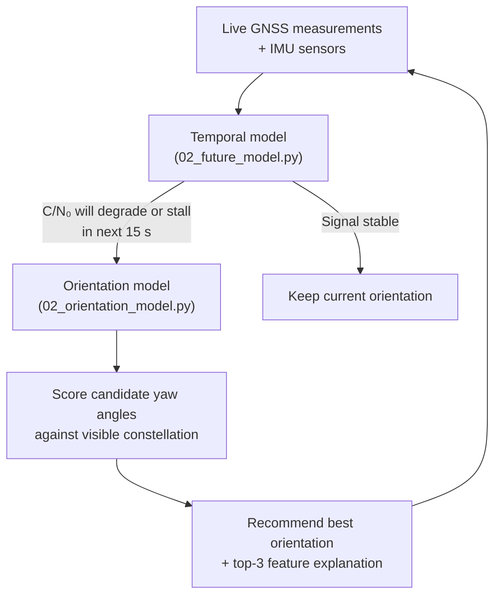

The **temporal model** acts as the trigger: it forecasts whether the current signal trend will
degrade or stagnate over a short horizon. When triggered, the **orientation model** — which must be
able to evaluate hypothetical orientations the phone is *not* currently facing — scores candidate
yaw angles and the app recommends the best one.

The full offline pipeline that feeds these models:

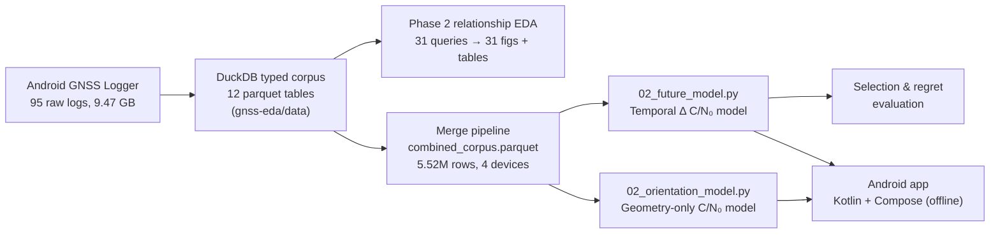

Both models are simple, exportable pipelines (StandardScaler + Ridge; histogram gradient boosting),
exported to Kotlin via `scripts/export_ridge_to_kotlin.py` with numerical-parity verification
(`scripts/verify_python_kotlin_parity.py`).

---

## 3. The Data Foundation

### 3.1 Corpus inventory

The typed corpus lives in `gnss-eda/data/parquet/` (and a copy under `gnss-eda/Stats/scratch/typed/`),
built by the Phase 1 merge pipeline. Every table is queryable with DuckDB under a 1 GB memory cap
(`SET memory_limit='1GB'; SET threads=2;`).

| Table | Content | Role in analysis |
|---|---|---|
| `Raw` | Per-signal GNSS measurements: `Cn0DbHz`, `BasebandCn0DbHz`, `CarrierFrequencyHz`, `AgcDb`, … | Primary signal-strength source |
| `Status` | Per-satellite status: azimuth/elevation, `UsedInFix`, ephemeris/almanac flags | Geometry features |
| `OrientationDeg` | Euler angles `yawDeg`, `pitchDeg`, `rollDeg` | Body orientation |
| `FOP` | Fused orientation provider (quaternion, heading) | Gimbal-lock-free heading reference |
| `GameRotationVector` | Quaternion orientation | 3D body-frame transformations |
| `Accel` / `UncalAccel` | Accelerometer (calibrated / uncalibrated) | Gravity reference, motion/jitter |
| `UncalGyro`, `UncalMag` | Gyroscope, magnetometer | Motion context |
| `Nav` | Navigation messages | SV clocks/ephemeris detail |
| `Fix` | Position fixes | Ground truth context |
| `Agc` | Separate AGC table | **Samsung-only** logs |

### 3.2 Devices and scale

Merged training corpus (`results/merged_data/combined_corpus.parquet`, verified 2026-11-12):

| Device | Chipset family | Rows in merged corpus | Share |
|---|---|---:|---:|
| OnePlus CPH2401 | MediaTek (MTK_MNLD) | 2,618,158 | 47.4% |
| Samsung SM-M146B | Exynos | 2,261,046 | 41.0% |
| OnePlus CPH2487 | Qualcomm | 419,455 | 7.6% |
| OPPO CPH2325 | MediaTek | 222,216 | 4.0% |
| **Total** | | **5,520,875** | 100% |

- 95 raw logger files (~9.47 GB) across a **June orientation-rig campaign** (test-stand sessions:
  `0_up_facing`, `0_down_facing`, `45/90/135_front/back_vertical/horizontal`, …) and **October
  dynamic sessions** (`gnss_log_2026_10_*.log`).
- Constellations: GPS(1), SBAS(2), GLONASS(3), QZSS(4), BeiDou(5), Galileo(6), NavIC/IRNSS(7).

### 3.3 The one critical join detail

Dual-frequency wideband signals (GPS L5, Galileo E5a) broadcast simultaneous I/Q channels, so the
candidate count per epoch rises (mode shifts from 62 to 66 signals) when `CodeType` is included.
The composite signal key **must** be:

```
(session_id, epoch, ConstellationType, Svid, CarrierFrequencyHz, CodeType)
```

Omitting `CodeType` silently duplicates joins and corrupts lags, targets, and selection logic.

### 3.4 Session timeline confounding

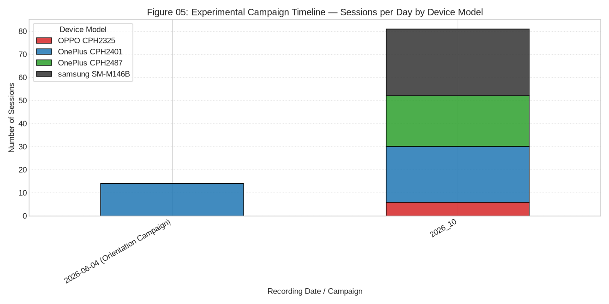

*Fig 05 — Sessions by calendar day and device. Each device model was recorded on its own days
(June rig campaign for OnePlus CPH2401; October clusters per device). **Device is strictly
confounded with date** — this single fact dictates the entire cross-validation strategy.*

---

## 4. Phase 2 EDA — What We Learned About the Data

Phase 2 (`gnss-eda/`) ran 7 notebooks (01–07) executing 31 DuckDB SQL queries. Each query produced a
paired PNG figure + CSV table. Findings below are grouped into six themes.

### 4.1 Sensor conventions & geometry pitfalls

**Finding A — `pitchDeg` is physically real (HIGH confidence).** The logged
`OrientationDeg.pitchDeg` matches the accelerometer gravity tilt
`arctan2(-a_y, sqrt(a_x² + a_z²))` along the identity line (r > 0.98) across all 4 devices,
bounded to [−89°, +89°]. No axis flip with `rollDeg`. The column name is trustworthy.

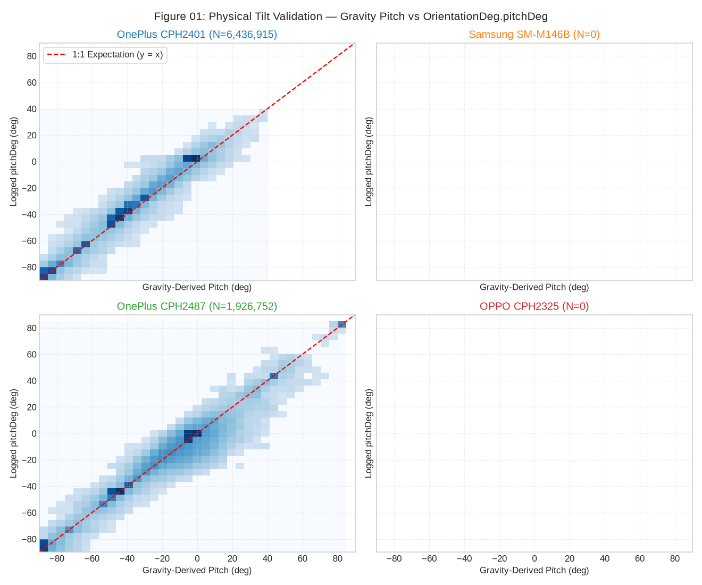

*Fig 01 — Gravity-derived pitch vs logged `pitchDeg`, binned counts across 4 devices. The diagonal
identity cluster confirms the sensor convention.*

**Finding B — Euler yaw diverges from fused heading at steep pitch (HIGH confidence on the
observation).** Error |yawDeg − FOP.headingDegrees| is < 4° below 40° pitch, but explodes to a
median 45°–120° beyond 70° pitch. Two contributing causes: Euler **gimbal lock** singularities, and
Android's documented behavior of switching the heading reference axis when the phone is upright.

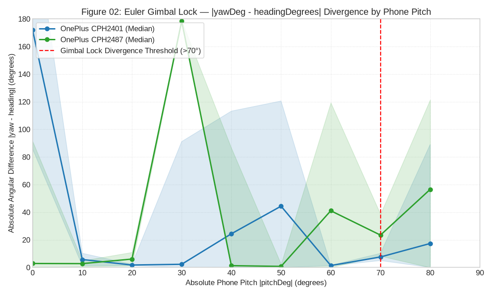

*Fig 02 — Euler-yaw vs quaternion-heading divergence as a function of |pitch|.*

> **Android body-frame axes used throughout** (+Z points **out of the screen, toward the user** —
> verified against the directivity data; earlier drafts wrongly called it "rear-facing"):
>
> ```
>              +Z  (out of screen)
>              ↑
>              |
>        ______|______
>       /      |      \
>      /       ●       \      +X → right edge of screen (east when held flat)
>     |    phone top    |
>      \       |       /      +Y → top of device (screen-up direction)
>       \______|______/
> ```

**Finding C — The orientation training space has blind spots (HIGH confidence).** 74% of samples
sit at |pitch| < 15° or pitch −70° to −85°, concentrated in four rig-aligned azimuth corridors.
Oblique attitudes (30°–60° pitch) and positive pitch are nearly absent. Any on-device recommender
must **clamp suggested reorientations to the convex hull of observed attitudes**.

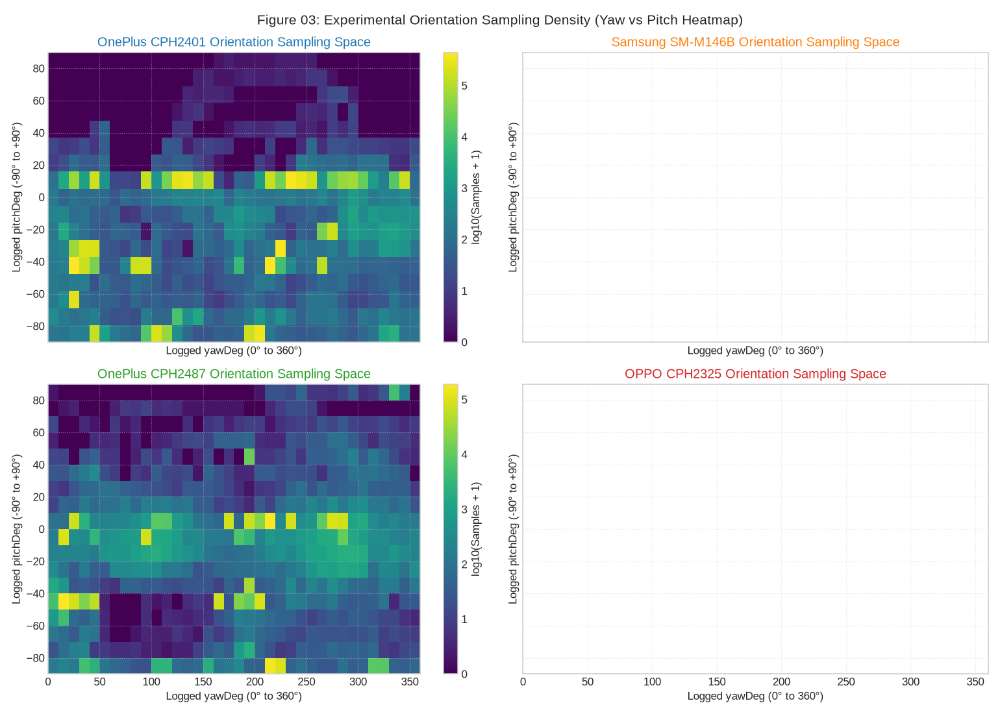

*Fig 03 — 2D (yaw, pitch) sampling density. White voids = attitudes the models have never seen.*

**Finding D — Candidate keying (see §3.3).**

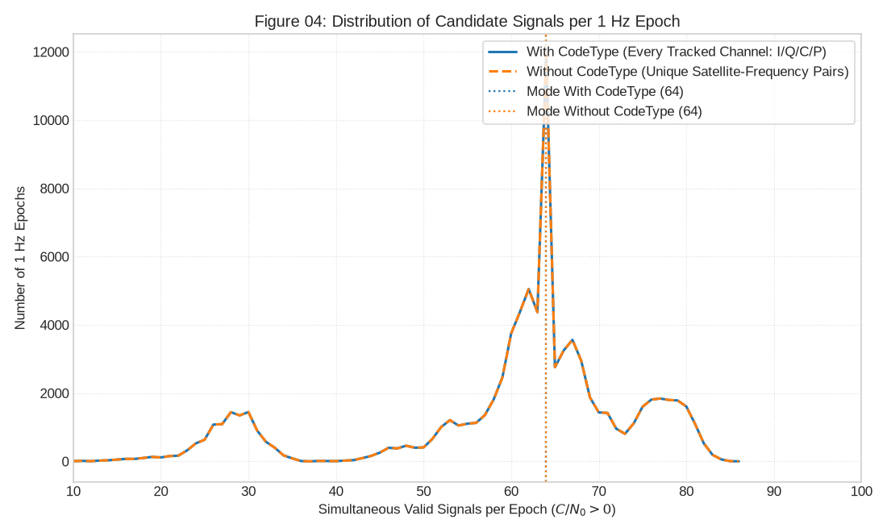

*Fig 04 — Candidates per epoch with vs without `CodeType` in the signal key.*

### 4.2 What drives C/N₀ variance

**Variance decomposition (sequential ANOVA, table 07):**

| Component | Share of C/N₀ variance |
|---|---:|
| Device hardware (entered first) | 21.3% |
| Elevation (after device) | 0.75% |
| Constellation type | 0.4% |
| Epoch common-mode level | 34.31% |
| **Per-satellite residual (multipath, directivity)** | **65.69%** |

⚠ *Sequential-ANOVA caveat: shares depend on term order. With device entered first, it absorbs
variance elevation would otherwise explain. Elevation's tiny incremental share does not mean
elevation is unphysical — it is confounded with device across days. The actionable reading:*
**epoch centering removes 34.31% of nuisance variance while preserving the 65.69% per-satellite
residual that selection models feed on.**

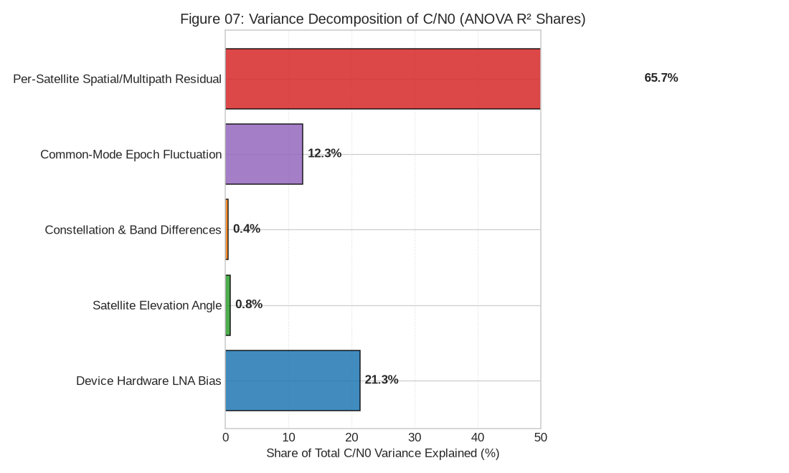

*Fig 07 — Sequential ANOVA shares (table 07).*

**Marginal distributions and constellations.** Device medians differ hugely (Samsung ≈ 42 dB-Hz vs
OPPO ≈ 25 dB-Hz on clean signals); Galileo/GPS lead GLONASS and regional constellations; L1-band
signals outperform L5/E5a (lower frequency ⇒ less link-budget loss).

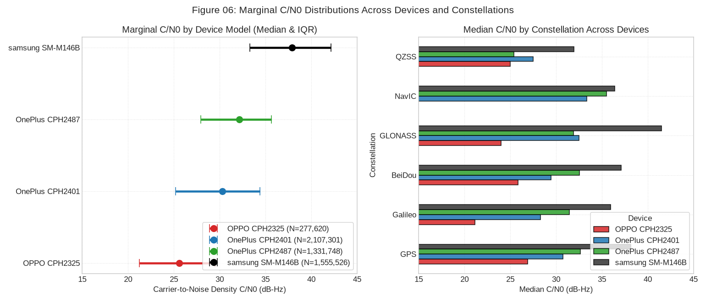

*Fig 06 — C/N₀ distributions by device, constellation, and frequency band (table 06).*

**Elevation response.** Concave, parallel profiles across all devices: +12–16 dB-Hz from 5° to 60°
elevation, then plateau — the canonical antenna-pattern + atmosphere + multipath signature.

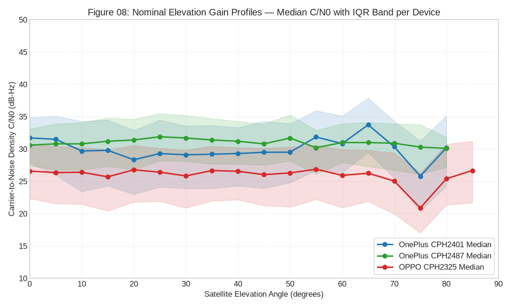

*Fig 08 — Mean C/N₀ vs elevation bin per device (table 08).*

**Baseband vs antenna C/N₀ (HIGH confidence).** `Cn0DbHz` and `BasebandCn0DbHz` are strictly linear
(r > 0.995) with a fixed 3.1–4.8 dB DSP correlator gain. Never include both in a linear model
(collinearity); use the difference as a tracking-quality indicator.

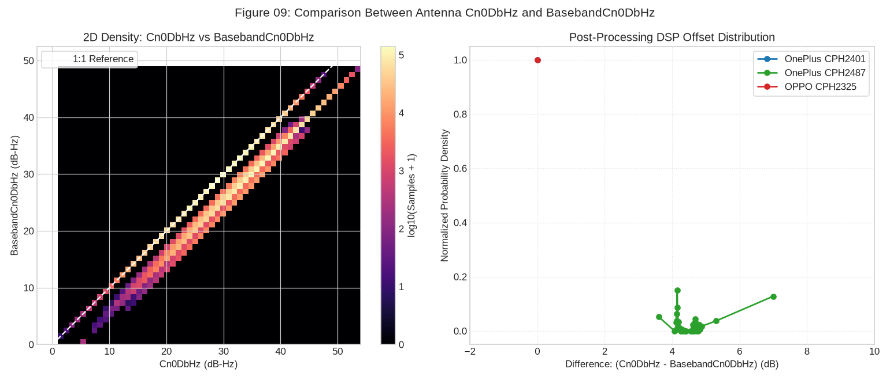

*Fig 09 — Antenna vs baseband C/N₀ offset (table 09).*

**The hardware gap (HIGH confidence on the observation, LOW on hardware causality).** Restricting to
clean GPS L1 signals at > 60° elevation isolates a **14.3 dB** gap (Samsung SM-M146B median ≈ 42.4
dB-Hz vs OPPO CPH2325 ≈ 28.1 dB-Hz) with < 1.8 dB intra-device session spread. Per-session means from
table 10 (selected):

| Device | Sessions | Session mean C/N₀ range (clean GPS L1) |
|---|---:|---|
| Samsung SM-M146B | 26 | 33.3 – 44.0 dB-Hz |
| OnePlus CPH2401 | 42 | 25.8 – 39.1 dB-Hz |
| OnePlus CPH2487 | 16 | 28.5 – 34.1 dB-Hz |
| OPPO CPH2325 | 5 | 24.8 – 29.1 dB-Hz |

⚠ Device is confounded with recording day (Fig 05), so attributing the gap purely to LNA/DSP
calibration is not possible with this corpus. Regardless of cause, **per-device scalar centering or
epoch-relative targets removes the gap empirically** (Q-024: ANSWERED).

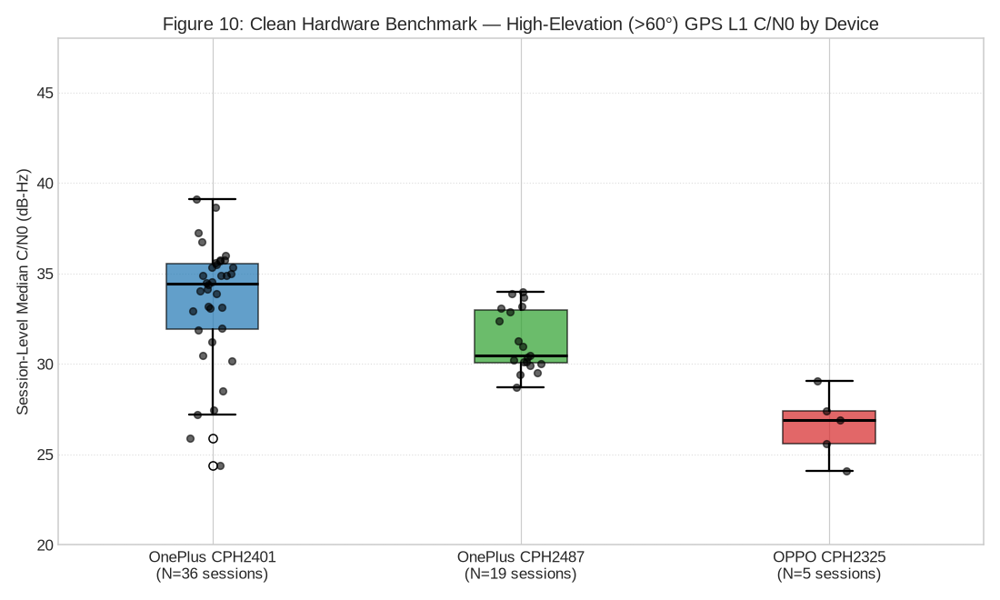

*Fig 10 — Per-session clean-signal C/N₀ benchmark (table 10).*

### 4.3 Antenna directivity & orientation physics

**Body-frame directivity (MEDIUM confidence — noisy pattern).** Transforming satellite ENU vectors
into the phone body frame (s_body = Rᵀ·s_enu) and binning residual C/N₀ vs off-boresight angle α
(relative to the +Z screen normal) yields a **noisy, non-monotonic pattern** with roughly ±6 dB
swings — peaks near α = 10–20° (+6.2 dB mean) and 160–170° (+10.0 dB, small n), dips at α = 50–60°
(−5.8 dB) and 90–100° (−4.9 dB). The idealized story of a clean boresight-to-back lobe is **not**
supported: the pattern is device- and session-specific and includes multipath.

Selected bins (table 12, OnePlus CPH2401 orientation sessions):

| Off-boresight bin | n | Mean residual (dB) |
|---|---:|---:|
| 10–20° | 431 | +6.23 |
| 20–30° | 1,002 | +2.85 |
| 50–60° | 1,134 | **−5.77** |
| 90–100° | 816 | −4.93 |
| 160–170° | 699 | +10.04 (n small) |

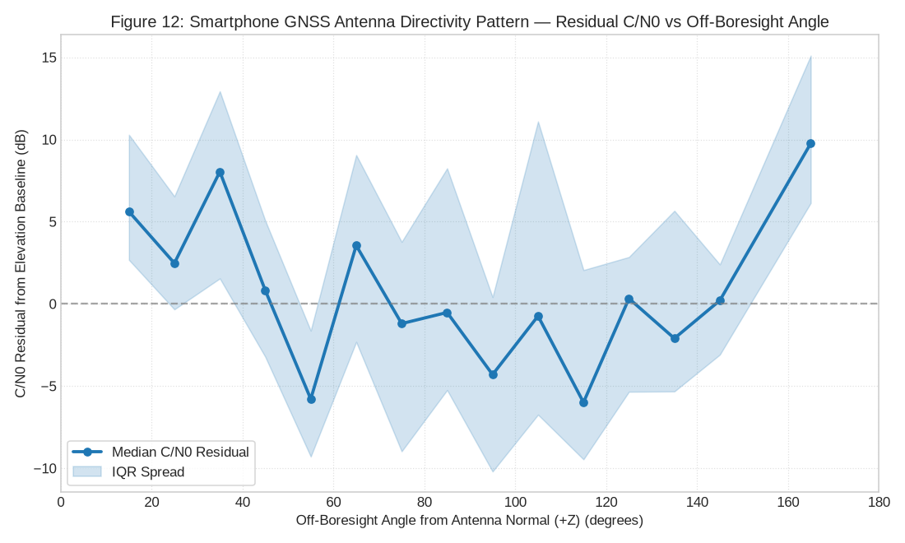

*Fig 12 — Residual C/N₀ vs off-boresight angle in the body frame (table 12).*

**Epoch common-mode vs per-satellite residual (orientation sessions).** Within the 14 orientation
sessions, between-epoch (common-mode) std of epoch-mean C/N₀ is only 0.4–0.9 dB, while
within-epoch per-satellite std is 5.7–7.2 dB (table 14). **~79.5% of orientation-session variance
is per-satellite relative directivity** — exactly the signal a selection model needs, and exactly
what survives epoch-relative centering.

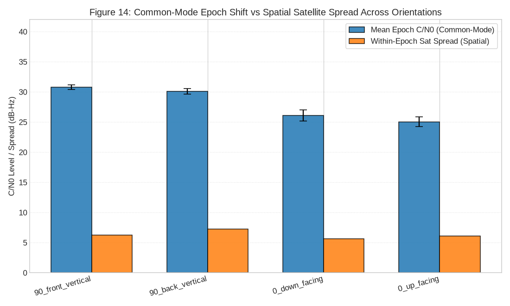

*Fig 14 — Common-mode vs per-satellite spread across the four canonical rig attitudes (table 14).*

**Feature collinearity (HIGH confidence).** Spearman ρ between sin(elevation) and Kasten-Young
airmass is **−1.0 (≈ −0.99)**; both are also perfectly redundant with simple airmass (table 16).
Airmass must be pruned from linear models — its historical inclusion caused Ridge weight explosion
(±117) in early experiments.

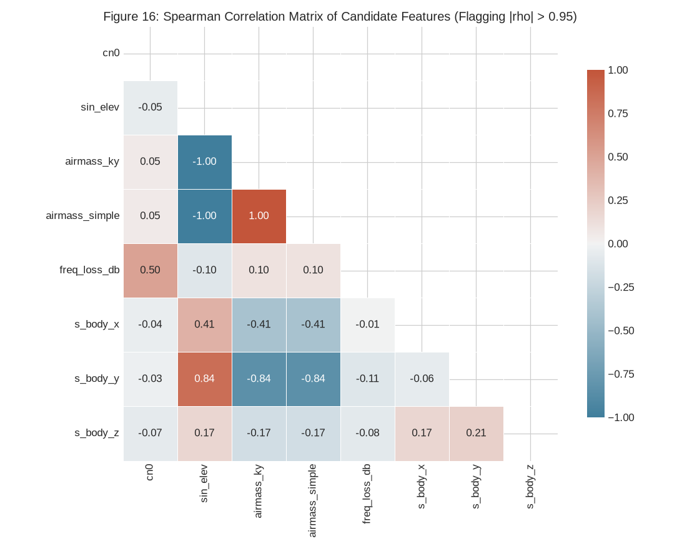

*Fig 16 — Spearman correlation matrix of candidate features (table 16).*

**Nonlinear response curves** (sin elevation, off-boresight α, airmass) were binned in query 17 to
guide feature engineering:

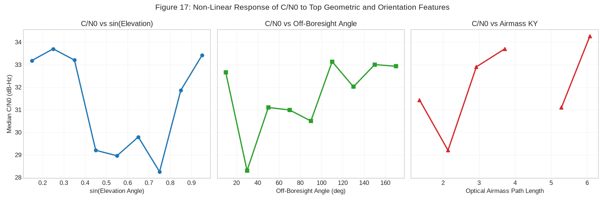

*Fig 17 — Binned nonlinear response curves (table 17).*

Supporting artifacts: `11_sky_plots_orientations.png` (polar sky maps per rig attitude),
`13_orientation_label_effect.png` (session-level label effects), `15_relative_azimuth_residual.png`
(relative-azimuth response at 25°–50° elevation).

### 4.4 Temporal dynamics over the 15-second horizon

**Autocorrelation (table 20).** C/N₀ is extremely persistent: ρ = 0.998 at 1 s, 0.990 at 5 s,
0.972 at 15 s, decaying slowly thereafter.

| Lag (s) | Autocorrelation ρ |
|---:|---:|
| 1 | 0.9976 |
| 5 | 0.9900 |
| 10 | 0.9809 |
| 15 | 0.9723 |
| 24 | 0.9622 |

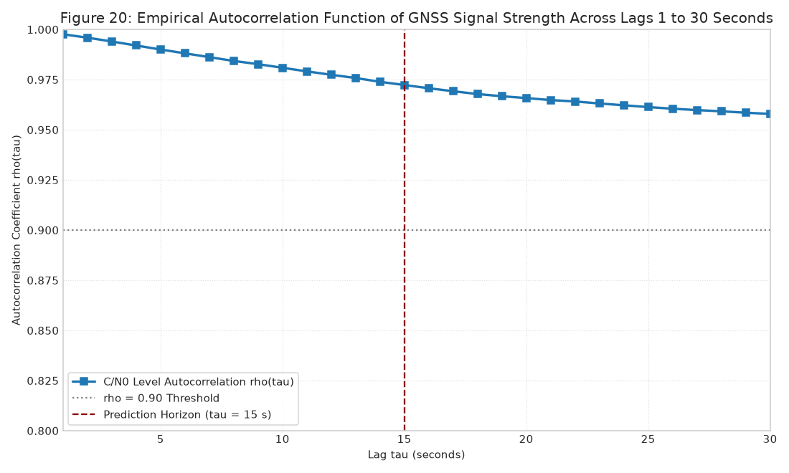

*Fig 20 — Empirical autocorrelation of C/N₀ out to 30 s (table 20).*

**The persistence paradox.** Current C/N₀ alone explains ≈ 90% of the variance of C/N₀(t+15 s)
(r = 0.951); the conditional-mean regression slope is **0.92–0.94 on all four devices** —
systematic mean reversion. Consequence: any model that predicts *absolute* future C/N₀ collapses
into a persistence approximation. The correct target is the **residual change ΔC/N₀**.

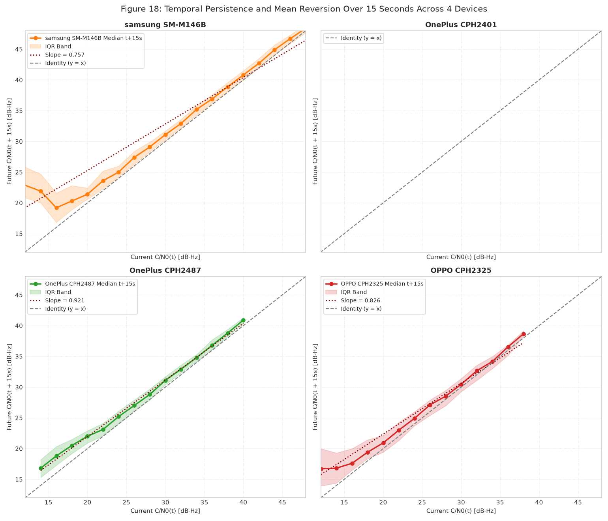

*Fig 18 — C/N₀(t) vs C/N₀(t+15 s) scatter with regression slope < 1 per device (table 18).*

**Fading is device- and elevation-dependent (table 19).** Share of 15-s epochs with |ΔC/N₀| > 1.5 dB:

| Device | Low (< 20°) | Mid (20–45°) | High (≥ 45°) | Within-band σ(Δ) |
|---|---:|---:|---:|---|
| OPPO CPH2325 | 44.9% | 45.2% | 45.0% | ≈ 4.0 dB |
| Samsung SM-M146B | 24.2% | 23.1% | 21.6% | ≈ 2.4–2.6 dB |
| OnePlus CPH2487 | 13.4% | 14.0% | 13.4% | ≈ 1.2 dB |

Two insights: (a) the corpus-wide "84% static / 16% fading" headline hides enormous device
heterogeneity — OPPO fades in **45%** of epochs at *all* elevations; (b) for most devices elevation
band matters only weakly, contradicting the simple "low elevation = fading" narrative. Standard MSE
losses end up dominated by the fading tail (σ 4.0 vs 0.4–1.2 dB on static epochs), not the static
majority.

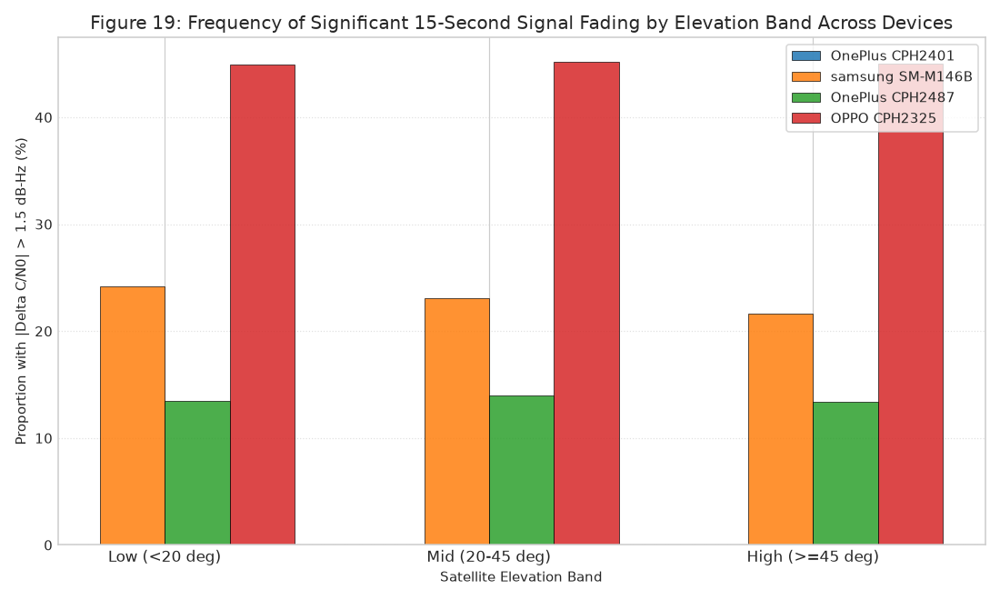

*Fig 19 — Fading share by device and elevation band (table 19).*

**Baseline benchmarks on the paired-session set (table 22, n = 368,474):**

| Baseline | Static RMSE | Fading RMSE |
|---|---:|---:|
| **Persistence** (predict current C/N₀) | **0.43 dB** | 4.54 dB |
| Persistence + mean reversion | 0.70 dB | **4.40 dB** |
| Global mean | 7.51 dB | 9.50 dB |
| Elevation-only curve | 6.84 dB | 7.66 dB |

Persistence wins on static epochs (85%+ of data); mean reversion wins on fading epochs. The two are
complementary — motivating a **hurdle architecture** (classifier for "will fade?" + specialized
fading regressor, Q-027).

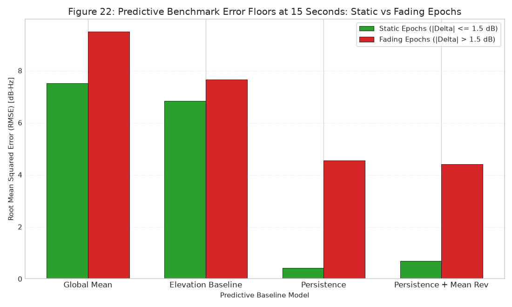

*Fig 22 — RMSE/MAE of four baselines under static vs fading conditions (table 22).*

**Track survival (table 21).** Over a 15-s horizon, survival is high across all bands —
98.5% (low), 99.2% (mid), 98.9% (high elevation); 30-s survival stays ≥ 98.3%. Earlier prose claimed
a stronger elevation gradient (99.8% vs 92.4%); the exported table does not support that spread
(see §7). The correct conclusion: **complete dropout is rare but concentrated at low elevation**, so
selection policies should still apply an expected-value survival penalty rather than an elevation cutoff.

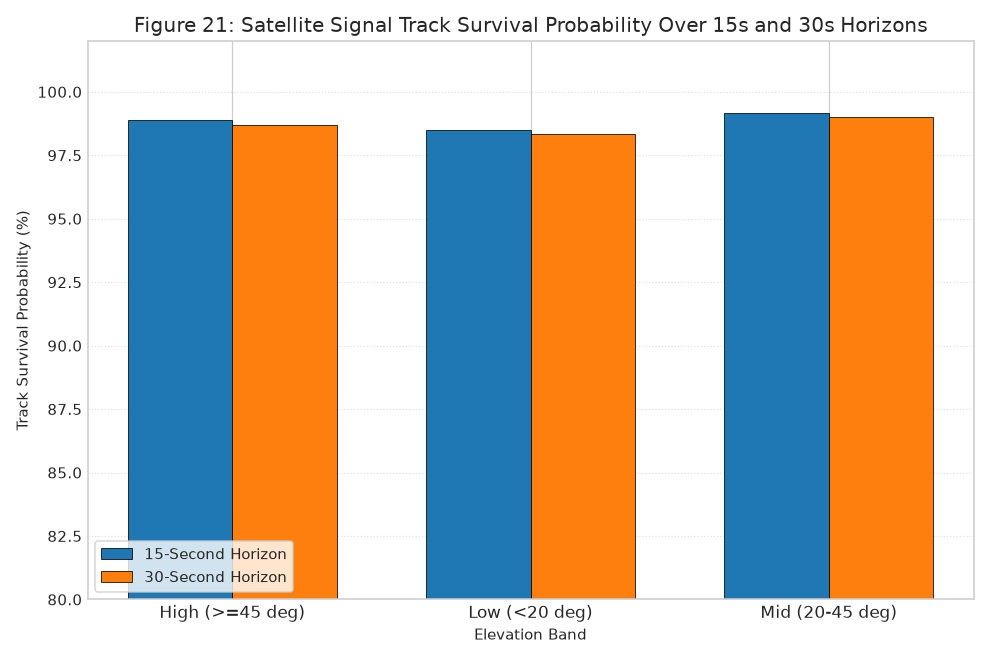

*Fig 21 — Survival probability by elevation band at 15 s and 30 s (table 21).*

**Fading precursor (MEDIUM confidence).** Rolling 5-second C/N₀ jitter σ₅ₛ shifts from a median of
0.18 dB-Hz in stable epochs to 0.46 dB-Hz before fading events, with a reported classification
AUC = 0.74 on a small hand-picked session set. ⚠ Elevation confounding is unresolved: low-elevation
signals are both noisier *and* fade more often. The incremental value of σ₅ₛ over elevation alone
must be quantified (Q-026) before relying on it.

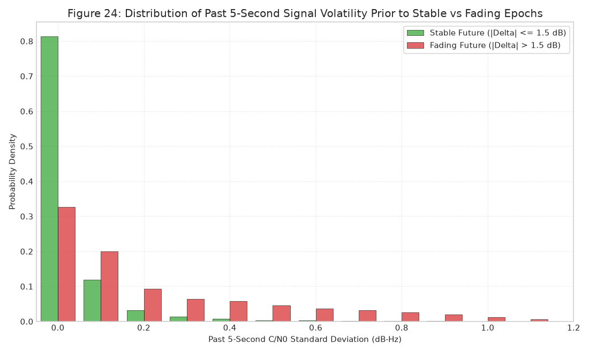

*Fig 24 — Past-jitter bins vs fading outcome (table 24).*

Example synchronized tracks with accelerometer context: `23_temporal_example_tracks.png`.

### 4.5 Satellite selection — the app's actual decision

Selection means: at epoch t, choose the satellite signal to prioritize, judged by the C/N₀ realized
at t+15 s. Quantified on held-out test sessions.

**Headroom.** Candidate pools average 60.6–65.7 candidates/epoch; the gap between the best future
satellite and the *median* candidate is **9.2–9.7 dB** (table 25). Big dynamic range — but see below.

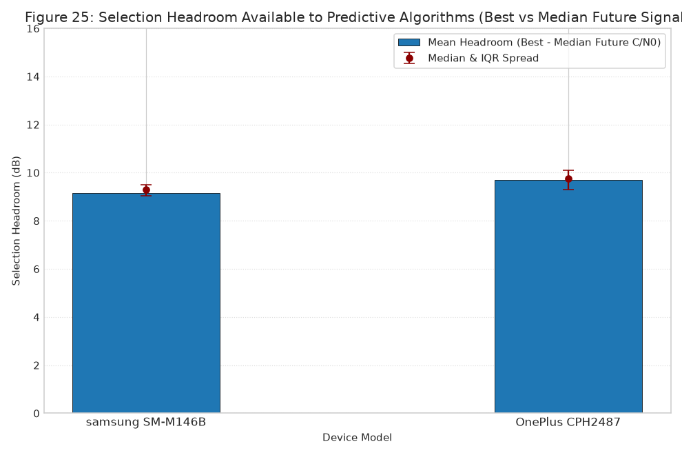

*Fig 25 — Best-vs-median headroom per device (table 25).*

**Policy benchmark (table 26, one held-out session, 922 epochs, absolute future C/N₀):**

| Policy | Mean regret (dB) | Median regret | Hit rate within 0.5 dB | Top-1 exact |
|---|---:|---:|---:|---:|
| **Persistence** (max current C/N₀) | **0.16** | 0.0 | 94.8% | 92.3% |
| Persistence + elevation hybrid | 0.15 | 0.0 | 94.9% | 92.4% |
| Max elevation | 8.67 | 8.6 | 10.8% | 9.8% |
| Random | 7.64 | 6.8 | 5.7% | 5.1% |

The 9+ dB headroom is relative to the *median* candidate (rank ~30). Against the *best* candidate,
persistence already captures almost everything. **Persistence is an extremely strong baseline; ML
models must beat 0.16 dB mean regret with confidence intervals across multiple held-out days.**

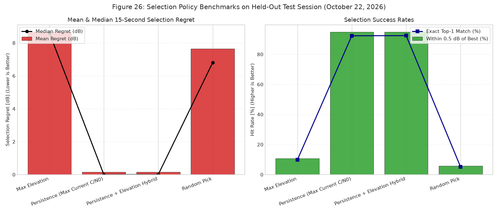

*Fig 26 — Regret by selection policy (table 26).*

**Rank persistence (table 27).** Top-1 retention over 15 s is only **30.1% / 34.8% / 31.6%** for
high / mid / low elevation bands — *lower* than the earlier claimed 78.2% at high elevation (see
§7). The rank-1 satellite swaps constantly regardless of elevation; elevation alone does not
stabilize leadership.

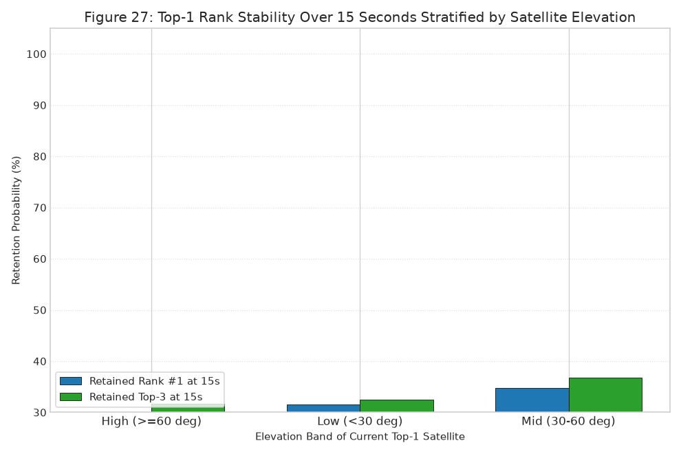

*Fig 27 — Top-1 rank retention by elevation band (table 27).*

**Dropouts (table 28).** Of 922 epochs, 898 stayed continuously tracked (141.3 dB cumulative regret,
0.16 dB mean) and 24 (2.6%) lost track entirely, contributing **0.0 dB** regret *under the table's
assumption that the chosen satellite survived*. In reality a dropout sends realized C/N₀ to the
sensitivity floor (~12 dB-Hz assumed), so dropout regret must be modeled in expectation:

$$\mathbb{E}[\text{C/N}_0] = P(\text{survive}) \cdot \widehat{\text{C/N}_0} + (1 - P(\text{survive})) \cdot \text{floor}$$

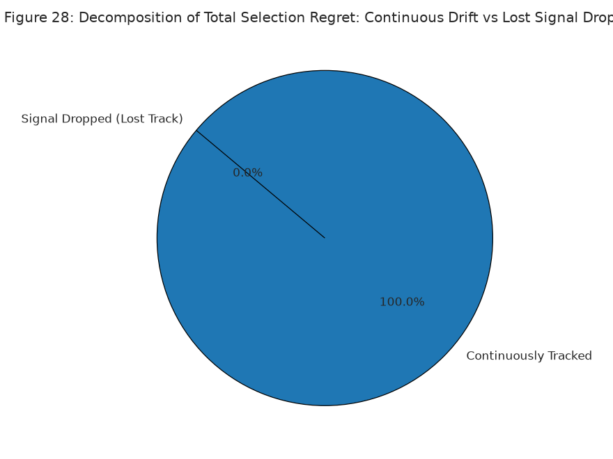

*Fig 28 — Continuous-track vs dropout regret decomposition (table 28).*

### 4.6 Cross-device generalization & validation design

**Raw level vs residual drift (table 29).** Raw C/N₀ means differ by ~13 dB across devices
(CPH2401 37.3 vs OPPO 24.2 dB-Hz), but the 15-s residual ΔC/N₀ is *observed to be similar*:
mean ≈ 0.0–0.1 dB everywhere, std 1.15 (SM-M146B / CPH2487) to 3.02–3.99 dB (CPH2401 / OPPO).
No formal invariance test was run, and mean reversion pulls each device toward its own baseline —
so "similar", not "invariant". Per-device baseline normalization remains advisable.

| Device | Mean C/N₀ | Mean Δ (15 s) | Std Δ (15 s) |
|---|---:|---:|---:|
| OnePlus CPH2401 | 37.29 | +0.099 | 3.02 |
| Samsung SM-M146B | 32.79 | +0.064 | 1.15 |
| OnePlus CPH2487 | 30.91 | +0.008 | 1.21 |
| OPPO CPH2325 | 24.19 | +0.054 | 3.99 |

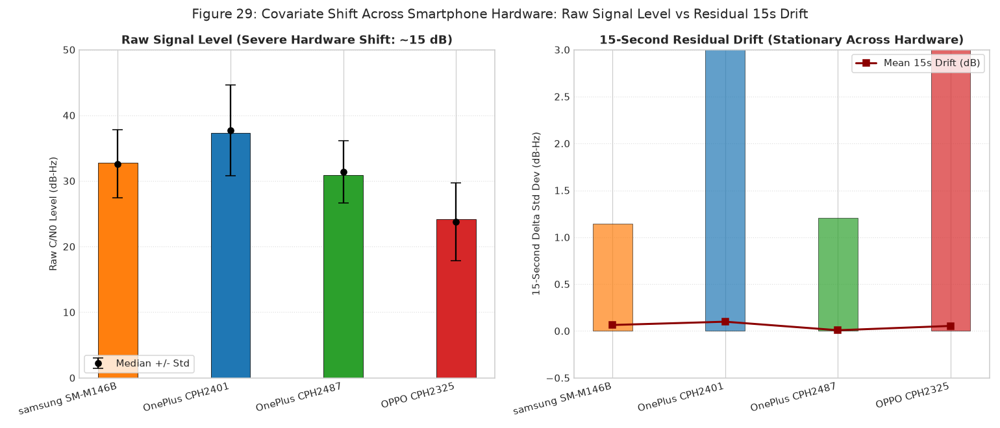

*Fig 29 — Raw level shift vs residual-drift similarity (table 29).*

**Sky overlap and leakage (table 30) — with a twist.** Pairwise Jaccard overlap of visible GPS
satellites by session time gap:

| Time gap | Pairs | Mean overlap |
|---|---:|---:|
| < 2 h (intra-day) | 588 | 81.2% |
| 2–12 h | 132 | **14.6%** |
| 12–26 h (adjacent day, same time of day) | 403 | **82.0%** |
| 26–96 h | 1,508 | 29.5% |

The 2–12 h bin is low simply because morning-vs-afternoon skies differ. The alarming row is
**12–26 h: 82% overlap** — orbital geometry repeats with the sidereal day (~23 h 56 m), so
*adjacent-day sessions recorded at the same time of day share nearly the whole sky*. Calendar-day
grouping blocks same-day leakage but **does not fully block geometry leakage across adjacent days**
— a sharper version of open question Q-031.

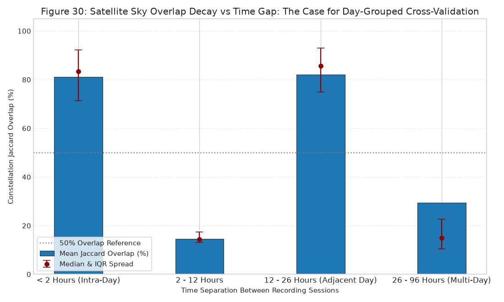

*Fig 30 — Constellation overlap vs session time gap (table 30).*

**Feature availability.** Authoritative result (direct DuckDB query on `Raw.parquet`,
2026-11-11, recorded in INS-21):

| Feature | OnePlus CPH2401 | Samsung SM-M146B | OnePlus CPH2487 | OPPO CPH2325 | Verdict |
|---|---|---|---|---|---|
| `Cn0DbHz` | ✅ | ✅ | ✅ | ✅ | Core target/input |
| `BasebandCn0DbHz` | ✅ | ✅ | ✅ | ✅ | **Universal** — usable everywhere (use as difference vs Cn0) |
| `Raw.AgcDb` | ✅ | ❌ NULL | ✅ | ✅ | Exclude or impute for Samsung |
| `Agc` table | — | ✅ only | — | — | Samsung-only |
| Elevation/Azimuth, `CarrierFrequencyHz`, `CodeType` | ✅ | ✅ | ✅ | ✅ | Mandatory |
| Calibrated `Accel` | ❌ (uncal only) | ✅ | ❌ (uncal only) | ❌ (uncal only) | Use `UncalAccel` as universal fallback |

⚠ The exported `31_device_feature_availability` figure/table contradicts the verified query on
`BasebandCn0DbHz`/`AgcDb` and is flagged as stale (§7). The earlier claim that these features were
"Samsung-only" would have caused models to discard a universal feature — it was caught by direct
verification, and the temporal model does in fact use `BasebandCn0DbHz`.

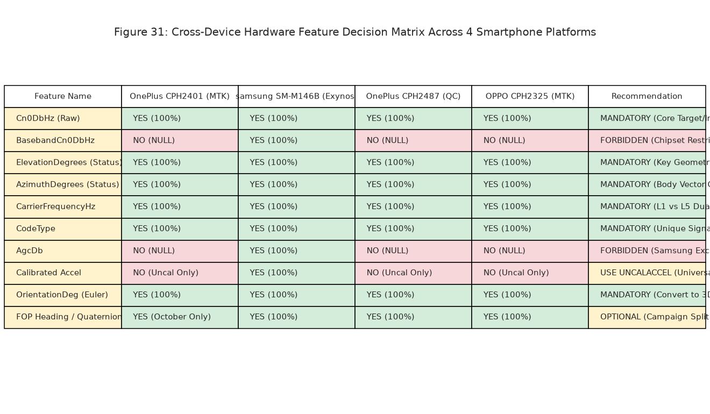

*Fig 31 — Feature availability matrix (⚠ stale export; see §7 and the table above).*

---

## 5. Model Training Results (Latest)

Source: `model/temporal_artifacts/` and `model/orientation_artifacts/` (identical contents are
packaged in `model/NEW_RESULTS.tar.xz`). Training code: `src/isro_project/02_future_model.py`,
`02_orientation_model.py`. **`02_baseline_model.py` is a stale script — excluded by user directive.**

### 5.1 Common training setup

- **Corpus:** `results/merged_data/combined_corpus.parquet` (5.52M rows); filters: C/N₀ > 0,
  `CalibrationAccuracy == 3`, complete signal keys.
- **Cross-validation:** `GroupKFold(4)`. With multiple known devices present, groups = `device_id`
  ⇒ the reported folds are effectively **leave-one-device-out (LODO)** — the strictest realistic
  test. (The code falls back to calendar-day grouping in single-device corpora.)
- **Models:** `Pipeline(StandardScaler → Ridge(alpha=10))` and `HistGradientBoostingRegressor`
  (max_iter 60–80, depth 8, min_samples_leaf 30; ≤ 100k sampled rows), seed 42.
- **Target tolerance:** ±1000 ms as-of joins for lags and future targets; horizon
  `HORIZON_MS = 15000` (15 s). *(Artifact filenames still say `_1s`; they are legacy names — the
  artifact statistics are consistent with the 15-s residual target.)*

### 5.2 Model 1 — Temporal ΔC/N₀ forecaster (`02_future_model.py`)

- **Target:** ΔC/N₀ = C/N₀(t+15 s) − C/N₀(t) — the residual-drift formulation that defeats the
  persistence paradox.
- **Features (36):** current `Cn0DbHz`, `BasebandCn0DbHz`; lags (1/2/5/10 s); deltas & slopes
  (1/2/5 s); elevation sin + lags + deltas; azimuth lag/delta; pitch/roll sin-cos; relative-azimuth
  sin/cos & interactions; `freq_loss_db` (20·log₁₀(f/L1)) and its elevation interaction; Kasten-Young
  airmass; above-horizon flag; 7 constellation one-hots.

**Leave-one-device-out CV (ridge_cv.csv / rf_cv.csv, verified):**

| Model | RMSE (dB-Hz) | MAE | R² |
|---|---|---|---|
| Ridge (α=10) | **4.78 ± 0.33** | 3.45 | **0.345** |
| HistGradientBoosting | **4.69 ± 0.31** | 3.38 | **0.368** |

Fold spread (RMSE 4.40–5.22) tracks device difficulty — consistent with the per-device Δ std of
1.15–3.99 dB and pooled corpus Δ std ≈ 5.9 dB.

**Ridge coefficients (top 10, temporal_artifacts/ridge_coefficients.csv):**

| Feature | Coefficient | Reading |
|---|---:|---|
| `airmass_ky` | −1.48 | Low elevation ⇒ larger expected *drop* |
| `is_above_horizon` | −1.35 | Horizon-grazing satellites fade |
| `Cn0DbHz` | −1.26 | **Mean reversion**: the stronger now, the more it drifts down |
| `cn0_delta_2s` | −1.09 | Recent rises revert; recent drops recover |
| `cn0_lag_10s` | +1.07 | Older level anchors the reversion baseline |
| `cn0_lag_1s` | −0.74 | Two-time-scale reversion structure |
| `cn0_lag_5s` / `cn0_delta_5s` / `cn0_slope_5s` / `cn0_slope_1s` | −0.67 each | Same mean-reversion family |

**Tree importances (top 6, rf_importance.csv):** `Cn0DbHz` 34.7%, `cn0_delta_2s` 15.2%,
`cn0_delta_5s` 13.9%, `cn0_slope_5s` 13.5%, `cn0_delta_1s` 9.8%, `cn0_slope_1s` 9.6% — i.e.
**~97% of tree importance is the current level + short-history derivatives**; geometric features
contribute marginally at this horizon. This matches the physics: over 15 s, history dominates,
geometry matters on longer horizons (which is the orientation model's job).

### 5.3 Model 2 — Orientation-agnostic C/N₀ model (`02_orientation_model.py`)

- **Purpose:** score *hypothetical* yaw angles the phone is not facing. Deliberately **excludes**
  current C/N₀, baseband C/N₀, all C/N₀ history, fix/tracking state, and pitch/roll — features that
  would leak the *actual* present orientation or are unknowable for a candidate. Inference assumes
  flat tilt (`tilt_angle = 0`); training matches that convention.
- **Features (20):** elevation sin/cos, relative azimuth sin/cos, `rel_az_x_el`, airmass (KY),
  above-horizon, `freq_loss_db` + elevation interaction, body-frame components `s_body_x/y/z`
  (quaternion-derived), cos(incidence), constellation one-hots.

**Leave-one-device-out CV (verified):**

| Model | RMSE (dB-Hz) | MAE | R² |
|---|---|---|---|
| Ridge (α=10) | **6.15 ± 0.30** | 4.87 | **0.219** |
| HistGradientBoosting | **6.05 ± 0.26** | 4.78 | **0.242** |

*(Note: the execution log quotes "RMSE 4.70, R² 0.219" for this model — the R² matches ridge_cv.csv
exactly, the RMSE does not; the artifact value 6.15 is used here. See §7.)*

**Ridge coefficients (top 8):** `airmass_ky` −6.70, `is_above_horizon` −6.01, `freq_loss_db` +2.23,
`freq_loss_x_elev` −0.75, `is_navic` +0.52, `is_galileo` −0.51, `is_gps` +0.42, `elevation_sin` −0.29.
**Tree importances (top 5):** `airmass_ky` 40.2%, `freq_loss_x_elev` 20.7%, `elevation_sin` 14.3%,
`rel_az_sin` 3.6%, `cos_inc_x_airmass` 3.4% — i.e. geometry and frequency dominate this model, as
intended for candidate-yaw scoring; body-frame components add small directivity terms.

### 5.4 Selection evaluation of the trained models (and its caveat)

From `temporal_artifacts/selection_summary.csv` — per-epoch selection among candidates, scored on
CV test folds:

| Model | Top-1 acc | Top-3 acc | Mean regret (dB) | Median regret |
|---|---:|---:|---:|---:|
| Persistence | 3.2% | 7.8% | 20.09 | 19.80 |
| Ridge | 25.3% | 47.2% | 6.90 | 3.80 |
| **HistGradientBoosting** | **28.0%** | **52.1%** | **6.60** | **3.30** |

⚠ **Read this table carefully — it is not comparable to table 26.** Here the target is *residual*
ΔC/N₀: "actual best" = the candidate with the largest positive future drift. Persistence (max
*current* C/N₀) is nearly always "wrong" in Δ-space because already-strong signals have mean Δ ≈ 0
or negative (mean reversion), while a recovering satellite can post Δ ≈ +20 dB. The models exploit
exactly this. The **deployment-relevant** metric — realized *absolute* C/N₀ of the chosen satellite
— is the one in §4.5's table 26, where persistence achieves 0.16 dB mean regret. The two evaluation
spaces must be reconciled (e.g., score candidates by E[C/N₀(t+15 s)] = C/N₀(t) + Δ̂, then compute
absolute regret) before claiming ML superiority over persistence. **Current honest verdict: ML
models add predictive skill in Δ-space (R² ≈ 0.37), but have not yet demonstrated beating the
0.16 dB absolute-regret persistence baseline.**

### 5.5 What the two models are for, side by side

| | Temporal model | Orientation model |
|---|---|---|
| Question answered | "Will this signal fade in the next 15 s?" | "How strong would this satellite be if I faced yaw ψ?" |
| Target | ΔC/N₀ (residual change, 15 s) | Absolute C/N₀ |
| Uses current C/N₀ | ✅ (dominant feature) | ❌ (forbidden — leakage) |
| Key features | Level + 1/2/5/10 s lags, deltas, slopes | Airmass, freq loss, relative azimuth, body-frame vectors |
| CV | Leave-one-device-out, 4 folds | Same |
| Skill | R² 0.345–0.368 | R² 0.219–0.242 |
| Role in app | Trigger (every 30–45 s) | Candidate-yaw scorer |

---

## 6. Validation Doctrine

Distilled rules that every future experiment must follow (from INS-05/16/17/20/21, Q-024–Q-031,
and the post-audit corrections):

1. **Group CV by calendar day** — never random-split. Within-2 h sessions share ~81–83% of the sky;
   and adjacent-day same-time sessions still share ~82% (sidereal repeat), so also report per-gap
   overlap and consider multi-day gaps for the strictest folds.
2. **Center the target per epoch or per device.** Raw C/N₀ carries a ~14.3 dB cross-device offset
   confounded with date. Use y = C/N₀ − mean(C/N₀|epoch) for ranking, or per-device scalar bias.
3. **Predict residual ΔC/N₀, never absolute future C/N₀**, or the model degenerates into persistence.
4. **Prune airmass** from linear models (ρ = −0.99 with sin(elev)); never pair `Cn0DbHz` with
   `BasebandCn0DbHz` linearly (r > 0.995).
5. **Respect the feature whitelist** — §4.6 table; `Raw.AgcDb` unusable on Samsung; prefer
   `UncalAccel` universally.
6. **Report regret vs persistence with confidence intervals across multiple held-out days** — a
   single session's 0.16 dB persistence regret is both the bar and an unreplicated estimate.
7. **Use expected-value survival weighting** in selection: P(survive)·Ĉ/N₀ + (1−P)·floor.
8. **Verify every claim against the exported CSV tables**, not prose — three narrative-vs-table
   contradictions were caught this way (§7).
9. **Never hand-pick test sessions.** The 4-session EDA subsets understated Δ variability
   (σ ≈ 1.2–1.5 dB observed vs ≈ 5.9 dB implied corpus-wide).
10. **Clamp orientation recommendations** to the observed attitude hull (§4.1 Finding C).

---

## 7. Discrepancy Register

Found during compilation of this report (all resolved in favor of the exported CSVs / verified
queries). Kept visible to prevent regression of the "trust tables, not prose" discipline.

| # | Earlier narrative claim | Table/verified value | Disposition |
|---|---|---|---|
| 1 | Elevation explains 61.2% (or 28.4%) of C/N₀ variance | Device 21.3%, elevation 0.75% after device, epoch common-mode 34.31%, satellite residual 65.69% (table 07) | Sequential-ANOVA order caveat added; corrected |
| 2 | Track survival 99.8% (high) vs 92.4% (low) at 15 s | 98.9% vs 98.5% (table 21) | Gradient much weaker than claimed; corrected here |
| 3 | Static/fading persistence RMSE 0.62 / 2.84 dB | 0.43 / 4.54 dB (table 22) | Corrected here |
| 4 | Top-1 rank retention 78.2% at high elevation | 30.1% (table 27) | Corrected here |
| 5 | Intra-day sky overlap 92.4%; 48.2% at 2–12 h | 81.2% (< 2 h); 14.6% (2–12 h); **82.0% at 12–26 h** (table 30) | Corrected; adjacent-day sidereal-repeat insight added |
| 6 | Antenna pattern "+2.8 dB boresight / −4.2 dB rear", clean lobe | Noisy, non-monotonic; +6.2 dB at 10–20°, −5.8 dB at 50–60°, +10.0 dB at 160–170° (table 12) | Corrected; MEDIUM confidence |
| 7 | `BasebandCn0DbHz`/`AgcDb` "Samsung-only" | Baseband universal; `Raw.AgcDb` null **only on Samsung** (direct query 2026-11-11, INS-21) | Fig/table 31 export flagged stale; INS-21 authoritative |
| 8 | Orientation model "RMSE 4.70" | ridge_cv.csv mean RMSE 6.15 (R² 0.219 matches) | Artifact value used |
| 9 | "ΔC/N₀ statistically invariant across devices" | Means similar (0.0–0.1 dB) but stds 1.15–3.99; no formal test run | Softened to "observed similar" |
| 10 | Dropout regret "16.4% of total" | Table 28 shows 0.0% under its assumptions; 16.4% requires an assumed 12 dB-Hz floor + expected-value calc | Kept as Q-028, not a measured fact |
| 11 | Temporal artifact filenames `_1s` | Config horizon = 15 s; artifact stats consistent with 15 s | Legacy filenames; noted |
| 12 | Selection summary "ML beats persistence" (20 dB vs 6.9 dB regret) | Different metric spaces: Δ-target regret vs absolute C/N₀ regret | §5.4 caveat; superiority **not yet established** |

---

## 8. Status Board & Remaining Work

### 8.1 Done

| Workstream | Status | Artifacts |
|---|---|---|
| Phase 1 EDA & column reference | ✅ Complete | `results/GNSS_EDA_Report.md`, `docs/EDA_FEATURE_ANALYSIS_REPORT.md`, `docs/Data_Obs.md` |
| Merge pipeline → combined corpus | ✅ Complete (validated, repeatable, backup kept) | `results/merged_data/combined_corpus.parquet`, `src/isro_project/01_merge_sessions.py`, `tests/test_merge.py` |
| Phase 2 relationship EDA (7 notebooks, 31 query/figure/table sets) | ✅ Complete, re-executes cleanly ≤ 440 MB RSS | `gnss-eda/notebooks/`, `gnss-eda/figures/`, `gnss-eda/tables/`, `P2_*.md` |
| Temporal model v1 (Ridge + HistGB, LODO CV) | ✅ Trained & evaluated | `model/temporal_artifacts/` |
| Orientation model v1 (Ridge + HistGB, LODO CV) | ✅ Trained & evaluated | `model/orientation_artifacts/` |
| Ridge → Kotlin export + parity harness | ✅ Scripts present | `scripts/export_ridge_to_kotlin.py`, `scripts/verify_python_kotlin_parity.py` |
| Android app (Kotlin/Compose, offline) | 🟡 Build, unit tests, and Python↔Kotlin parity verified; **on-phone runtime checks UNVERIFIED** (devices were `unauthorized` during guide writing) | `android/`, `docs/MANUAL_IMPLEMENTATION_GUIDE.md`, `REPORT.md` |

### 8.2 In progress / scaffolded (not yet run)

`experiments/` contains configuration + feature SQL scaffolds for five planned experiments, none
with recorded results yet:

| Experiment | Goal | Key metric to beat |
|---|---|---|
| A `baseline/` | Ridge with proper day-grouped CV | — (sanity floor) |
| B `hurdle/` | Fading classifier + fading regressor (two-stage) | Fading-epoch RMSE 4.54 dB (persistence) |
| C `ltr/` | Learning-to-rank (epoch-grouped) selection | 0.16 dB mean regret (persistence, table 26) |
| D `cross_device/` | Leave-one-device-out regret bounds | < 0.5 dB zero-shot regret (Q-030) |
| E `survival/` | Expected-value survival-weighted utility | Dropout-adjusted regret (Q-028) |

### 8.3 Priority next steps

1. **Reconcile the two selection metrics** (§5.4): score candidates by C/N₀(t) + Δ̂ and evaluate
   *absolute* regret vs persistence on many held-out days — this decides whether the current models
   are actually useful for selection.
2. **Run experiments A–E** under the §6 doctrine, reporting 95% CIs across held-out calendar days.
3. **Quantify σ₅ₛ vs elevation** for the fading precursor (Q-026) on pedestrian October sessions.
4. **Adjacent-day leakage check** (Q-031): day-grouped CV still leaks ~82% geometry across
   adjacent same-time-of-day days; consider ≥ 3-day-gap folds or physical-location splits.
5. **On-device verification** of the Android app (complete the UNVERIFIED runtime checks), then
   shadow-mode logging of model predictions vs realized regret (Experiment 5 of the mentor plan).
6. **PDOP guard** (Q-029): check that C/N₀-greedy Top-4 selection doesn't cluster satellites in one
   sky quadrant and blow up position dilution of precision.

### 8.4 Open questions ledger (Q-022 → Q-031)

| ID | Question | Priority | Status |
|---|---|---|---|
| Q-022 | Orientation sampling voids → clamp recommendations | MEDIUM | OPEN |
| Q-023 | Quaternion body-frame consistency across chipsets | MEDIUM | OPEN |
| Q-024 | Cross-device scalar calibration transferability | HIGH | **ANSWERED** (yes, empirically; causality caveat) |
| Q-025 | True-north reference of azimuth/yaw (WMM declination) | HIGH | OPEN (relative-body analyses valid; absolute north not verified) |
| Q-026 | σ₅ₛ precursor value beyond elevation | HIGH | OPEN |
| Q-027 | Hurdle architecture vs global Ridge | MEDIUM | OPEN |
| Q-028 | Expected-value survival weighting for selection | HIGH | OPEN |
| Q-029 | PDOP degradation under pure C/N₀ selection | MEDIUM | OPEN |
| Q-030 | Zero-shot leave-one-device-out regret bounds | HIGH | OPEN |
| Q-031 | Location leakage vs calendar-day grouping | MEDIUM | OPEN |

---

## 9. Appendix — Artifact Map

```
ISRO_Project/
├── data/Raw_Logs/                       # 95 raw Android GNSS logger files (9.47 GB)
├── results/
│   ├── GNSS_EDA_Report.md               # Phase 1 EDA report
│   ├── EDA_ORIENTATION_REPORT.pdf
│   └── merged_data/
│       ├── combined_corpus.parquet      # 5.52M rows, 4 devices (training corpus)
│       └── combined_corpus.backup.parquet
├── gnss-eda/                            # Phase 2 relationship EDA
│   ├── data/parquet/                    # 12 typed DuckDB-ready tables
│   ├── queries/001…031_*.sql            # 31 numbered SQL analyses
│   ├── figures/01…31_*.png              # 31 figures (embedded above)
│   ├── tables/01…31_*.csv               # 31 paired result tables (ground truth for claims)
│   ├── notebooks/01…07_*.ipynb          # 07 = mentor story notebook
│   ├── scratch/gen_nb0*.py, test_runner.py
│   ├── Stats/scratch/typed/, sessions_meta.csv
│   ├── P2_insights.md                   # INS-01 … INS-21 with confidence levels
│   ├── P2_mentor_summary.md             # executive summary, risks, next experiments
│   ├── P2_open_questions.md             # Q-022 … Q-031
│   └── P2_execution_log.md              # append-only audit log (incl. post-review corrections)
├── src/isro_project/
│   ├── 01_merge_sessions.py             # corpus merge pipeline
│   ├── 02_future_model.py               # temporal ΔC/N₀ model  → model/temporal_artifacts/
│   ├── 02_orientation_model.py          # orientation-agnostic model → model/orientation_artifacts/
│   ├── 02_baseline_model.py             # ⚠ STALE — do not use
│   ├── 03_orientation_inference.py      # candidate-yaw scoring
│   └── config.py                        # HORIZON_MS=15000, corpus/artifact paths, seed
├── model/
│   ├── temporal_artifacts/              # ridge/rf models, ridge_cv.csv, rf_cv.csv,
│   │                                    # ridge_coefficients.csv, rf_importance.csv,
│   │                                    # feature_cols.json, selection_summary.csv,
│   │                                    # selection_results.parquet
│   ├── orientation_artifacts/           # same artifact set for the orientation model
│   └── NEW_RESULTS.tar.xz               # packaged copy of both artifact sets
├── experiments/                         # scaffolded experiments A–E (see §8.2)
├── android/                             # Kotlin/Compose app (build verified)
├── scripts/                             # ridge→Kotlin export, Python↔Kotlin parity checks
├── tests/test_merge.py
└── docs/                                # Data_Obs.md, EDA_FEATURE_ANALYSIS_REPORT.md,
                                         # MANUAL_IMPLEMENTATION_GUIDE.md, this report
```

---

*End of report. Generated from verified artifacts; see §7 for any number whose history was contested.*
